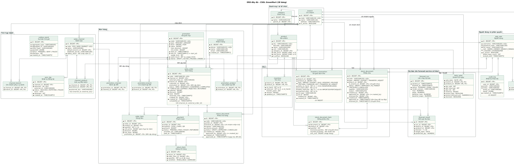

# ERD – CSDL GreenMart

ERD mức logic của toàn hệ thống, là bản chuẩn để viết migration Flyway (SV03) và các bảng dự báo (SV06). Khớp mục 7 SRS v1.0, có bổ sung các bảng liên kết ghi ở cuối trang.

| # | Sơ đồ | Nội dung | Ảnh |
| --- | --- | --- | --- |
| 00 | Đầy đủ | 28 bảng, toàn bộ quan hệ | [png](png/00-erd-day-du.png) |
| 01 | Bán hàng | Đơn hàng, dòng đơn, thanh toán, trả hàng, khách hàng, khuyến mại | [png](png/01-erd-ban-hang.png) |
| 02 | Kho | Tồn kho, phiếu kho, sổ giao dịch kho | [png](png/02-erd-kho.png) |
| 03 | Tích hợp, hệ thống, dự báo | Kênh bán, outbox, nhật ký, doanh số ngày, kết quả dự báo | [png](png/03-erd-tich-hop-du-bao.png) |

## Cách đọc

- `*` trước tên cột: bắt buộc (NOT NULL). `<<PK>>` khóa chính, `<<FK>>` khóa ngoại, `<<UQ>>` duy nhất.
- Ký hiệu chân quạ ở đầu đường nối: `||` đúng một, `|o` không hoặc một, `}o` không hoặc nhiều, `}|` một hoặc nhiều.
- Ràng buộc trong ngoặc, ví dụ `(≥ 0)`, phải được tạo bằng `CHECK` trong migration.

## Ràng buộc bắt buộc

| Bảng | Ràng buộc | Lý do |
| --- | --- | --- |
| inventory | `on_hand >= 0`, `reserved >= 0`, `reserved <= on_hand` | Không tồn âm (BR-01, AC-02) |
| sales_order | `UNIQUE (channel_id, external_order_id)` | Chống trùng đơn từ kênh (BR-05) |
| channel_product | `UNIQUE (channel_id, external_sku)` | Một SKU kênh chỉ ứng với một sản phẩm |
| stock_document, return_document | `approved_by <> created_by` | Người lập không tự duyệt (BR-13) |
| stock_document, return_document | `approved_at` có giá trị khi và chỉ khi `status` đã duyệt (`APPROVED` trở đi) | Biết thời điểm tồn thay đổi và ngày trả hàng (BR-18) |
| inventory_transaction, audit_log | Chỉ INSERT, không UPDATE/DELETE | Truy vết (BR-06) |
| product, customer, app_user | Không xóa cứng khi đã có giao dịch, dùng `is_active` | Giữ lịch sử |
| Tiền | `BIGINT` (VND), không dùng số thực | Tránh sai số làm tròn |

## Chỉ mục cần có

`sales_order (branch_id, created_at)`, `sales_order (status, reserved_until)`, `inventory_transaction (branch_id, product_id, created_at)`, `daily_sales (product_id, branch_id, sale_date)`, `forecast_result (run_id, branch_id, product_id)`.

## Bổ sung so với SRS v1.0

- `promotion_product`, `promotion_branch`, `promotion_channel`: tách phạm vi khuyến mại thành bảng liên kết thay vì lưu danh sách trong một cột.
- `channel_branch`: danh sách chi nhánh phục vụ mỗi kênh, dùng cho phân bổ đơn (BR-14) và tính tồn đẩy ra kênh (BR-15).
- Thêm cột: `app_user.failed_login_count`, `locked_until` (khóa sau 5 lần sai); `stock_document.received_by`, `reason`; `stock_document_item.counted_quantity`; `payment.status`.
- Thêm cột thời gian (31/10, SRS 1.2, migration V4): `return_document.created_at`, `approved_at`; `stock_document.approved_at`, `received_at`.

SRS đã cập nhật theo ở phiên bản 1.1 và 1.2.

## Sửa ERD

1. Chỉ sửa `_entities.iuml` (thực thể, cột, quan hệ). Mỗi thực thể có tag `$core`, `$sales`, `$stock`, `$ops` để chọn sơ đồ hiển thị.
2. Chạy `python generate_views.py` trong thư mục này để sinh lại 4 file `.puml`.
3. Xuất ảnh: `java -jar plantuml.jar -charset UTF-8 -tpng -o png 0*.puml`.

Mọi thay đổi ERD đi qua PR và cần BA/Lead duyệt; migration Flyway phải khớp ERD.

