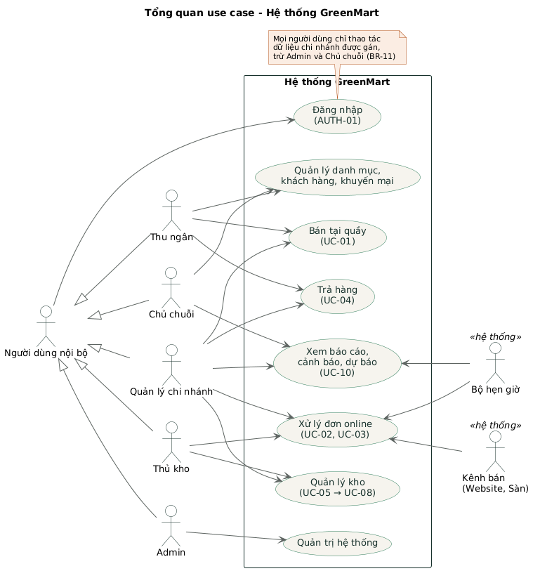

# Sơ đồ use case – GreenMart

Mã use case (UC), yêu cầu (AUTH, PRD, ORD, INV, SYNC, DASH, AI…) và quy tắc (BR) khớp với `docs/requirements/SRS.md`.

| # | Sơ đồ | Phạm vi | Ảnh |
| --- | --- | --- | --- |
| 00 | Tổng quan | Toàn bộ tác nhân và các nhóm chức năng chính | [png](png/00-tong-quan.png) |
| 01 | Xác thực và quản trị | Đăng nhập, tài khoản, vai trò, chi nhánh, kênh bán, nhật ký | [png](png/01-xac-thuc-quan-tri.png) |
| 02 | Danh mục, khách hàng, khuyến mại | Sản phẩm, giá, khách hàng, chương trình khuyến mại | [png](png/02-danh-muc-khuyen-mai.png) |
| 03 | Bán tại quầy và trả hàng | UC-01, UC-04 | [png](png/03-ban-tai-quay.png) |
| 04 | Đơn online và tích hợp kênh | UC-02, UC-03, đồng bộ tồn và trạng thái | [png](png/04-don-online-kenh-ban.png) |
| 05 | Quản lý kho | UC-05 → UC-08, sổ giao dịch, cảnh báo | [png](png/05-quan-ly-kho.png) |
| 06 | Báo cáo, cảnh báo, dự báo | Dashboard, UC-10 | [png](png/06-bao-cao-du-bao.png) |

## Quy ước

- `<<include>>`: use case gốc luôn thực hiện use case được include.
- `<<extend>>`: use case mở rộng chỉ xảy ra khi có điều kiện (ghi trong ngoặc trên mũi tên).
- Mũi tên tam giác rỗng: tổng quát hóa (ví dụ Thanh toán → Tiền mặt / Thẻ / QR).
- `<<hệ thống>>`: tác nhân là hệ thống bên ngoài (kênh bán) hoặc bộ hẹn giờ.

## Sửa sơ đồ

Nguồn là file `.puml` (PlantUML), kiểu dùng chung ở `_style.iuml`. Sau khi sửa, xuất lại ảnh:

```
java -jar plantuml.jar -charset UTF-8 -tpng -o png 0*.puml
```

Hoặc dùng extension PlantUML trong VS Code / IntelliJ. Thay đổi sơ đồ đi qua PR và cần BA/Lead duyệt.


