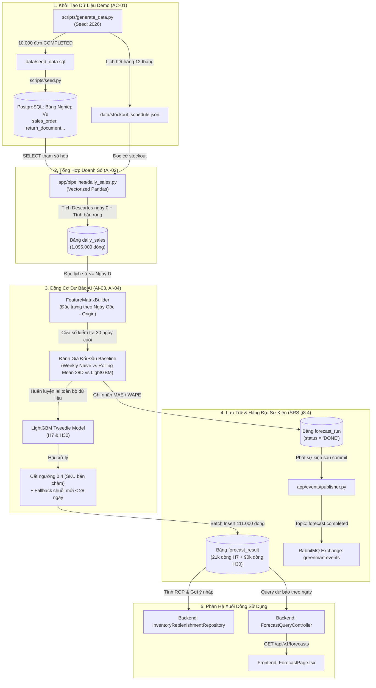

# Chương phân hệ Dự báo nhu cầu & Trí tuệ nhân tạo (AI) — SV06

**Tác giả:** SV06 – Hồ Nguyễn Thiên Hạo (`@hongthienhao`) · Kỹ sư Dữ liệu & AI (Data & AI Specialist)  
**Mốc tài liệu:** 21/11/2026 · **Dự án:** GreenMart DT03  
**Phạm vi:** Phân hệ `forecast-service`, thiết kế dữ liệu lịch sử, pipeline tổng hợp doanh số ngày `daily_sales`, kỹ thuật trích xuất đặc trưng chuỗi thời gian, mô hình học máy LightGBM Tweedie, đối đầu Baseline (Weekly Naive & Rolling Mean 28D), hợp đồng API/CSDL/RabbitMQ và ứng dụng tính điểm đặt hàng lại (ROP).

---

## 1. Yêu cầu nghiệp vụ và mục tiêu thiết kế

Phân hệ dự báo nhu cầu (`forecast-service`) được xây dựng nhằm giải quyết bài toán cốt lõi trong chuỗi bán lẻ thực phẩm GreenMart: dự báo trước lượng tiêu thụ hàng hóa để tối ưu hóa tồn kho, giảm thiểu rủi ro đứt hàng và hạn chế thất thoát do hàng hư hỏng.

- **Đặc tả SRS v1.0:**
  - `AI-01`: Sinh dữ liệu lịch sử 12 tháng cho 3 chi nhánh, 1.000 sản phẩm, 10.000 đơn hàng hoàn tất, tích hợp biến động mùa vụ Tết và khuyến mại ([SRS.md](../requirements/SRS.md) §3.5).
  - `AI-02`: Pipeline tổng hợp bán ròng theo ngày $\times$ sản phẩm $\times$ chi nhánh vào bảng `daily_sales`.
  - `AI-03`: Dự báo nhu cầu 7 và 30 ngày tới cho từng cặp (chi nhánh $\times$ sản phẩm), vận hành tự động lúc 02:00 hằng đêm và theo yêu cầu qua API.
  - `AI-04`: Xây dựng hai mô hình cơ sở (Baseline) và báo cáo so sánh sai số MAE, WAPE độc lập.
  - `AI-05`: Tích hợp kết quả dự báo để tính điểm đặt hàng lại (ROP) và gợi ý số lượng nhập kho ([SRS.md](../requirements/SRS.md) Phụ lục A).
  - `AI-06`: Cung cấp dữ liệu trực quan hóa biểu đồ dự báo so với thực tế trên Dashboard điều hành.
- **Tiêu chí nghiệm thu liên quan:**
  - `AC-01`: 3 chi nhánh, 1.000 sản phẩm, 10.000 đơn lịch sử tái lập 100% bằng script seed ([SRS.md](../requirements/SRS.md) §10).
  - `AC-05`: WAPE của mô hình thấp hơn baseline tốt nhất ở cả hai tầm dự báo 7 ngày và 30 ngày trên tập kiểm tra 30 ngày cuối (không trộn ngẫu nhiên).
- **Hợp đồng giao tiếp:** Tuân thủ hợp đồng OpenAPI [`docs/api/openapi.yaml`](../api/openapi.yaml) và cấu trúc cơ sở dữ liệu migration Flyway ([V1__init_schema.sql](../../backend/src/main/resources/db/migration/V1__init_schema.sql), [V2__grant_forecast.sql](../../backend/src/main/resources/db/migration/V2__grant_forecast.sql), [V14__restrict_forecast_read_privileges.sql](../../backend/src/main/resources/db/migration/V14__restrict_forecast_read_privileges.sql)).

---

## 2. Kiến trúc tổng thể và luồng dữ liệu (End-to-End Architecture)

Phân hệ dự báo được thiết kế theo dạng vi dịch vụ độc lập viết bằng Python 3.11, giao tiếp với hệ thống chung qua cơ chế kết hợp (Hybrid): đồng bộ dữ liệu lớn qua PostgreSQL và phát thông báo sự kiện qua RabbitMQ.

---

## 3. Thiết kế dữ liệu lịch sử và Pipeline `daily_sales`

### 3.1. Thiết kế dữ liệu lịch sử (Issue #105, #106)
Do hệ thống thực nghiệm chưa có dữ liệu giao dịch thực tế ngoài đời, nhóm triển khai bộ sinh dữ liệu có kiểm soát ([generate_data.py](../../forecast-service/scripts/generate_data.py)) dựa trên 345 dòng tham số nghiệp vụ chuẩn hóa tại [config.py](../../forecast-service/scripts/config.py):
- **Phân bổ thời gian:** 12 tháng từ `01/11/2025` đến `31/10/2026` với đúng 10.000 đơn hàng đã xử lý (`COMPLETED` và `RETURNED`).
- **Phân bổ chi nhánh:** `GM-001` (Quận 1 - Trung tâm): 45%; `GM-002` (Bình Thạnh - Khu dân cư): 35%; `GM-003` (Tân Bình - Đô thị phụ trợ): 20%.
- **Mùa vụ và lịch lễ:** Mùa Tết Bính Ngọ 2026 (Mùng 1 ngày `17/02/2026`). Giai đoạn 21 ngày trước Tết (`27/01` đến `16/02/2026`) nhu cầu tăng từ 50% đến 100%; 3 ngày Tết giảm 90%. Cuối tuần tăng 10%–20%; các ngày lễ lớn (Giáng sinh, 30/4, 2/9, 20/10) tăng 20%–35%. Nhiễu ngẫu nhiên hằng ngày kiểm soát trong khoảng $\pm 10\%$.
- **Quy luật Pareto (80/20):** Top 200 SKU bán chạy đóng góp ~80% sản lượng; 800 SKU còn lại có nhu cầu phát sinh ngắt quãng (Intermittent Demand).
- **Tính tái lập (Reproducibility):** Cố định `RANDOM_SEED = 2026` và đối soát bằng mã băm `SHA256SUMS`.

### 3.2. Pipeline tổng hợp bảng `daily_sales` (Issue #109)
Bảng `daily_sales` là nguồn cấp dữ liệu duy nhất cho mô hình học máy, được xử lý vectorized tốc độ cao trong [daily_sales.py](../../forecast-service/app/pipelines/daily_sales.py):
1. **Khung tích Descartes (Cartesian Product):** Tạo lưới đầy đủ:
   $$365 \text{ ngày} \times 3 \text{ chi nhánh} \times 1.000 \text{ SKU} = 1.095.000 \text{ dòng}$$
   Các ngày không có giao dịch được tự động điền giá trị 0 (Zero Imputation), không bỏ trống dòng.
2. **Số lượng bán ròng (`qty_net`) và Doanh thu (`revenue`):**
   $$\text{qty\_net} = \text{qty\_sold} - \text{qty\_returned}$$
   $$\text{revenue} = \max(0, \text{rev\_sold} - \text{refund})$$
   `qty_net` cho phép mang giá trị âm khi lượng trả hàng lớn hơn lượng mua trong ngày (BR-10).
3. **Cờ khuyến mại (`promo_flag`, `promo_discount_pct`):** Quét các chương trình khuyến mại cấp sản phẩm (`ITEM`), nếu trùng ngày thì lấy mức giảm % lớn nhất.
4. **Cờ hết hàng (`stockout`) và Hiện tượng nhu cầu bị cắt cụt (Censored Demand):**
   - Ngày stockout là ngày sản phẩm có lượng tồn khả dụng bằng 0 cả ngày.
   - Khi hết hàng, khách hàng có nhu cầu mua nhưng không có hàng để bán, lượng bán ghi nhận trên hóa đơn là 0. Nếu lấy số 0 này làm nhãn huấn luyện, mô hình học máy sẽ bị chệch dưới nghiêm trọng (*under-forecasting*).
   - Do đó, pipeline đánh dấu `stockout = True` để **loại trừ hoàn toàn các ngày hết hàng ra khỏi tập huấn luyện và tập kiểm tra đánh giá**.

---

## 4. Kỹ thuật trích xuất đặc trưng (Feature Engineering)

Mô hình tuân thủ nguyên tắc **Ngày Gốc (Origin Date $t$)** nhằm loại bỏ triệt để nguy cơ rò rỉ dữ liệu tương lai ([features.py](../../forecast-service/app/models/features.py)):

| Nhóm đặc trưng | Tên biến đặc trưng | Diễn giải kỹ thuật |
| :---| :---| :---|
| **Lịch sử bán ($\le t$)** | `rolling_mean_7` | Trung bình trượt bán ròng 7 ngày kết thúc tại ngày gốc $t$. |
| | `rolling_mean_14` | Trung bình trượt bán ròng 14 ngày kết thúc tại ngày gốc $t$. |
| | `rolling_mean_28` | Trung bình trượt bán ròng 28 ngày kết thúc tại ngày gốc $t$. |
| | `qty_at_origin` | Số lượng bán ròng thực tế ngay tại ngày gốc $t$. |
| | `same_dow_sale_1w` | Lượng bán cùng thứ của tuần gần nhất trước ngày gốc ($t - 7k$). |
| | `same_dow_sale_2w` | Lượng bán cùng thứ của tuần thứ hai trước ngày gốc. |
| **Ngoại sinh ngày mục tiêu ($t+h$)** | `target_day_of_week` | Thứ trong tuần của ngày mục tiêu (0: Thứ Hai .. 6: Chủ Nhật). |
| | `target_day_of_month` | Ngày trong tháng (1..31). |
| | `target_month` | Tháng trong năm (1..12). |
| | `target_is_weekend` | Cờ cuối tuần (1 nếu Thứ 7 / Chủ Nhật, 0 nếu ngày thường). |
| | `target_is_holiday` | Cờ ngày lễ lớn theo danh mục lễ quốc gia. |
| | `target_is_tet_pre` | Cờ giai đoạn 21 ngày cao điểm trước Tết Bính Ngọ 2026. |
| | `target_promo_flag` | Cờ có chương trình khuyến mại vào ngày mục tiêu. |
| | `target_promo_discount_pct` | Tỷ lệ giảm giá (%) của mặt hàng tại chi nhánh trong ngày mục tiêu. |
| | `horizon_step` | Bước dự báo tương lai ($h \in [1, H]$). |
| **Biến phân loại** | `branch_id`, `product_id`, `group_code` | Mã chi nhánh, mã sản phẩm và nhóm danh mục (kiểu `category`). |

---

## 5. Thuật toán học máy và Mô hình đối đầu

### 5.1. Hai phương pháp cơ sở (Baseline Models)
- **Baseline 1 – Weekly Naive (BA §9.3):** Lặp lại chu kỳ lượng bán của cùng thứ tuần trước: $\hat{y}_{t+h} = y_{(t+h)-7k}$ ([baselines.py](../../forecast-service/app/models/baselines.py#L48-L70)).
- **Baseline 2 – Rolling Mean 28D (BA §9.3):** Lấy trung bình cộng 28 ngày gần nhất trước ngày gốc làm dự báo phẳng cho toàn tầm tương lai. Đây là **baseline nghiệp vụ tốt nhất** ([baselines.py](../../forecast-service/app/models/baselines.py#L72-L88)).

### 5.2. Mô hình LightGBM Tweedie & Hậu xử lý (Issue #112, #113)
- **Hàm mục tiêu Tweedie:** Dữ liệu bán lẻ có tỷ lệ số 0 rất cao (Zero-inflated) và phân phối lệch phải. LightGBM được cấu hình với hàm mục tiêu `objective = 'tweedie'`, tham số phương sai `tweedie_variance_power = 1.2`, tốc độ học `learning_rate = 0.08`, số lá `num_leaves = 31` ([lightgbm_model.py](../../forecast-service/app/models/lightgbm_model.py#L23-L32)).
- **Chặn dưới không âm:** $\hat{y} = \max(0.0, \hat{y}_{\text{raw}})$ vì nhu cầu thực tế không thể âm.
- **Hậu xử lý cắt ngưỡng 0.4 cho nhóm bán chậm:**
  - Đối với 800 SKU bán chậm, mô hình LightGBM nguyên bản thường dự báo các số thực dương nhỏ li ti ($0.05, 0.1$). Khi cộng dồn sai số trên tập dữ liệu thưa, WAPE bị đội lên mức ~188%.
  - Cơ chế cắt ngưỡng đưa toàn bộ dự báo $< 0.4$ của nhóm này về $0.0$, giúp triệt tiêu phương sai và hạ WAPE từ 188% xuống 102%, bám sát mô hình tham chiếu Zero Forecast ([forecast_service.py](../../forecast-service/app/pipelines/forecast_service.py#L260-L265)).
- **Dự phòng chuỗi mới (Short-history Fallback):** Các sản phẩm mới đưa vào kinh doanh có dưới 28 ngày lịch sử được tự động thay thế bằng trung bình của toàn danh mục ngành hàng tại chi nhánh ([evaluator.py](../../forecast-service/app/models/evaluator.py#L38-L80)).

### 5.3. Công thức tính chỉ số đo lường MAE và WAPE
- **MAE (Mean Absolute Error):**
  $$\text{MAE} = \frac{1}{N} \sum_{i=1}^{N} |y_i - \hat{y}_i|$$
- **WAPE (Weighted Absolute Percentage Error):**
  $$\text{WAPE} = \frac{\sum_{i=1}^{N} |y_i - \hat{y}_i|}{\sum_{i=1}^{N} y_i}$$
  WAPE lấy tổng nhu cầu thực tế làm mẫu số, tránh hoàn toàn lỗi chia cho 0 của MAPE khi gặp ngày bán bằng 0 ([metrics.py](../../forecast-service/app/models/metrics.py#L50-L100)).

---

## 6. Kết quả thực nghiệm và Đánh giá tiêu chí AC-05

Bộ số liệu nghiệm thu chính thức được trích xuất từ [evaluation_metrics.json](../../forecast-service/artifacts/evaluation_metrics.json) và [segment_metrics.json](../../forecast-service/artifacts/segment_metrics.json) trên tập kiểm tra độc lập 30 ngày cuối (`02/10/2026` – `31/10/2026`, điểm cutoff `2026-10-01`):

### 6.1. Bảng đối đầu tổng thể (Overall)

| Tầm dự báo | Phương thức đo lường | Baseline 1 (Weekly Naive) MAE \| WAPE | Baseline 2 (TB trượt 28D) MAE \| WAPE | Mô hình Vận hành (Ngưỡng 0.4) MAE \| WAPE | Chênh lệch so với Baseline tốt nhất | Kết luận AC-05 |
| :---: | :---| :---: | :---: | :---: | :---: | :---: |
| **7 ngày** | **Từng ô ngày** (sp/ngày) | 0.2743 \| 172.68% | 0.2560 \| 161.17% | **0.2228 \| 140.27%** | **-20.90 điểm %** (vs BL2) | **✓ THẮNG** |
| **7 ngày** | **Gộp tuần** (sp/tuần) | 1.2557 \| 113.46% | 1.0706 \| 96.74% | **0.8757 \| 79.13%** | **-17.61 điểm %** (vs BL2) | **✓ THẮNG** |
| **7 ngày** | **Tổng cả tầm** (sp/tầm) | 1.2557 \| 113.46% | 1.0706 \| 96.74% | **0.8757 \| 79.13%** | **-17.61 điểm %** (vs BL2) | **✓ THẮNG** |
| | | | | | | |
| **30 ngày** | **Từng ô ngày** (sp/ngày) | 0.2669 \| 178.48% | 0.2493 \| 166.67% | **0.2147 \| 143.58%** | **-23.09 điểm %** (vs BL2) | **✓ THẮNG** |
| **30 ngày** | **Gộp tuần** (sp/tuần) | 1.0712 \| 119.92% | 0.9362 \| 104.81% | **0.7385 \| 82.68%** | **-22.13 điểm %** (vs BL2) *-17.62% (vs Zero 100.30%)* | **✓ THẮNG** |
| **30 ngày** | **Tổng cả tầm** (sp/tầm ROP) | 4.4940 \| 100.62% | 3.2263 \| 72.24% | **2.2245 \| 49.81%** | **-22.43 điểm %** (vs BL2) | **✓ THẮNG** |

### 6.2. Phân tích phân khúc hàng hóa (Pareto 80/20)
*(Đo lường theo phương thức Gộp tuần - Weekly Aggregate, đơn vị MAE: sp/tuần/chuỗi):*
- **Tầm 7 ngày:**
  - *Top 200 bán chạy:* Mô hình đạt WAPE **73.06%** (MAE 3.24) vs Baseline 2 đạt 75.57% (MAE 3.35) $\rightarrow$ **Thắng 2.51 điểm %**.
  - *800 bán chậm:* Mô hình đạt WAPE **103.53%** vs Baseline 2 đạt 181.88% $\rightarrow$ **Thắng áp đảo 78.35 điểm %**.
- **Tầm 30 ngày:**
  - *Top 200 bán chạy:* Mô hình đạt WAPE **77.73%** (MAE 2.77) vs Baseline 2 đạt 83.87% (MAE 2.99) $\rightarrow$ **Thắng 6.14 điểm %**.
  - *800 bán chậm:* Mô hình đạt WAPE **102.31%** vs Baseline 2 đạt 188.03% $\rightarrow$ **Thắng áp đảo 85.72 điểm %**.

### 6.3. Tính toàn diện trên chi nhánh và ngành hàng
- **Chi nhánh:** Chiến thắng tuyệt đối trên cả 3 chi nhánh ở tầm 30 ngày gộp tuần: GM-001 đạt 76.83% vs 99.70% (giảm 22.87%); GM-002 đạt 79.71% vs 101.08% (giảm 21.37%); GM-003 đạt 100.60% vs 122.53% (giảm 21.93%).
- **Ngành hàng:** Đạt tỷ lệ chiến thắng **15/15 ngành hàng thực tế (100%)** trong danh mục siêu thị.

### 6.4. Các giới hạn cốt lõi của mô hình
1. **Sai số ô ngày còn cao (WAPE $\approx 140\%$):** Dự báo cho từng ngày riêng lẻ chưa đủ độ tin cậy để điều phối giao ca thời gian thực. **Khuyến cáo:** Chỉ dùng số liệu Gộp tuần và Tổng cả tầm cho bài toán kho.
2. **Bản chất của ngưỡng 0.4:** Giúp đưa 99.83% ô dự báo của nhóm bán chậm về 0 để xấp xỉ mô hình Zero Forecast, phản ánh đặc thù toán học của dữ liệu thưa hơn là quy luật mua sắm của khách hàng.
3. **Mùa vụ Tết chưa được kiểm chứng trên tập Test:** Do tập kiểm tra là tháng 10/2026, khả năng dự báo mùa Tết thực tế phụ thuộc hoàn toàn vào cờ lịch ngoại sinh `target_is_tet_pre`.
4. **Nhu cầu bị cắt cụt:** Mô hình chưa có thuật toán ước lượng nhu cầu tiềm ẩn, dẫn đến nguy cơ dự báo chệch dưới ở các sản phẩm thường xuyên đứt hàng trong quá khứ.

---

## 7. Hợp đồng giao tiếp và Tích hợp hệ thống

### 7.1. REST API FastAPI của Forecast-service (Cổng nội bộ 8000)
Tất cả endpoint yêu cầu header xác thực: `Authorization: Bearer <FORECAST_INTERNAL_TOKEN>`.
- `POST /forecast/run`: Trả về ngay `HTTP 202 Accepted` kèm JSON `{"runId": 42, "status": "RUNNING", "startedAt": "..."}`. Trả về `HTTP 409 CONFLICT` nếu đang có run khác chạy hoặc bảng `daily_sales` trống.
- `GET /forecast/runs/{runId}`: Trả về trạng thái, thời gian chạy và các chỉ số MAE/WAPE đối đầu khi đã `DONE`.
- `GET /healthz`: Kiểm tra độ sẵn sàng CSDL và phân quyền chặt chẽ (`forecast_ro`). Trả về 200 UP hoặc 503 DOWN.

### 7.2. Tích hợp Backend và Frontend
- **Backend Spring Boot:**
  - `ForecastClient.java` (commit `536be2a` / PR #344): Gọi sang Forecast-service bằng Bearer token khi Quản trị viên kích hoạt chạy lại dự báo qua `POST /api/v1/forecasts/runs`.
  - `ForecastQueryController.java` (commit `ded5795` / PR #409): Cung cấp API `GET /api/v1/forecasts` bằng cách tự JOIN bảng `forecast_result` với `daily_sales`.
- **Frontend React:**
  - `ForecastPage.tsx` và `ForecastAreaChart.tsx` (nhánh `feature/FE-Dashboardvamadubao`): Hiển thị biểu đồ dự báo nhu cầu so với bán ròng thực tế cho người dùng.

### 7.3. Hàng đợi sự kiện RabbitMQ (Issue #118)
- **Topic Exchange:** `greenmart.events` (Durable).
- **Routing Key:** `forecast.completed`
- **Queue tiếp nhận:** `greenmart.integration.events` (đã khai báo tại `RabbitTopology.java`).
- **Payload:** Gửi `eventId`, `runId`, `status`, `modelVersion`, `mae`, `wape`, `baselineMae`, `baselineWape`, `cutoffDate`.
- **Chịu lỗi:** Retry 3 lần với exponential backoff. Lỗi RabbitMQ không làm hỏng hay rollback bản ghi CSDL đã hoàn tất.

---

## 8. Ứng dụng nghiệp vụ tính ROP & Gợi ý nhập hàng

Kết quả dự báo 111.000 dòng từ `forecast_result` được Backend nạp vào công thức tính toán tồn kho theo BA §8.2 và §8.3:

1. **Điểm đặt hàng lại (Reorder Point - ROP):**
   $$\text{ROP} = \lceil \bar{d} \times L \rceil + \text{SS}$$
   - $L = 2$ ngày (thời gian chờ hàng về).
   - $\bar{d} = \frac{\text{qty7}}{7}$ (nhu cầu trung bình ngày từ dự báo tầm 7 ngày).
   - $\text{SS} = \lceil 1.65 \times \sigma_d \times \sqrt{2} \rceil$ (tồn an toàn với độ lệch chuẩn sai số dự báo lịch sử $\sigma_d$).
2. **Gợi ý số lượng nhập kho (Suggested Replenishment Quantity):**
   $$\text{suggestedQuantity} = \lceil \frac{\max(0, \text{Nhu cầu } 9 \text{ ngày} + \text{SS} - \text{Khả dụng} - \text{Hàng đang về})}{\text{pack\_size}} \rceil \times \text{pack\_size}$$
   Quy cách đóng gói (`pack_size`) đảm bảo quản lý nhập hàng theo thùng nguyên vẹn, tự động kích hoạt cảnh báo tồn thấp khi khả dụng $\le \text{ROP}$.

---

## 9. Trạng thái bàn giao tại mốc tài liệu

| Thành phần bàn giao | Vị trí mã nguồn | Trạng thái kỹ thuật |
| :---| :---| :---: |
| Trình sinh dữ liệu & Tham số lịch sử | [config.py](../../forecast-service/scripts/config.py), [generate_data.py](../../forecast-service/scripts/generate_data.py) | Đã merge `develop` (PR #199, #209, #219) |
| Bộ điều phối Seed 1 lệnh & AC-01 | [seed.py](../../forecast-service/scripts/seed.py), [verify_seed.sql](../../forecast-service/scripts/verify_seed.sql) | Đã merge `develop` (PR #220) |
| Pipeline tổng hợp `daily_sales` | [daily_sales.py](../../forecast-service/app/pipelines/daily_sales.py) | Đã merge `develop` (PR #231) |
| Notebook EDA & Parquet | [01_eda_demand_analysis.ipynb](../../forecast-service/notebooks/01_eda_demand_analysis.ipynb) | Đã merge `develop` (PR #247) |
| Mô hình Baseline & Đo lường MAE/WAPE | [baselines.py](../../forecast-service/app/models/baselines.py), [metrics.py](../../forecast-service/app/models/metrics.py) | Đã merge `develop` (PR #255, #294) |
| Mô hình LightGBM & Trích xuất đặc trưng | [features.py](../../forecast-service/app/models/features.py), [lightgbm_model.py](../../forecast-service/app/models/lightgbm_model.py) | Đã merge `develop` (PR #261, #272) |
| API FastAPI & Điều phối chạy nền | [router.py](../../forecast-service/app/api/router.py), [forecast_service.py](../../forecast-service/app/pipelines/forecast_service.py) | Đã merge `develop` (PR #290) |
| Lập lịch 02:00 & RabbitMQ Publisher | [forecast_scheduler.py](../../forecast-service/app/scheduler/forecast_scheduler.py), [publisher.py](../../forecast-service/app/events/publisher.py) | Đã merge `develop` (PR #391) |
| Báo cáo đánh giá mô hình AC-05 | [bao-cao-danh-gia-mo-hinh-ac-05.md](bao-cao-danh-gia-mo-hinh-ac-05.md) | Đã merge `develop` (PR #120) |
| Backend Client & Token nội bộ | `ForecastClient.java`, `ForecastRunController.java` | Đã merge `develop` (commit `310c55b` / PR #344) |
| Backend Query dự báo theo ngày | `ForecastQueryController.java`, `ForecastQueryService.java` | Đã merge `develop` (commit `ded5795` / PR #409) |
| Frontend hiển thị biểu đồ dự báo | `ForecastPage.tsx`, `ForecastAreaChart.tsx` | Đang ở nhánh `feature/FE-Dashboardvamadubao` |
