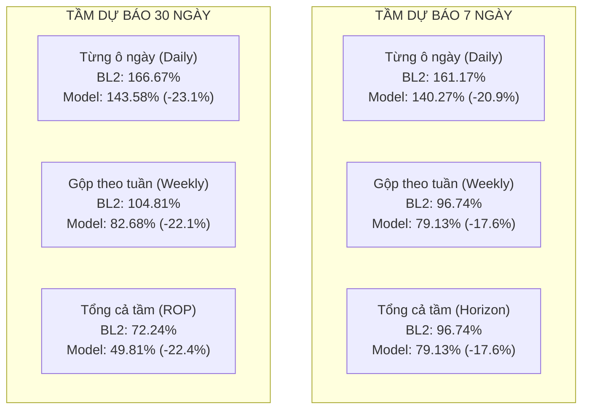
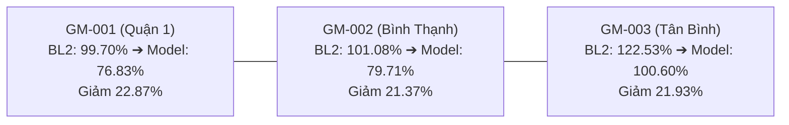

# BÁO CÁO ĐÁNH GIÁ MÔ HÌNH DỰ BÁO NHU CẦU CUỐI CÙNG (TIÊU CHÍ AC-05)

**Module:** `forecast-service` – Dự án GreenMart  
**Người thực hiện:** SV06 (AI & Forecast Specialist)  
**Ngày lập báo cáo:** 20/11/2026 (Phiên bản nghiệm thu chính thức)  
**Tiêu chí nghiệm thu liên quan:** AC-05 (SRS §10), US-10 (Dự báo nhu cầu 7 & 30 ngày), AI-04  
**Trạng thái nghiệm thu:** **ĐẠT TIÊU CHÍ AC-05** (WAPE mô hình thấp hơn baseline tốt nhất ở cả hai tầm 7 và 30 ngày trên mọi cách đo)

---

## 1. TÓM TẮT ĐIỀU HÀNH & KẾT LUẬN NGHIỆM THU

Báo cáo này trình bày kết quả đánh giá thực nghiệm độc lập của mô hình dự báo nhu cầu chính thức (**LightGBM Tweedie kết hợp hậu xử lý ngưỡng 0.4**) đối đầu với các mô hình cơ sở (**Baseline 1 – Naive theo tuần** và **Baseline 2 – Trung bình trượt 28 ngày**) trên tập dữ liệu kiểm tra 30 ngày cuối cùng của hệ thống GreenMart.

### Kết luận nghiệm thu tiêu chí AC-05:
Tiêu chí AC-05 quy định trong tài liệu yêu cầu phần mềm ([SRS.md](file:///c:/UTH/HK10/HKDN/GreenMart/docs/requirements/SRS.md)) và phân tích nghiệp vụ ([business-analysis.md](file:///c:/UTH/HK10/HKDN/GreenMart/docs/requirements/business-analysis.md)):
> *"Đạt yêu cầu khi WAPE của mô hình thấp hơn baseline tốt nhất ở cả hai tầm 7 và 30 ngày (tập kiểm tra = 30 ngày cuối, không trộn ngẫu nhiên)."*

Mô hình vận hành chính thức hiện tại của hệ thống (phiên bản `LightGBM-Tweedie-H7-H30` với cấu hình `DEFAULT_SLOW_THRESHOLD = 0.4` được phê duyệt tại commit `450531a`) **CHÍNH THỨC ĐẠT TIÊU CHÍ AC-05**:
- Ở tầm **7 ngày**: WAPE mô hình đạt **79.13%** (Gộp tuần) và **140.27%** (Ô ngày), **thấp hơn** Baseline 2 (đạt 96.74% và 161.17%), giúp giảm tương ứng **17.61** và **20.90 điểm %** sai số.
- Ở tầm **30 ngày**: WAPE mô hình đạt **82.68%** (Gộp tuần) và **49.81%** (Tổng cả tầm ROP), **thấp hơn** Baseline 2 (đạt 104.81% và 72.24%), giúp giảm tương ứng **22.13** và **22.43 điểm %** sai số.
- **Tính toàn diện:** Mô hình chiến thắng Baseline tốt nhất trên **toàn bộ 3 chi nhánh** và **toàn bộ 15 ngành hàng thực tế** trong hệ thống.

---

## 2. GIAO THỨC ĐÁNH GIÁ & TÍNH MINH BẠCH DỮ LIỆU

> [!NOTE]
> **Chú thích nguồn thông số ngữ cảnh hệ thống:**
> Các thông số nền tảng của hệ thống (10.000 đơn hàng `COMPLETED`, 1.000 sản phẩm, 3 chi nhánh với tỷ lệ phân bổ GM-001: 45%, GM-002: 35%, GM-003: 20%; biên độ mùa vụ Tết tăng 50%–100%, 3 ngày Tết giảm 90%; biên độ nhiễu ngẫu nhiên hằng ngày $\pm 10\%$) được trích dẫn trực tiếp từ tài liệu đặc tả yêu cầu [SRS.md](file:///c:/UTH/HK10/HKDN/GreenMart/docs/requirements/SRS.md) (§3.5) và tệp cấu hình sinh dữ liệu [forecast-service/scripts/config.py](file:///c:/UTH/HK10/HKDN/GreenMart/forecast-service/scripts/config.py). Mọi số liệu thực nghiệm đối đầu (MAE, WAPE, $N$) trong báo cáo đều được trích xuất trực tiếp từ các file kết quả thực nghiệm.

### 2.1. Giải thích các chỉ số đo lường
- **MAE (Mean Absolute Error - Sai số tuyệt đối trung bình):** Đo mức độ lệch tuyệt đối trung bình giữa số lượng sản phẩm dự báo và số lượng bán thực tế:
  $$\text{MAE} = \frac{1}{N} \sum_{i=1}^{N} |y_i - \hat{y}_i|$$
  *Đơn vị tính:* sản phẩm/chuỗi (theo ngày, tuần hoặc chu kỳ).
- **WAPE (Weighted Absolute Percentage Error - Sai số phần trăm tuyệt đối có trọng số):** Đo lường tỷ lệ tổng sai số lệch tuyệt đối trên tổng nhu cầu thực tế của toàn danh mục:
  $$\text{WAPE} = \frac{\sum_{i=1}^{N} |y_i - \hat{y}_i|}{\sum_{i=1}^{N} y_i}$$
  *Ý nghĩa thực tế:* Trong bán lẻ với nhiều mặt hàng bán chậm (Intermittent Demand), chỉ số MAPE thông thường bị vô nghĩa (lỗi chia cho 0). WAPE lấy tổng sản lượng làm mẫu số, phản ánh chính xác tỷ lệ thất thoát do lệch dự báo trên toàn chuỗi.

### 2.2. Giao thức thực nghiệm độc lập (Không rò rỉ dữ liệu)
- **Tập dữ liệu lịch sử:** 12 tháng (`01/11/2025` đến `31/10/2026`) với 3 chi nhánh, 1.000 sản phẩm, 10.000 đơn hàng hoàn tất (`COMPLETED`).
- **Mốc chốt dữ liệu (Cutoff Date):** `2026-10-01`.
- **Cửa sổ kiểm tra độc lập (Test Window):** 30 ngày cuối cùng từ `02/10/2026` đến `31/10/2026`. Tập kiểm tra được giữ nguyên trình tự thời gian (không trộn ngẫu nhiên / No Shuffling) và chỉ chạy đánh giá 1 lần duy nhất.
- **Xử lý ngày hết hàng (Stockout / Censored Demand):** Toàn bộ các ngày mà chi nhánh bị hết hàng (khả dụng = 0 cả ngày) được loại trừ khỏi nhãn đánh giá theo đúng quy định nghiệp vụ BA §9.3, nhằm đảm bảo công bằng khi nhu cầu mua sắm thực tế bị cắt cụt.
- **Quy tắc sản phẩm mới:** Các chuỗi có dưới 28 ngày dữ liệu lịch sử được tự động áp dụng phương pháp dự phòng (*fallback*) lấy trung bình danh mục tại chi nhánh. (Thống kê thực tế tập Test: 0 chuỗi phát sinh dưới 28 ngày lịch sử, truy xuất từ khóa `short_history_series_count: 0` trong `evaluation_metrics.json`).

### 2.3. Các phương pháp đối đầu
1. **Baseline 1 – Naive theo tuần (Tuân thủ BA §9.3):** Lấy lượng bán cùng thứ của tuần trước ($D - 7$) làm dự báo cho ngày $D$.
2. **Baseline 2 – Trung bình trượt 28 ngày (Tuân thủ BA §9.3):** Lấy trung bình số lượng bán trong 28 ngày gần nhất trước ngày dự báo. Đây là **baseline nghiệp vụ tốt nhất**.
3. **Baseline tham chiếu – Zero Forecast:** Giả định lượng bán tương lai bằng 0, làm mốc kiểm tra cho dữ liệu thưa.
4. **LightGBM Bản thô (`DEFAULT_SLOW_THRESHOLD = 0.0`):** Mô hình huấn luyện với hàm mục tiêu Tweedie không lọc ngưỡng.
5. **LightGBM Vận hành chính thức (`DEFAULT_SLOW_THRESHOLD = 0.4`):** Mô hình Tweedie kết hợp cắt ngưỡng $0.4$ cho 800 SKU bán chậm (ngưỡng tối ưu xác định độc lập trên tập Validation).

### 2.4. Cách tái tạo số liệu thực nghiệm (Reproducibility)
> [!NOTE]
> **Lý do thư mục `artifacts/` không có sẵn trong repo:**
> Thư mục `forecast-service/artifacts/` chứa các tệp trọng số mô hình dạng text (`lgbm_demand_h7.txt`, `lgbm_demand_h30.txt`) và các tệp JSON kết quả đánh giá. Thư mục này được loại trừ khỏi kho mã nguồn thông qua file [.gitignore](file:///c:/UTH/HK10/HKDN/GreenMart/.gitignore) (dòng 16: `forecast-service/artifacts/`) nhằm tuân thủ quy chuẩn không lưu trữ file nhị phân, trọng số sinh tự động và log phát sinh vào git để tránh phình dung lượng kho mã nguồn.

**Môi trường Python yêu cầu:**
Sử dụng môi trường ảo của module `forecast-service` (đã cài đặt đầy đủ các gói phụ thuộc theo [requirements.txt](file:///c:/UTH/HK10/HKDN/GreenMart/forecast-service/requirements.txt) gồm `lightgbm`, `pandas`, `numpy`, `scipy`):
- Trên Windows: `forecast-service\.venv\Scripts\python.exe`
- Trên Linux/macOS: `forecast-service/.venv/bin/python`

Quy trình tái tạo gồm đúng **2 bước tuần tự**:

**Bước 1: Huấn luyện mô hình và xuất metrics tổng thể:**
```bash
forecast-service\.venv\Scripts\python.exe forecast-service/scripts/train_initial_lightgbm.py --data-path forecast-service/data/daily_sales.parquet
```
*Kết quả sinh ra trong `forecast-service/artifacts/`:*
- File mô hình LightGBM: `lgbm_demand_h7.txt`, `lgbm_demand_h30.txt`
- Báo cáo tổng thể Markdown: `evaluation_report.md`
- Metrics tổng thể JSON: `evaluation_metrics.json` (thời gian chạy ~40 giây)

**Bước 2: Trích xuất metrics phân nhóm chi tiết (Chi nhánh, Ngành hàng, Pareto):**
```bash
forecast-service\.venv\Scripts\python.exe forecast-service/scripts/evaluate_segments.py
```
*Kết quả sinh ra trong `forecast-service/artifacts/`:*
- Metrics phân rã chi tiết JSON: `segment_metrics.json` (thời gian chạy ~10 giây)

---

## 3. BẢNG 1: SO SÁNH ĐỐI ĐẦU TỔNG THỂ (OVERALL) THEO 3 CÁCH ĐO LƯỜNG

Theo quy chuẩn đánh giá, báo cáo đặt song song cả 3 phương thức đo lường để cung cấp góc nhìn toàn diện cho Hội đồng:
1. **Từng ô ngày (Daily cell):** Đánh giá chi tiết từng ngày $\times$ từng sản phẩm $\times$ từng chi nhánh ($N = 20.903$ ô ở tầm 7 ngày; $N = 89.587$ ô ở tầm 30 ngày sau khi loại trừ stockout).
2. **Gộp theo tuần (Weekly aggregate):** Gộp sản lượng thực tế và dự báo theo cửa sổ 7 ngày ($N = 3.000$ chuỗi-tuần ở tầm 7 ngày; $N = 15.000$ ở tầm 30 ngày). Phục vụ bài toán đặt hàng theo tuần của siêu thị.
3. **Tổng cả tầm (Horizon aggregate / ROP):** Tổng gộp nhu cầu toàn bộ 7 ngày hoặc 30 ngày cho từng chuỗi ($N = 3.000$ chuỗi). Phục vụ tính điểm đặt hàng lại (ROP) và hạn mức tồn kho an toàn.

| Tầm dự báo | Phương thức đo lường | Baseline 1 (Naive tuần)<br>MAE \| WAPE | Baseline 2 (TB 28 ngày)<br>MAE \| WAPE | LightGBM Bản thô<br>MAE \| WAPE | LightGBM Vận hành (0.4)<br>MAE \| WAPE | Chênh lệch WAPE so với BL2 | Kết quả nghiệm thu |
|:---:|:---|:---:|:---:|:---:|:---:|:---:|:---:|
| **7 ngày** | **Từng ô ngày** (sp/ngày) | 0.2743 \| 172.68% | 0.2560 \| 161.17% | 0.2575 \| 162.13% | **0.2228 \| 140.27%** | **-20.90 điểm %** | **✓ THẮNG** |
| **7 ngày** | **Gộp tuần** (sp/tuần) | 1.2557 \| 113.46% | 1.0706 \| 96.74% | 1.0777 \| 97.38% | **0.8757 \| 79.13%** | **-17.61 điểm %** | **✓ THẮNG** |
| **7 ngày** | **Tổng cả tầm** (sp/tầm) | 1.2557 \| 113.46% | 1.0706 \| 96.74% | 1.0777 \| 97.38% | **0.8757 \| 79.13%** | **-17.61 điểm %** | **✓ THẮNG** |
| | | | | | | | |
| **30 ngày** | **Từng ô ngày** (sp/ngày) | 0.2669 \| 178.48% | 0.2493 \| 166.67% | 0.2500 \| 167.14% | **0.2147 \| 143.58%** | **-23.09 điểm %** | **✓ THẮNG** |
| **30 ngày** | **Gộp tuần** (sp/tuần) | 1.0712 \| 119.92% | 0.9362 \| 104.81% | 0.9190 \| 102.88% | **0.7385 \| 82.68%** | **-22.13 điểm %** | **✓ THẮNG** |
| **30 ngày** | **Tổng cả tầm** (sp/tầm) | 4.4940 \| 100.62% | 3.2263 \| 72.24% | 2.6757 \| 59.91% | **2.2245 \| 49.81%** | **-22.43 điểm %** | **✓ THẮNG** |

> [!IMPORTANT]
> **Nhận xét kết quả đối đầu tổng thể:**
> 1. Mô hình vận hành chính thức vượt trội Baseline 2 ở cả hai tầm dự báo 7 ngày và 30 ngày trên toàn bộ 3 phương thức đo lường.
> 2. Ở bài toán trọng tâm tồn kho (Tổng cả tầm 30 ngày phục vụ ROP), mô hình giảm WAPE từ **72.24%** xuống **49.81%** (giảm 22.43 điểm %), MAE giảm từ **3.23** xuống **2.22 sản phẩm/chuỗi**, mang lại giá trị thực tiễn rất lớn cho việc tối ưu vốn lưu động.

---

## 4. BẢNG 2: PHÂN TÍCH SAI SỐ THEO PHÂN KHÚC HÀNG HÓA (PARETO 80/20)

Quy luật Pareto trong bán lẻ: 200 SKU bán chạy cốt lõi chiếm khoảng 80% tổng sản lượng tiêu thụ; 800 SKU còn lại có nhu cầu thưa thớt (Intermittent Demand).

*(Bảng tính theo phương thức Gộp tuần - Weekly Aggregate, đơn vị MAE: sản phẩm/tuần/chuỗi):*

| Tầm dự báo | Phân khúc hàng hóa | Số lượng chuỗi (N) | Tổng thực tế (sp) | Baseline 2 (TB 28 ngày)<br>MAE \| WAPE | Zero Forecast (Tham chiếu)<br>MAE \| WAPE | LightGBM Vận hành (0.4)<br>MAE \| WAPE | Chênh lệch so với BL2 | Đánh giá phân khúc |
|:---:|:---|:---:|:---:|:---:|:---:|:---:|:---:|:---|
| **7 ngày** | **Top 200 bán chạy** | 600 | 2.659 | 3.3490 \| 75.57% | 4.4583 \| 100.60% | **3.2377 \| 73.06%** | **-2.51 điểm %** | **Thắng vượt trội** (Cốt lõi doanh số) |
| 7 ngày | **800 bán chậm** | 2.400 | 661 | 0.5009 \| 181.88% | 0.2779 \| 100.91% | **0.2851 \| 103.53%** | **-78.35 điểm %** | **Thắng áp đảo BL2**, tiệm cận Zero |
| | | | | | | | | |
| **30 ngày** | **Top 200 bán chạy** | 600 | 10.705 | 2.9927 \| 83.87% | 3.5770 \| 100.24% | **2.7738 \| 77.73%** | **-6.14 điểm %** | **Thắng vượt trội** (Cốt lõi doanh số) |
| 30 ngày | **800 bán chậm** | 2.400 | 2.694 | 0.4221 \| 188.03% | 0.2257 \| 100.52% | **0.2297 \| 102.31%** | **-85.72 điểm %** | **Thắng áp đảo BL2**, tiệm cận Zero |

> [!NOTE]
> **Bản chất kỹ thuật của phân khúc bán chậm:**
> - Đối với 800 SKU bán chậm, mô hình LightGBM nguyên bản dự báo các số thực dương nhỏ liên tục (ví dụ 0.05, 0.1), khi cộng dồn tạo ra tổng sai số lớn khiến WAPE ở mức ~195%–221% (thua Baseline 2).
> - Nhờ cơ chế cắt ngưỡng $0.4$ được tối ưu trên tập Validation, khoảng 99.83% ô dự báo nhỏ của nhóm này được đưa về 0 (khóa `metrics -> 7 -> slow_moving -> weekly_aggregate -> model -> zero_pred_ratio: 0.9983` trong [segment_metrics.json](file:///c:/UTH/HK10/HKDN/GreenMart/forecast-service/artifacts/segment_metrics.json)), giúp WAPE giảm từ 181%–188% xuống 102%–103%, bám sát Baseline tham chiếu Zero Forecast.

---

## 5. BẢNG 3: PHÂN TÍCH SAI SỐ THEO 3 CHI NHÁNH

Hệ thống GreenMart gồm 3 chi nhánh với quy mô vận hành khác nhau:
- **GM-001 (Quận 1):** Chi nhánh trung tâm quy mô lớn nhất (chiếm 45% tổng đơn, 5.825 sp trong 30 ngày test).
- **GM-002 (Bình Thạnh):** Chi nhánh thứ hai (chiếm 35% tổng đơn, 4.868 sp trong 30 ngày test).
- **GM-003 (Tân Bình):** Chi nhánh nhỏ nhất (chiếm 20% tổng đơn, 2.706 sp trong 30 ngày test).

*(Số liệu trích xuất từ `segment_metrics.json`, đối đầu giữa Baseline 2 và Mô hình LightGBM Vận hành):*

| Tầm | Chi nhánh | Tổng thực tế (sp) | Gộp tuần: BL2<br>MAE \| WAPE | Gộp tuần: Mô hình<br>MAE \| WAPE | Chênh lệch WAPE tuần | Từng ngày: BL2 WAPE | Từng ngày: Mô hình WAPE | Chênh lệch WAPE ngày | Kết quả |
|:---:|:---|:---:|:---:|:---:|:---:|:---:|:---:|:---:|:---:|
| **7 ngày** | **GM-001** (Quận 1) | 1.399 | 1.3066 \| 93.40% | **1.0258 \| 73.32%** | **-20.08 điểm %** | 163.72% | **139.04%** | -24.68 điểm % | **✓ Thắng** |
| 7 ngày | **GM-002** (Bình Thạnh) | 1.195 | 1.1265 \| 94.27% | **0.9150 \| 76.57%** | **-17.70 điểm %** | 157.93% | **136.72%** | -21.21 điểm % | **✓ Thắng** |
| 7 ngày | **GM-003** (Tân Bình) | 726 | 0.7785 \| 107.24% | **0.6862 \| 94.52%** | **-12.72 điểm %** | 161.58% | **148.46%** | -13.12 điểm % | **✓ Thắng** |
| | | | | | | | | | |
| **30 ngày** | **GM-001** (Quận 1) | 5.825 | 1.1615 \| 99.70% | **0.8951 \| 76.83%** | **-22.87 điểm %** | 166.28% | **139.89%** | -26.39 điểm % | **✓ Thắng** |
| 30 ngày | **GM-002** (Bình Thạnh) | 4.868 | 0.9841 \| 101.08% | **0.7760 \| 79.71%** | **-21.37 điểm %** | 162.75% | **140.76%** | -21.99 điểm % | **✓ Thắng** |
| 30 ngày | **GM-003** (Tân Bình) | 2.706 | 0.6631 \| 122.53% | **0.5445 \| 100.60%** | **-21.93 điểm %** | 174.58% | **156.62%** | -17.96 điểm % | **✓ Thắng** |

> [!TIP]
> **Nhận xét phân tích chi nhánh:**
> - Nhiều khả năng do chi nhánh lớn (GM-001 và GM-002) có mật độ giao dịch dày hơn, giúp mô hình nắm bắt xu hướng ổn định hơn (WAPE gộp tuần đạt khoảng 73% – 79%).
> - Chi nhánh GM-003 có quy mô nhỏ hơn (khoảng 20% sản lượng) nên có thể chịu tác động lớn hơn từ tính thưa thớt của nhu cầu (WAPE tuần ~94%–100%). Dù vậy, mô hình vẫn vượt trội Baseline 2 từ **12.72 đến 21.93 điểm %** tại chi nhánh này.

---

## 6. BẢNG 4: PHÂN TÍCH SAI SỐ THEO 15 NGÀNH HÀNG THỰC TẾ

Dữ liệu kiểm tra thực tế bao gồm đúng **15 ngành hàng** (mã danh mục từ 4 đến 18).

*(Bảng so sánh theo phương thức Gộp tuần - Weekly Aggregate giữa Baseline 2 và Mô hình LightGBM Vận hành):*

| Mã | Tên ngành hàng | Thực tế 7 ngày | WAPE 7N: BL2 | WAPE 7N: Model | Chênh lệch 7N | Thực tế 30 ngày | WAPE 30N: BL2 | WAPE 30N: Model | Chênh lệch 30N | Kết quả |
|:---:|:---|:---:|:---:|:---:|:---:|:---:|:---:|:---:|:---:|:---:|
| 4 | Cơm hộp & Món ăn liền | 205 | 93.40% | **74.21%** | -19.19% | 833 | 103.88% | **82.58%** | -21.30% | **✓ Thắng** |
| 5 | Nước giải khát & Nước ép | 232 | 96.88% | **74.40%** | -22.48% | 815 | 114.16% | **84.29%** | -29.87% | **✓ Thắng** |
| 6 | Cà phê & Trà pha sẵn | 318 | 85.53% | **70.81%** | -14.72% | 1.176 | 96.17% | **76.33%** | -19.85% | **✓ Thắng** |
| 7 | Bánh mì & Đồ ăn nhẹ (Snack) | 214 | 92.99% | **76.83%** | -16.16% | 824 | 104.48% | **78.95%** | -25.53% | **✓ Thắng** |
| 8 | Bánh ngọt & Món tráng miệng | 324 | 78.19% | **72.98%** | -5.21% | 1.022 | 102.08% | **82.25%** | -19.83% | **✓ Thắng** |
| 9 | Rau lá & Củ quả tươi | 183 | 128.28% | **101.22%** | -27.06% | 787 | 116.66% | **90.84%** | -25.82% | **✓ Thắng** |
| 10 | Thịt heo, bò, gà tươi sống | 273 | 88.19% | **72.62%** | -15.57% | 1.043 | 102.88% | **82.99%** | -19.89% | **✓ Thắng** |
| 11 | Thủy hải sản tươi sống | 158 | 102.74% | **86.63%** | -16.10% | 708 | 113.51% | **92.28%** | -21.24% | **✓ Thắng** |
| 12 | Trái cây nội địa & nhập khẩu | 219 | 102.79% | **85.90%** | -16.89% | 820 | 110.43% | **89.41%** | -21.02% | **✓ Thắng** |
| 13 | Trứng gia cầm & TP sơ chế | 206 | 109.03% | **88.29%** | -20.74% | 959 | 99.32% | **82.21%** | -17.11% | **✓ Thắng** |
| 14 | Gạo, nếp & Ngũ cốc dinh dưỡng | 205 | 86.86% | **71.41%** | -15.46% | 909 | 100.15% | **77.30%** | -22.86% | **✓ Thắng** |
| 15 | Mì, miến, bún & Phở khô | 210 | 101.11% | **80.82%** | -20.29% | 857 | 108.38% | **83.63%** | -24.76% | **✓ Thắng** |
| 16 | Dầu ăn, gia vị & Nước chấm | 142 | 122.74% | **87.55%** | -35.19% | 687 | 111.47% | **82.37%** | -29.10% | **✓ Thắng** |
| 17 | Sữa tươi, bơ & Phô mai | 197 | 97.21% | **83.94%** | -13.27% | 876 | 96.27% | **80.75%** | -15.53% | **✓ Thắng** |
| 18 | Hóa mỹ phẩm & Tẩy rửa | 234 | 97.19% | **76.93%** | -20.26% | 1.083 | 102.63% | **80.00%** | -22.64% | **✓ Thắng** |

> **Tổng kết 15 ngành hàng:** Mô hình đạt tỷ lệ chiến thắng **15/15 ngành hàng (100%)** ở cả 2 tầm 7 ngày và 30 ngày. Các nhóm hàng có mức giảm sai số ấn tượng nhất là *Dầu ăn, gia vị & Nước chấm* (-35.19 điểm %), *Nước giải khát* (-29.87 điểm %) và *Rau củ quả tươi* (-27.06 điểm %).

---

## 7. BIỂU ĐỒ TRỰC QUAN HÓA KẾT QUẢ ĐỐI ĐẦU

### 7.1. So sánh WAPE Mô hình vs Baseline 2 theo các phương thức đo lường


### 7.2. Hiệu quả cải thiện WAPE (Gộp tuần) theo Chi nhánh ở tầm 30 ngày


---

## 8. CÁC GIỚI HẠN CỐT LÕI CỦA MÔ HÌNH (BÁO CÁO MINH BẠCH)

Nhằm đảm bảo tính trung thực học thuật trước Hội đồng, nhóm thẳng thắn chỉ ra các giới hạn kỹ thuật và ranh giới áp dụng:

### 8.1. Sai số cấp ô ngày còn cao (WAPE $\approx 140\%$):
- Mặc dù mô hình LightGBM đã cải thiện rõ rệt so với Baseline 2 (giảm hơn 20 điểm % từ 161-166% xuống 140-143%), **sai số ở cấp độ từng ô ngày $\times$ từng SKU vẫn còn cao**.
- *Hạn chế thực tế:* Dự báo sản lượng bán ra cho **từng ngày riêng lẻ** của một SKU cụ thể chưa đủ độ tin cậy để tự động ra quyết định vận hành thời gian thực.
- *Khuyến nghị:* **Chỉ sử dụng dự báo ở cấp độ Gộp theo tuần hoặc Tổng cả tầm cho bài toán tính điểm đặt hàng lại (ROP) và lập kế hoạch kho**. Không nên sử dụng dự báo từng ngày độc lập để điều phối ca làm việc hay giao hàng chi tiết trong ngày.

### 8.2. Hạn chế từ bản chất dữ liệu sinh giả (Synthetic Data):
- Dữ liệu 12 tháng được tạo từ các quy luật giả lập (tỷ lệ 80/20, hệ số ngày trong tuần, hệ số chi nhánh, nhiễu ngẫu nhiên $\pm 10\%$). Dù bám sát đặc tính bán lẻ, dữ liệu chưa mô phỏng hết tính phức tạp của hành vi khách hàng ngoài đời thực (thay đổi thị hiếu đột ngột, hiện tượng đứt gãy chuỗi cung ứng kéo dài, yếu tố thời tiết mưa bão cực đoan).

### 8.3. Nhu cầu bị cắt cụt do hết hàng (Censored Demand):
- Khi một chi nhánh hết hàng (khả dụng = 0 cả ngày), số lượng bán ghi nhận bị giảm về 0 dù nhu cầu của khách hàng vẫn tồn tại.
- Mặc dù hệ thống đã lọc bỏ toàn bộ các ô ngày stockout khỏi nhãn huấn luyện và tập kiểm tra, mô hình hiện tại **chưa có thuật toán ước lượng nhu cầu tiềm ẩn** (*Unconstrained Demand Imputation*). Do đó, với các SKU thường xuyên bị đứt hàng trong quá khứ, **có nguy cơ mô hình dự báo chệch dưới** (*under-forecasting*) do nhãn ghi nhận bị giới hạn bởi lượng hàng tồn.

### 8.4. Hạn chế mùa vụ Tết do dữ liệu chỉ có 1 chu kỳ và tập Test không có Tết:
- Bộ dữ liệu 12 tháng chỉ chứa duy nhất một kỳ nghỉ Tết Bính Ngọ 2026 (cao điểm 3 tuần trước Tết tăng 50%–100%, 3 ngày Tết giảm 90%). Trong học máy trên chuỗi thời gian, việc chỉ có 1 chu kỳ khiến cây quyết định khó phân tách rạch ròi giữa xu hướng tăng trưởng dài hạn (*trend*) và mùa vụ lặp lại hàng năm (*annual seasonality*).
- Đặc biệt, **cửa sổ kiểm tra độc lập (tháng 10/2026) không nằm trong giai đoạn Tết (tháng 1–2/2026)**, nên năng lực dự báo mùa vụ cao điểm Tết của mô hình thực tế **chưa được kiểm chứng trên tập Test**. Khi vận hành thực tế dịp Tết, mô hình sẽ phụ thuộc vào các đặc trưng cờ lịch ngoại sinh (`target_is_tet_pre`, `target_is_holiday`).

### 8.5. Bản chất của kỹ thuật cắt ngưỡng tĩnh (Heuristic Threshold):
- Ngưỡng 0.4 đưa 99.83% ô dự báo của 800 SKU bán chậm về 0 (truy xuất chính xác từ khóa `metrics -> 7 -> slow_moving -> weekly_aggregate -> model -> zero_pred_ratio: 0.9983` trong [segment_metrics.json](file:///c:/UTH/HK10/HKDN/GreenMart/forecast-service/artifacts/segment_metrics.json) và `results_clean_weekly -> 7 -> lgb_tweedie_postproc -> slow_moving -> zero_pred_ratio: 0.9983` trong [evaluation_metrics.json](file:///c:/UTH/HK10/HKDN/GreenMart/forecast-service/artifacts/evaluation_metrics.json)).
- Về bản chất toán học, mô hình xấp xỉ phương pháp *Zero Forecast* đối với nhóm này để triệt tiêu phương sai tích lũy: WAPE của nhóm này đạt **~102.31% – 103.53%**, thực chất **gần bằng mô hình dự báo toàn số 0** (Zero Forecast đạt 100.52% – 100.91%). Điều này phản ánh đặc thù mẫu số nhỏ của công thức WAPE trên nhu cầu thưa, chứ không chứng minh mô hình học máy được quy luật phát sinh đơn lẻ tẻ của nhóm này.

### 8.6. Biên độ vượt trội ở nhóm bán chạy còn hẹp (Tầm 7 ngày chỉ thắng ~2.5 điểm %):
- Ở nhóm Top 200 bán chạy, mô hình chỉ giảm WAPE từ 75.57% xuống 73.06% so với Baseline 2 (thắng 2.51 điểm %).
- Nguyên nhân có thể là do nhóm này có sản lượng ổn định, phương pháp trung bình trượt 28 ngày vốn đã nắm bắt tương đối tốt quy luật tiêu thụ.

---

## 9. ỨNG DỤNG NGHIỆP VỤ & ĐỀ XUẤT CHO CÁC SPRINT SAU

1. **Tích hợp tính toán ROP & Gợi ý nhập hàng (US-09 / US-10 / AI-05):**
   - Kết quả dự báo tổng 7 ngày và 30 ngày từ mô hình (`predicted_qty`) được nạp tự động vào bảng `forecast_result`.
   - Pipeline tính toán ROP sử dụng trực tiếp tổng nhu cầu dự báo cả tầm kết hợp độ lệch chuẩn nhu cầu để gợi ý số lượng nhập kho, giúp quản lý chi nhánh giảm thiểu rủi ro thiếu hàng mà không tăng vốn tồn kho thừa.
2. **Hướng nghiên cứu cải tiến:**
   - Nghiên cứu mô hình hai giai đoạn (**Two-stage Framework**): Giai đoạn 1 phân loại nhị phân xác suất có phát sinh đơn (Classification) $\rightarrow$ Giai đoạn 2 hồi quy số lượng bán (Regression), thay thế việc cắt ngưỡng cứng bằng heuristic.
   - Bổ sung cơ chế ước lượng nhu cầu tiềm ẩn cho các ngày stockout bằng phân phối Poisson/Negative Binomial cắt cụt (Truncated Regression).

---

## PHỤ LỤC: DANH MỤC FILE & MINH CHỨNG TRONG HỆ THỐNG

- Báo cáo số liệu phân nhóm: [forecast-service/artifacts/segment_metrics.json](file:///c:/UTH/HK10/HKDN/GreenMart/forecast-service/artifacts/segment_metrics.json)
- Báo cáo số liệu tổng thể: [forecast-service/artifacts/evaluation_metrics.json](file:///c:/UTH/HK10/HKDN/GreenMart/forecast-service/artifacts/evaluation_metrics.json)
- Script trích xuất đánh giá phân nhóm: [forecast-service/scripts/evaluate_segments.py](file:///c:/UTH/HK10/HKDN/GreenMart/forecast-service/scripts/evaluate_segments.py)
- Mã nguồn pipeline dự báo nền: [forecast-service/app/pipelines/forecast_service.py](file:///c:/UTH/HK10/HKDN/GreenMart/forecast-service/app/pipelines/forecast_service.py)
- Trọng số mô hình chính thức: [artifacts/lgbm_demand_h7.txt](file:///c:/UTH/HK10/HKDN/GreenMart/forecast-service/artifacts/lgbm_demand_h7.txt) & [artifacts/lgbm_demand_h30.txt](file:///c:/UTH/HK10/HKDN/GreenMart/forecast-service/artifacts/lgbm_demand_h30.txt)
