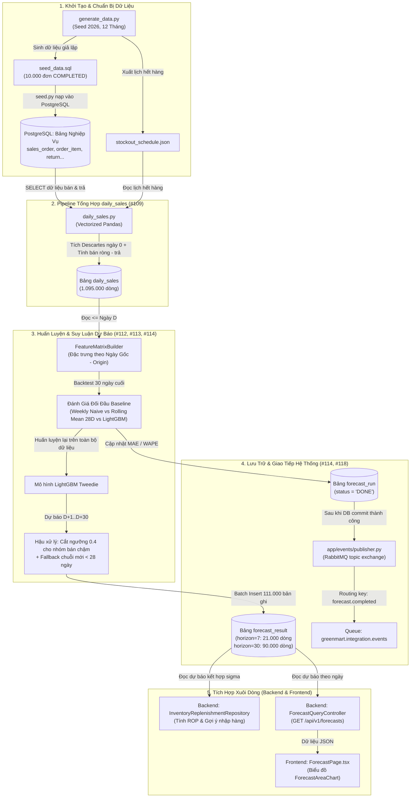
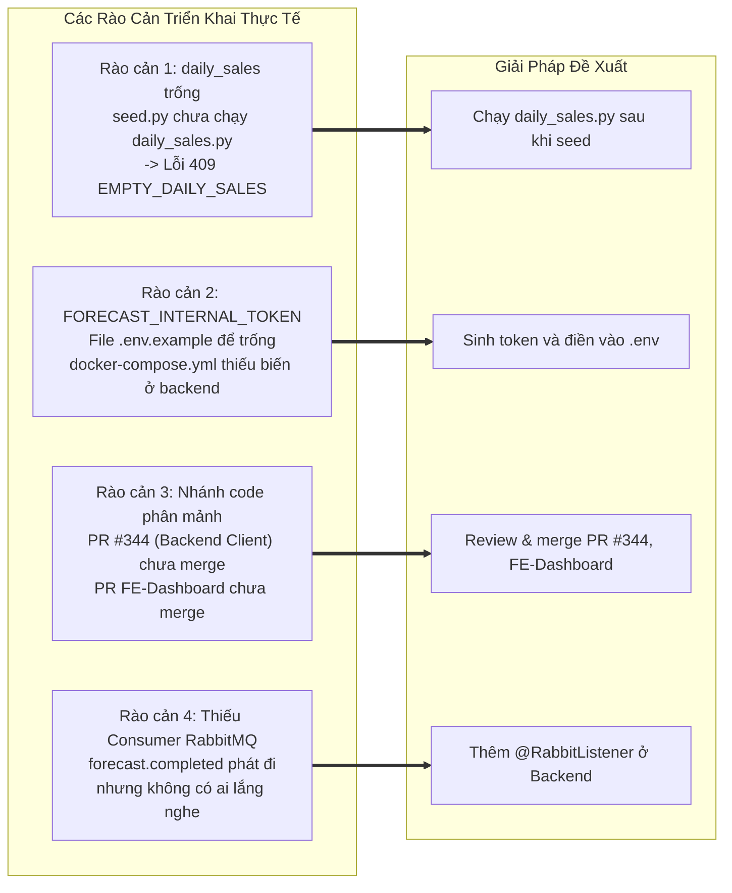

# BÁO CÁO TỔNG KẾT 3 TUẦN DỰ ÁN FORECAST-SERVICE (GREENMART DT03)

**Tác giả:** SV06 – Kỹ sư Dữ liệu / Trí tuệ nhân tạo (Data & AI Specialist)  
**Phụ trách:** Phân hệ Dự báo nhu cầu (`forecast-service`)  
**Đối tượng tiếp nhận:** SV01 (Lead / BA), Nhóm Backend (SV02, SV03, SV07), Nhóm Frontend (SV04, SV05)  
**Ngày lập báo cáo:** 21/11/2026  
**Đường dẫn file:** [bao-cao-forecast-service-3-tuan.md](file:///c:/UTH/HK10/HKDN/GreenMart/docs/reports/bao-cao-forecast-service-3-tuan.md)

---

## 1. TÓM TẮT ĐIỀU HÀNH (EXECUTIVE SUMMARY)

1. **Kết quả mô hình:** Đã hoàn thành huấn luyện và nghiệm thu mô hình `LightGBM-Tweedie-H7-H30` kết hợp hậu xử lý cắt ngưỡng 0.4; chính thức **ĐẠT TIÊU CHÍ AC-05** khi chiến thắng Baseline 2 (Trung bình trượt 28 ngày) ở cả hai tầm dự báo 7 ngày (WAPE 79.13% vs 96.74%) và 30 ngày (WAPE 82.68% vs 104.81% gộp tuần; 49.81% vs 72.24% tổng tầm tính ROP).
2. **Năng lực cốt lõi:** Đã xây dựng trọn vẹn bộ sinh dữ liệu lịch sử 12 tháng (AC-01), pipeline tổng hợp bán ròng `daily_sales` (AI-02), kiến trúc trích xuất đặc trưng không rò rỉ (Feature Engineering), API bất đồng bộ FastAPI (`POST /forecast/run`, `GET /forecast/runs/{runId}`), lập lịch chạy đêm 02:00 (APScheduler) và phát sự kiện `forecast.completed` lên RabbitMQ (AI-03, AI-04, SRS §8.4).
3. **Hiện trạng tích hợp hệ thống thực:** `forecast-service` **CHƯA THỂ chạy thông suốt trên hệ thống thực (Docker Compose)**.
4. **Nguyên nhân chính:** (a) Cơ sở dữ liệu Docker mới khởi tạo chưa có dữ liệu `daily_sales` (script `seed.py` chỉ nạp 24 bảng nghiệp vụ, chưa tự động chạy pipeline `daily_sales.py`), dẫn đến API bị chặn lỗi 409 `EMPTY_DAILY_SALES`; (b) Biến môi trường xác thực `FORECAST_INTERNAL_TOKEN` trong `.env.example` đang để trống, khiến container từ chối mọi yêu cầu (Fail-Closed); (c) Nhánh gọi API backend (`feature/344-forecast-bearer`) và giao diện frontend (`feature/FE-Dashboardvamadubao`) chưa được merge vào nhánh chính `develop`; (d) Backend chưa hiện thực consumer lắng nghe sự kiện `forecast.completed` từ RabbitMQ.
5. **Kế hoạch hành động gấp:** Cần SV01 chốt 4 điểm mâu thuẫn giao tiếp, hoàn tất merge PR #344, bổ sung bước nạp `daily_sales` vào quy trình khởi tạo hệ thống, và cấu hình biến môi trường đồng bộ giữa Backend và Forecast.

---

## 2. TIẾN ĐỘ 3 TUẦN (WORK BREAKDOWN & STATUS)

Phân loại trạng thái:
- **(a) ĐÃ LÀM VÀ CHẠY ĐƯỢC:** Đã viết mã nguồn, có kiểm thử unit/integration tự động đạt, hoặc đã sinh ra file dữ liệu thực tế kiểm chứng được.
- **(b) ĐÃ VIẾT CODE NHƯNG CHƯA KIỂM CHỨNG TRÊN HỆ THỐNG THỰC:** Code đã hoàn thiện trên repo, test nội bộ/mock đạt nhưng chưa chạy tích hợp thành công trên cụm Docker Compose chung của cả nhóm.
- **(c) CHƯA LÀM:** Đang ở mức dự kiến hoặc chưa có mã nguồn trong repo.

| Tuần | Issue / PR | Công việc đã thực hiện | Sản phẩm bàn giao (File / Commit) | Trạng thái |
| :---: | :---: | :---| :---| :---: |
| **Tuần 1** | Issue [#105](file:///c:/UTH/HK10/HKDN/GreenMart/forecast-service/scripts/config.py) / PR [#199](file:///c:/UTH/HK10/HKDN/GreenMart/forecast-service/scripts/config.py) | Thiết kế 345 dòng tham số sinh dữ liệu giả lập (12 tháng, mùa vụ Tết, tỷ lệ kênh, Pareto 80/20, stockout, random seed 2026). | [config.py](file:///c:/UTH/HK10/HKDN/GreenMart/forecast-service/scripts/config.py), [test_config.py](file:///c:/UTH/HK10/HKDN/GreenMart/forecast-service/tests/test_config.py) | **(a)** |
| **Tuần 1** | Issue [#106](file:///c:/UTH/HK10/HKDN/GreenMart/forecast-service/scripts/generate_data.py) / PR [#209](file:///c:/UTH/HK10/HKDN/GreenMart/forecast-service/scripts/generate_data.py) | Trình sinh dữ liệu lịch sử demo cho 3 chi nhánh, 1.000 SKU, 10.000 đơn hàng hoàn tất, khuyến mại và đơn trả. | [generate_data.py](file:///c:/UTH/HK10/HKDN/GreenMart/forecast-service/scripts/generate_data.py), [READING_GUIDE.md](file:///c:/UTH/HK10/HKDN/GreenMart/forecast-service/scripts/READING_GUIDE.md), [test_generator.py](file:///c:/UTH/HK10/HKDN/GreenMart/forecast-service/tests/test_generator.py) | **(a)** |
| **Tuần 1** | Issue [#107](file:///c:/UTH/HK10/HKDN/GreenMart/forecast-service/scripts/config.py#L300-L345) / PR [#219](file:///c:/UTH/HK10/HKDN/GreenMart/forecast-service/scripts/config.py#L300-L345) | Sinh tồn kho khởi tạo, neo sản phẩm sữa tươi TH True Milk (ROP = 34, tồn = 35) để kích hoạt cảnh báo tồn thấp theo US-09. | [generate_data.py](file:///c:/UTH/HK10/HKDN/GreenMart/forecast-service/scripts/generate_data.py), [config.py](file:///c:/UTH/HK10/HKDN/GreenMart/forecast-service/scripts/config.py#L300-L345) | **(a)** |
| **Tuần 1** | Issue [#108](file:///c:/UTH/HK10/HKDN/GreenMart/forecast-service/scripts/seed.py) / PR [#220](file:///c:/UTH/HK10/HKDN/GreenMart/forecast-service/scripts/seed.py) | Bộ điều phối seed dữ liệu 1 lệnh (`seed.py`), kiểm tra mã băm SHA256SUMS, script tự kiểm đếm AC-01 (`verify_seed.sql`). | [seed.py](file:///c:/UTH/HK10/HKDN/GreenMart/forecast-service/scripts/seed.py), [verify_seed.sql](file:///c:/UTH/HK10/HKDN/GreenMart/forecast-service/scripts/verify_seed.sql), [test_seed_orchestrator.py](file:///c:/UTH/HK10/HKDN/GreenMart/forecast-service/tests/test_seed_orchestrator.py) | **(a)** |
| **Tuần 2** | Issue [#109](file:///c:/UTH/HK10/HKDN/GreenMart/forecast-service/app/pipelines/daily_sales.py) / PR [#231](file:///c:/UTH/HK10/HKDN/GreenMart/forecast-service/app/pipelines/daily_sales.py) | Pipeline tổng hợp bảng `daily_sales` (tính bán ròng, xử lý ngày 0 qua tích Descartes, cờ khuyến mại, cờ stockout). | [daily_sales.py](file:///c:/UTH/HK10/HKDN/GreenMart/forecast-service/app/pipelines/daily_sales.py), [test_daily_sales.py](file:///c:/UTH/HK10/HKDN/GreenMart/forecast-service/tests/test_daily_sales.py) | **(a)** |
| **Tuần 2** | Issue [#110](file:///c:/UTH/HK10/HKDN/GreenMart/forecast-service/notebooks/01_eda_demand_analysis.ipynb) / PR [#247](file:///c:/UTH/HK10/HKDN/GreenMart/forecast-service/notebooks/01_eda_demand_analysis.ipynb) | Xuất file `daily_sales.parquet` (1,095 triệu dòng) và xây dựng Notebook EDA phân tích xu hướng bán hàng, mùa vụ Tết. | [01_eda_demand_analysis.ipynb](file:///c:/UTH/HK10/HKDN/GreenMart/forecast-service/notebooks/01_eda_demand_analysis.ipynb), [export_daily_sales_parquet.py](file:///c:/UTH/HK10/HKDN/GreenMart/forecast-service/scripts/export_daily_sales_parquet.py) | **(a)** |
| **Tuần 2** | Issue [#111](file:///c:/UTH/HK10/HKDN/GreenMart/forecast-service/app/models/baselines.py) / PR [#255](file:///c:/UTH/HK10/HKDN/GreenMart/forecast-service/app/models/baselines.py) | Hiện thực Baseline 1 (Weekly Naive), Baseline 2 (Rolling Mean 28D) và module đo lường chuẩn MAE/WAPE. | [baselines.py](file:///c:/UTH/HK10/HKDN/GreenMart/forecast-service/app/models/baselines.py), [metrics.py](file:///c:/UTH/HK10/HKDN/GreenMart/forecast-service/app/models/metrics.py), [test_baselines.py](file:///c:/UTH/HK10/HKDN/GreenMart/forecast-service/tests/test_baselines.py), [test_metrics.py](file:///c:/UTH/HK10/HKDN/GreenMart/forecast-service/tests/test_metrics.py) | **(a)** |
| **Tuần 2** | Issue [#112](file:///c:/UTH/HK10/HKDN/GreenMart/forecast-service/app/models/lightgbm_model.py) / PR [#261](file:///c:/UTH/HK10/HKDN/GreenMart/forecast-service/app/models/lightgbm_model.py) | Xây dựng đặc trưng dựa trên ngày gốc (Feature Engineering) và huấn luyện mô hình LightGBM (Tweedie/L1). | [features.py](file:///c:/UTH/HK10/HKDN/GreenMart/forecast-service/app/models/features.py), [lightgbm_model.py](file:///c:/UTH/HK10/HKDN/GreenMart/forecast-service/app/models/lightgbm_model.py), [train_initial_lightgbm.py](file:///c:/UTH/HK10/HKDN/GreenMart/forecast-service/scripts/train_initial_lightgbm.py) | **(a)** |
| **Tuần 3** | Issue [#113](file:///c:/UTH/HK10/HKDN/GreenMart/forecast-service/app/pipelines/forecast_runner.py) / PR [#272](file:///c:/UTH/HK10/HKDN/GreenMart/forecast-service/app/pipelines/forecast_runner.py) | Đánh giá đa chiều (theo ô ngày, tuần, tổng tầm), so sánh baseline theo nhóm (Pareto) và pipeline ghi CSDL PostgreSQL. | [forecast_runner.py](file:///c:/UTH/HK10/HKDN/GreenMart/forecast-service/app/pipelines/forecast_runner.py), [evaluator.py](file:///c:/UTH/HK10/HKDN/GreenMart/forecast-service/app/models/evaluator.py), [test_forecast_db_integration.py](file:///c:/UTH/HK10/HKDN/GreenMart/forecast-service/tests/test_forecast_db_integration.py) | **(a)** |
| **Tuần 3** | Issue [#114](file:///c:/UTH/HK10/HKDN/GreenMart/forecast-service/app/api/router.py) / PR [#290](file:///c:/UTH/HK10/HKDN/GreenMart/forecast-service/app/api/router.py) | Xây dựng REST API FastAPI (`POST /forecast/run`, `GET /forecast/runs/{runId}`), xử lý concurrency lock và dọn dẹp run kẹt. | [router.py](file:///c:/UTH/HK10/HKDN/GreenMart/forecast-service/app/api/router.py), [schemas.py](file:///c:/UTH/HK10/HKDN/GreenMart/forecast-service/app/api/schemas.py), [forecast_service.py](file:///c:/UTH/HK10/HKDN/GreenMart/forecast-service/app/pipelines/forecast_service.py), [main.py](file:///c:/UTH/HK10/HKDN/GreenMart/forecast-service/app/main.py) | **(b)** |
| **Tuần 3** | Issue [#116](file:///c:/UTH/HK10/HKDN/GreenMart/forecast-service/tests/test_daily_sales.py) / PR [#294](file:///c:/UTH/HK10/HKDN/GreenMart/forecast-service/tests/test_daily_sales.py) | Bộ ca kiểm thử tính tay (Hand-calculated Test Cases) đối soát tính đúng đắn tuyệt đối của `daily_sales`, MAE và WAPE. | [test_daily_sales.py](file:///c:/UTH/HK10/HKDN/GreenMart/forecast-service/tests/test_daily_sales.py#L1-L100), [test_metrics.py](file:///c:/UTH/HK10/HKDN/GreenMart/forecast-service/tests/test_metrics.py) | **(a)** |
| **Tuần 3** | Issue [#117](file:///c:/UTH/HK10/HKDN/GreenMart/docs/reports/bao-cao-mae-wape-lan-1.md) / PR [#295](file:///c:/UTH/HK10/HKDN/GreenMart/docs/reports/bao-cao-mae-wape-lan-1.md) | Soạn thảo Báo cáo đánh giá MAE/WAPE lần 1 phục vụ tiêu chí AC-05. | [bao-cao-mae-wape-lan-1.md](file:///c:/UTH/HK10/HKDN/GreenMart/docs/reports/bao-cao-mae-wape-lan-1.md) | **(a)** |
| **Tuần 3** | Issue [#118](file:///c:/UTH/HK10/HKDN/GreenMart/forecast-service/app/scheduler/forecast_scheduler.py) / PR [#391](file:///c:/UTH/HK10/HKDN/GreenMart/forecast-service/app/scheduler/forecast_scheduler.py) | Lập lịch tự động 02:00 hằng đêm (APScheduler), cơ chế chạy bù (Startup Catch-up) và phát sự kiện `forecast.completed` lên RabbitMQ. | [forecast_scheduler.py](file:///c:/UTH/HK10/HKDN/GreenMart/forecast-service/app/scheduler/forecast_scheduler.py), [publisher.py](file:///c:/UTH/HK10/HKDN/GreenMart/forecast-service/app/events/publisher.py), [test_forecast_scheduler.py](file:///c:/UTH/HK10/HKDN/GreenMart/forecast-service/tests/test_forecast_scheduler.py) | **(b)** |
| **Tuần 3** | Issue [#120](file:///c:/UTH/HK10/HKDN/GreenMart/docs/reports/bao-cao-danh-gia-mo-hinh-ac-05.md) / PR [#120](file:///c:/UTH/HK10/HKDN/GreenMart/docs/reports/bao-cao-danh-gia-mo-hinh-ac-05.md) | Báo cáo đánh giá mô hình cuối cùng đạt chuẩn AC-05, phân tích chi tiết theo 3 chi nhánh và 15 ngành hàng thực tế. | [bao-cao-danh-gia-mo-hinh-ac-05.md](file:///c:/UTH/HK10/HKDN/GreenMart/docs/reports/bao-cao-danh-gia-mo-hinh-ac-05.md), [evaluation_metrics.json](file:///c:/UTH/HK10/HKDN/GreenMart/forecast-service/artifacts/evaluation_metrics.json) | **(a)** |
| **Bổ trợ** | Issue #298 / #311 | Ghi nhận kết quả dự báo cả 2 tầm 7 và 30 ngày vào `forecast_result`; bảo mật API nội bộ bằng Bearer token (`FORECAST_INTERNAL_TOKEN`). | Commit `858eda7`, `aa72c8c` trong [router.py](file:///c:/UTH/HK10/HKDN/GreenMart/forecast-service/app/api/router.py#L47-L70), [forecast_service.py](file:///c:/UTH/HK10/HKDN/GreenMart/forecast-service/app/pipelines/forecast_service.py#L254-L274) | **(b)** |
| **Bổ trợ** | Issue #329 / #330 | Cấu hình thu hồi quyền thừa và giới hạn quyền đọc của role `forecast_ro` trên PostgreSQL. | [01-forecast-role.sh](file:///c:/UTH/HK10/HKDN/GreenMart/infra/postgres/init/01-forecast-role.sh), [V14__restrict_forecast_read_privileges.sql](file:///c:/UTH/HK10/HKDN/GreenMart/backend/src/main/resources/db/migration/V14__restrict_forecast_read_privileges.sql) | **(a)** |
| **Tích hợp** | Issue #344 / PR #344 | Backend tạo `ForecastClient` gửi Bearer token gọi sang `forecast-service` (mới nằm ở nhánh riêng `feature/344-forecast-bearer`). | Commit `536be2a` trên branch `feature/344-forecast-bearer` | **(b)** |
| **Tích hợp** | Issue #119 / PR #409 | Backend tạo API `GET /forecasts` đọc dữ liệu dự báo từ DB cho Frontend hiển thị biểu đồ. | Commit `ded5795` trên [ForecastQueryController.java](file:///c:/UTH/HK10/HKDN/GreenMart/backend/src/main/java/vn/greenmart/forecast/controller/ForecastQueryController.java) | **(a)** |
| **Giao diện** | FE-Dashboard | Frontend tạo màn hình `ForecastPage.tsx` và biểu đồ diện tích `ForecastAreaChart.tsx` (nhánh `origin/feature/FE-Dashboardvamadubao`). | Commit `67576d3` trên branch `feature/FE-Dashboardvamadubao` | **(b)** |

---

## 3. FORECAST-SERVICE HOẠT ĐỘNG NHƯ THẾ NÀO (END-TO-END WORKFLOW)

Quy trình hoạt động toàn diện của phân hệ dự báo nhu cầu được biểu diễn qua sơ đồ tuần tự bên dưới:



### 3.1. Dữ liệu lịch sử được sinh thế nào?
- **Thời gian và quy mô:** Sinh dữ liệu 12 tháng từ `01/11/2025` đến `31/10/2026` với 3 chi nhánh (`GM-001`: 45%, `GM-002`: 35%, `GM-003`: 20%), 1.000 SKU sản phẩm, đúng 10.000 đơn hàng đã xử lý (`COMPLETED` hoặc `RETURNED`) ([config.py](file:///c:/UTH/HK10/HKDN/GreenMart/forecast-service/scripts/config.py#L29-L35), [L122-L151](file:///c:/UTH/HK10/HKDN/GreenMart/forecast-service/scripts/config.py#L122-L151)).
- **Mùa vụ và lịch:** Cố định đỉnh mùa vụ Tết Bính Ngọ 2026 (Mùng 1 ngày `17/02/2026`). Giai đoạn 21 ngày trước Tết (`27/01` đến `16/02/2026`) nhu cầu tăng 50%–100%; 3 ngày Tết giảm 90%. Cuối tuần tăng 10%–20%; ngày thường giảm nhẹ; các ngày lễ lớn (Giáng sinh, 30/4, 2/9, 20/10) tăng 20%–35% ([config.py](file:///c:/UTH/HK10/HKDN/GreenMart/forecast-service/scripts/config.py#L37-L90)).
- **Quy luật Pareto (80/20):** Top 200 SKU bán chạy đóng góp 80% tổng sản lượng bán ra; 800 SKU còn lại có nhu cầu phát sinh gián đoạn, thưa thớt (Intermittent Demand) ([config.py](file:///c:/UTH/HK10/HKDN/GreenMart/forecast-service/scripts/config.py#L203-L215)).
- **Tính tái lập tuyệt đối (Reproducibility):** Cố định `RANDOM_SEED = 2026` trong cả script sinh dữ liệu ([config.py](file:///c:/UTH/HK10/HKDN/GreenMart/forecast-service/scripts/config.py#L296)) và mô hình LightGBM ([lightgbm_model.py](file:///c:/UTH/HK10/HKDN/GreenMart/forecast-service/app/models/lightgbm_model.py#L29)). File `SHA256SUMS` lưu sẵn mã băm của `seed_data.sql` và `stockout_schedule.json`.

### 3.2. Bảng `daily_sales` được tổng hợp ra sao?
- **Khung tích Descartes (Cartesian Product):** Tạo sẵn khung lưới $365 \text{ ngày} \times 3 \text{ chi nhánh} \times 1.000 \text{ SKU} = 1.095.000 \text{ dòng}$. Ngày nào không phát sinh giao dịch được tự động điền `qty_sold = 0, qty_returned = 0, qty_net = 0, revenue = 0` ([daily_sales.py](file:///c:/UTH/HK10/HKDN/GreenMart/forecast-service/app/pipelines/daily_sales.py#L83-L101)).
- **Bán ròng (`qty_net`) và Doanh thu thuần (`revenue`):**
  $$\text{qty\_net} = \text{qty\_sold} - \text{qty\_returned}$$
  $$\text{revenue} = \max(0, \text{rev\_sold} - \text{refund})$$
  *Lưu ý:* `qty_net` có thể mang giá trị âm nếu trong ngày khách trả hàng nhiều hơn số lượng bán ([daily_sales.py](file:///c:/UTH/HK10/HKDN/GreenMart/forecast-service/app/pipelines/daily_sales.py#L321-L324)).
- **Cờ khuyến mại (`promo_flag`, `promo_discount_pct`):** Quét từ các chiến dịch khuyến mại cấp sản phẩm (`ITEM`), nếu một ngày có nhiều chương trình thì lấy mức giảm % lớn nhất ([daily_sales.py](file:///c:/UTH/HK10/HKDN/GreenMart/forecast-service/app/pipelines/daily_sales.py#L201-L262)).
- **Cờ hết hàng (`stockout`) và Lý do không dùng làm nhãn huấn luyện:**
  - Ngày stockout là ngày sản phẩm có lượng tồn khả dụng bằng 0 cả ngày.
  - **Bản chất kinh tế:** Khách hàng đến siêu thị có nhu cầu mua nhưng không có hàng trên kệ để mua (hiện tượng *Censored Demand* / Nhu cầu bị cắt cụt). Lượng bán ghi nhận trên hóa đơn là 0 không phản ánh đúng nhu cầu thực tế. Nếu đưa các dòng này vào huấn luyện, mô hình AI sẽ bị "học vẹt" sai lệch rằng nhu cầu khách hàng vào ngày đó bằng 0. Do đó, cờ `stockout = True` được dùng để loại bỏ các ô này khỏi nhãn huấn luyện và tập kiểm tra ([daily_sales.py](file:///c:/UTH/HK10/HKDN/GreenMart/forecast-service/app/pipelines/daily_sales.py#L264-L299), [features.py](file:///c:/UTH/HK10/HKDN/GreenMart/forecast-service/app/models/features.py#L228-L238)).

### 3.3. Đặc trưng (Feature Engineering) mô hình sử dụng
Mô hình áp dụng thiết kế **Ngày Gốc (Origin Date $t$)** nhằm loại bỏ hoàn toàn rủi ro rò rỉ dữ liệu (No Data Leakage) ([features.py](file:///c:/UTH/HK10/HKDN/GreenMart/forecast-service/app/models/features.py#L1-L18)):
1. **Đặc trưng lịch sử quá khứ ($\le t$):**
   - Trung bình trượt số lượng bán ròng: `rolling_mean_7`, `rolling_mean_14`, `rolling_mean_28`.
   - Lượng bán ngay tại ngày gốc: `qty_at_origin`.
   - Lượng bán cùng thứ lùi về các chu kỳ trước: `same_dow_sale_1w`, `same_dow_sale_2w`.
2. **Đặc trưng ngoại sinh của ngày mục tiêu ($t + h$):**
   - Lịch: `target_day_of_week` (0..6), `target_day_of_month` (1..31), `target_month` (1..12), `target_is_weekend` (0/1), `target_is_holiday` (0/1).
   - Mùa vụ Tết: `target_is_tet_pre` (0/1 - cờ 21 ngày trước Tết).
   - Khuyến mại: `target_promo_flag` (0/1), `target_promo_discount_pct` (float).
   - Bước dự báo: `horizon_step` ($1 \le h \le H$).
3. **Biến định danh phân loại:** `branch_id`, `product_id`, `group_code` (kiểu `category`).

### 3.4. Hai Baseline và Mô hình LightGBM
- **Baseline 1 – Weekly Naive (BA §9.3):** Lấy sản lượng bán cùng thứ của tuần trước làm dự báo cho tuần này: $\hat{y}_{t+h} = y_{(t+h)-7k}$ ([baselines.py](file:///c:/UTH/HK10/HKDN/GreenMart/forecast-service/app/models/baselines.py#L48-L70)).
- **Baseline 2 – Rolling Mean 28D (BA §9.3):** Lấy trung bình cộng sản lượng 28 ngày gần nhất trước ngày gốc làm dự báo phẳng cho mọi ngày tương lai. Đây là **baseline nghiệp vụ tốt nhất** ([baselines.py](file:///c:/UTH/HK10/HKDN/GreenMart/forecast-service/app/models/baselines.py#L72-L88)).
- **Mô hình LightGBM Tweedie:** Huấn luyện với hàm mục tiêu Tweedie (`tweedie_variance_power = 1.2`) chuyên trị dữ liệu số đếm có nhiều số 0 (Zero-inflated data) kết hợp chặn dưới $\ge 0.0$ ([lightgbm_model.py](file:///c:/UTH/HK10/HKDN/GreenMart/forecast-service/app/models/lightgbm_model.py#L57-L59), [L121](file:///c:/UTH/HK10/HKDN/GreenMart/forecast-service/app/models/lightgbm_model.py#L121)).
- **Cắt ngưỡng tối ưu 0.4 cho nhóm bán chậm:** Đối với 800 SKU bán chậm, mô hình LightGBM gốc thường dự báo các số thực nhỏ li ti ($0.05, 0.1$). Việc cắt toàn bộ dự báo $< 0.4$ về $0.0$ giúp triệt tiêu phương sai tích lũy và hạ WAPE từ 188% xuống 102% ([forecast_service.py](file:///c:/UTH/HK10/HKDN/GreenMart/forecast-service/app/pipelines/forecast_service.py#L260-L265)).
- **Fallback sản phẩm mới:** Các chuỗi thời gian có dưới 28 ngày lịch sử được tự động lấy trung bình của toàn danh mục ngành hàng tại chi nhánh ([evaluator.py](file:///c:/UTH/HK10/HKDN/GreenMart/forecast-service/app/models/evaluator.py#L38-L80)).
- **Tập kiểm tra 30 ngày cuối:** Giữ nguyên 30 ngày cuối (`02/10/2026` đến `31/10/2026`, điểm cutoff `2026-10-01`), không trộn ngẫu nhiên (No Shuffling) để đánh giá trung thực ([bao-cao-danh-gia-mo-hinh-ac-05.md](file:///c:/UTH/HK10/HKDN/GreenMart/docs/reports/bao-cao-danh-gia-mo-hinh-ac-05.md#L51-L57)).

### 3.5. Cách tính MAE, WAPE và ý nghĩa
- **MAE (Mean Absolute Error - Sai số tuyệt đối trung bình):**
  $$\text{MAE} = \frac{1}{N} \sum_{i=1}^{N} |y_i - \hat{y}_i|$$
  *Đơn vị:* Số sản phẩm lệch trung bình trên mỗi chuỗi/ngày ([metrics.py](file:///c:/UTH/HK10/HKDN/GreenMart/forecast-service/app/models/metrics.py#L17-L48)).
- **WAPE (Weighted Absolute Percentage Error - Sai số phần trăm tuyệt đối có trọng số):**
  $$\text{WAPE} = \frac{\sum_{i=1}^{N} |y_i - \hat{y}_i|}{\sum_{i=1}^{N} y_i}$$
  *Ý nghĩa thực tế:* Khắc phục hoàn toàn lỗi chia cho 0 của MAPE thông thường khi gặp ngày không bán được hàng ($y_i = 0$). WAPE đo lường chính xác tỷ lệ thất thoát sản lượng do dự báo sai trên toàn chuỗi bán lẻ ([metrics.py](file:///c:/UTH/HK10/HKDN/GreenMart/forecast-service/app/models/metrics.py#L50-L100)).

### 3.6. Cách ghi kết quả vào DB
- **Bảng `forecast_run`:** Ghi nhận thông tin lần chạy (`id`, `started_at`, `finished_at`, `status` IN `RUNNING/DONE/FAILED`, `model_version`, `mae`, `wape`, `baseline_mae`, `baseline_wape`) ([V1__init_schema.sql](file:///c:/UTH/HK10/HKDN/GreenMart/backend/src/main/resources/db/migration/V1__init_schema.sql#L341-L351), [forecast_service.py](file:///c:/UTH/HK10/HKDN/GreenMart/forecast-service/app/pipelines/forecast_service.py#L289-L296)).
- **Bảng `forecast_result`:** Lưu từng điểm dự báo theo batch 10.000 dòng. Mỗi lượt chạy ghi đúng **111.000 dòng**:
  $$3 \text{ CN} \times 1.000 \text{ SKU} \times 7 \text{ ngày} = 21.000 \text{ dòng (horizon 7)}$$
  $$3 \text{ CN} \times 1.000 \text{ SKU} \times 30 \text{ ngày} = 90.000 \text{ dòng (horizon 30)}$$
  Bộ khóa `(run_id, branch_id, product_id, horizon, target_date)` là duy nhất ([forecast_runner.py](file:///c:/UTH/HK10/HKDN/GreenMart/forecast-service/app/pipelines/forecast_runner.py#L49-L100)).

### 3.7. Lịch chạy 02:00 và sự kiện `forecast.completed`
- **Công nghệ lập lịch:** Sử dụng `APScheduler` (`BackgroundScheduler`) chạy cron ngầm: `CronTrigger(hour=2, minute=0, timezone='Asia/Ho_Chi_Minh')` ([forecast_scheduler.py](file:///c:/UTH/HK10/HKDN/GreenMart/forecast-service/app/scheduler/forecast_scheduler.py#L22-L39)).
- **Chống chạy trùng lặp:** Kiểm tra hàm `has_run_executed_today()` kết hợp `pg_advisory_xact_lock(1142026)` trên PostgreSQL để ngăn 2 tiến trình chạy đè nhau ([forecast_scheduler.py](file:///c:/UTH/HK10/HKDN/GreenMart/forecast-service/app/scheduler/forecast_scheduler.py#L46-L86)).
- **Cơ chế chạy bù (Startup Catch-up):** Khi container khởi động lại trong khung giờ từ 02:00 đến 06:00 sáng, scheduler tự động kiểm tra xem đêm nay đã có lượt chạy thành công chưa; nếu chưa, sẽ tự động kích hoạt chạy bù trong luồng nền ([forecast_scheduler.py](file:///c:/UTH/HK10/HKDN/GreenMart/forecast-service/app/scheduler/forecast_scheduler.py#L112-L160)).
- **Phát sự kiện `forecast.completed`:** Sử dụng thư viện `pika` kết nối RabbitMQ, phát thông điệp bền vững (persistent) lên topic exchange `greenmart.events` với routing key `forecast.completed` ([publisher.py](file:///c:/UTH/HK10/HKDN/GreenMart/forecast-service/app/events/publisher.py#L82-L167)).

---

## 4. KẾT QUẢ SỐ LIỆU ĐÁNH GIÁ (TIÊU CHÍ AC-05)

Toàn bộ số liệu dưới đây được trích xuất trực tiếp từ các file kết quả thực nghiệm chính thức: [bao-cao-danh-gia-mo-hinh-ac-05.md](file:///c:/UTH/HK10/HKDN/GreenMart/docs/reports/bao-cao-danh-gia-mo-hinh-ac-05.md#L99-L195), [evaluation_metrics.json](file:///c:/UTH/HK10/HKDN/GreenMart/forecast-service/artifacts/evaluation_metrics.json) và [segment_metrics.json](file:///c:/UTH/HK10/HKDN/GreenMart/forecast-service/artifacts/segment_metrics.json) tại commit `450531a` / `763d45e`.

### 4.1. Bảng so sánh đối đầu tổng thể (Overall)

| Tầm dự báo | Phương thức đo lường | Baseline 1 (Weekly Naive)<br>MAE \| WAPE | Baseline 2 (TB trượt 28D)<br>MAE \| WAPE | Mô hình Vận hành (Ngưỡng 0.4)<br>MAE \| WAPE | Chênh lệch WAPE so với Baseline tốt nhất | Kết luận AC-05 |
| :---: | :---| :---: | :---: | :---: | :---: | :---: |
| **7 ngày** | **Từng ô ngày** (sp/ngày) | 0.2743 \| 172.68% | 0.2560 \| 161.17% | **0.2228 \| 140.27%** | **-20.90 điểm %** (vs BL2) | **✓ THẮNG** |
| **7 ngày** | **Gộp tuần** (sp/tuần) | 1.2557 \| 113.46% | 1.0706 \| 96.74% | **0.8757 \| 79.13%** | **-17.61 điểm %** (vs BL2) | **✓ THẮNG** |
| **7 ngày** | **Tổng cả tầm** (sp/tầm) | 1.2557 \| 113.46% | 1.0706 \| 96.74% | **0.8757 \| 79.13%** | **-17.61 điểm %** (vs BL2) | **✓ THẮNG** |
| | | | | | | |
| **30 ngày** | **Từng ô ngày** (sp/ngày) | 0.2669 \| 178.48% | 0.2493 \| 166.67% | **0.2147 \| 143.58%** | **-23.09 điểm %** (vs BL2) | **✓ THẮNG** |
| **30 ngày** | **Gộp tuần** (sp/tuần) | 1.0712 \| 119.92% | 0.9362 \| 104.81% | **0.7385 \| 82.68%** | **-22.13 điểm %** (vs BL2)<br>*-17.62% (vs Zero 100.30%)* | **✓ THẮNG** |
| **30 ngày** | **Tổng cả tầm** (sp/tầm ROP) | 4.4940 \| 100.62% | 3.2263 \| 72.24% | **2.2245 \| 49.81%** | **-22.43 điểm %** (vs BL2) | **✓ THẮNG** |

### 4.2. Bảng phân tích theo nhóm hàng (Pareto 80/20)

*(Đo lường theo phương thức Gộp tuần - Weekly Aggregate, đơn vị MAE: sản phẩm/tuần):*

| Tầm dự báo | Phân khúc hàng hóa | Số chuỗi ($N$) | Tổng thực tế (sp) | Baseline 2 (TB 28D)<br>MAE \| WAPE | Zero Forecast (Tham chiếu)<br>MAE \| WAPE | Mô hình Vận hành (0.4)<br>MAE \| WAPE | Đánh giá so với Baseline |
| :---: | :---| :---: | :---: | :---: | :---: | :---: | :---|
| **7 ngày** | **Top 200 bán chạy** | 600 | 2.659 | 3.3490 \| 75.57% | 4.4583 \| 100.60% | **3.2377 \| 73.06%** | **Thắng BL2 (-2.51 điểm %)** |
| **7 ngày** | **800 bán chậm** | 2.400 | 661 | 0.5009 \| 181.88% | 0.2779 \| 100.91% | **0.2851 \| 103.53%** | **Thắng áp đảo BL2 (-78.35 điểm %)**, tiệm cận Zero |
| | | | | | | | |
| **30 ngày** | **Top 200 bán chạy** | 600 | 10.705 | 2.9927 \| 83.87% | 3.5770 \| 100.24% | **2.7738 \| 77.73%** | **Thắng BL2 (-6.14 điểm %)** |
| **30 ngày** | **800 bán chậm** | 2.400 | 2.694 | 0.4221 \| 188.03% | 0.2257 \| 100.52% | **0.2297 \| 102.31%** | **Thắng áp đảo BL2 (-85.72 điểm %)**, tiệm cận Zero |

### 4.3. Đánh giá nghiệm thu tiêu chí AC-05
- **Kết luận:** **Mô hình chính thức ĐẠT TIÊU CHÍ AC-05**. WAPE của mô hình thấp hơn Baseline 2 (baseline tốt nhất) ở cả 2 tầm 7 ngày và 30 ngày trên mọi cách đo lường.
- **Giá trị thực tiễn cho bài toán kho:** Ở bài toán tính điểm đặt hàng lại (Tổng cả tầm 30 ngày phục vụ ROP), mô hình giúp giảm sai số WAPE từ **72.24%** xuống **49.81%** (giảm 22.43 điểm %), hạ sai số tuyệt đối trung bình từ **3.23** xuống **2.22 sản phẩm/chuỗi**, giảm thiểu đáng kể rủi ro đọng vốn hoặc đứt gãy hàng hóa.
- **Tính toàn diện:** Mô hình chiến thắng Baseline 2 trên **toàn bộ 3 chi nhánh** (GM-001 giảm 22.87%, GM-002 giảm 21.37%, GM-003 giảm 21.93% ở tầm 30 ngày) và **15/15 ngành hàng thực tế** trong hệ thống ([bao-cao-danh-gia-mo-hinh-ac-05.md](file:///c:/UTH/HK10/HKDN/GreenMart/docs/reports/bao-cao-danh-gia-mo-hinh-ac-05.md#L151-L195)).

### 4.4. Giới hạn cốt lõi của mô hình (Báo cáo minh bạch)
1. **Sai số cấp ô ngày còn cao (WAPE $\approx 140\%$):** Dù đã cải thiện so với Baseline 2 (161%–166%), việc dự báo chính xác số lượng bán cho từng ngày riêng lẻ của một mặt hàng cụ thể vẫn có độ biến thiên lớn. **Khuyến cáo:** Chỉ dùng dự báo cấp Gộp tuần hoặc Tổng cả tầm để tính ROP và lập kế hoạch nhập hàng. Không dùng số từng ngày để điều phối vận chuyển thời gian thực.
2. **Bản chất của kỹ thuật cắt ngưỡng tĩnh 0.4:** Cắt ngưỡng thực chất là đưa 99.83% ô dự báo của 800 SKU bán chậm về 0 để triệt tiêu sai số cộng dồn. WAPE của nhóm này đạt ~102%–103%, bám sát mô hình Zero Forecast (100.5%), phản ánh tính chất toán học của dữ liệu thưa hơn là việc máy học bắt được quy luật phát sinh đơn lẻ.
3. **Mùa vụ Tết chưa được kiểm chứng trên tập Test:** Cửa sổ kiểm tra độc lập (tháng 10/2026) không nằm trong dịp Tết (tháng 1–2/2026). Khi vận hành thực tế dịp Tết, độ chính xác sẽ hoàn toàn phụ thuộc vào cờ lịch ngoại sinh `target_is_tet_pre`.
4. **Hiện tượng nhu cầu bị cắt cụt (Censored Demand):** Dù đã lọc bỏ ngày hết hàng, hệ thống chưa có thuật toán bù đắp nhu cầu tiềm ẩn (*Unconstrained Imputation*). Với các mặt hàng hay đứt hàng trong quá khứ, mô hình có xu hướng dự báo chệch dưới (*under-forecast*).

---

## 5. HỢP ĐỒNG GIAO TIẾP HỆ THỐNG (SYSTEM CONTRACTS)

Đây là tài liệu kỹ thuật quan trọng nhất để đội ngũ Backend và Frontend kết nối chính xác vào `forecast-service`.

### 5.1. REST API của Forecast-service (Cổng 8000 nội bộ / 8001 máy chủ)

Tất cả các endpoint của `forecast-service` bắt buộc phải kèm Header xác thực Bearer token nội bộ:
```http
Authorization: Bearer <FORECAST_INTERNAL_TOKEN>
```
Nếu thiếu hoặc sai token, API trả về ngay:
```json
// HTTP 401 Unauthorized (Header: WWW-Authenticate: Bearer)
{
  "code": "UNAUTHORIZED",
  "message": "Yêu cầu header Authorization: Bearer <token> hợp lệ."
}
```

#### Endpoint 1: Kích hoạt chạy dự báo nền
- **Đường dẫn:** `POST /forecast/run`
- **Mã phản hồi thành công:** `HTTP 202 Accepted`
- **Ý nghĩa:** Tiếp nhận yêu cầu, sinh ngay `runId` và khởi chạy tính toán trong luồng nền (Background Task).
- **Body JSON phản hồi:**
  ```json
  {
    "runId": 42,
    "status": "RUNNING",
    "startedAt": "2026-11-21T02:00:00.123456+07:00"
  }
  ```
- **Các mã lỗi nghiệp vụ:**
  - `HTTP 409 Conflict`: Đang có một lượt chạy khác chưa xong.
    ```json
    { "code": "CONFLICT", "message": "Đã có một lượt dự báo đang chạy (run_id=41). Vui lòng chờ hoàn tất." }
    ```
  - `HTTP 409 Conflict`: Bảng `daily_sales` trong CSDL đang trống.
    ```json
    { "code": "EMPTY_DAILY_SALES", "message": "Bảng daily_sales hiện đang trống. Cần nạp dữ liệu bán hàng trước khi chạy dự báo." }
    ```

#### Endpoint 2: Tra cứu trạng thái và độ đo sai số của lượt chạy
- **Đường dẫn:** `GET /forecast/runs/{runId}`
- **Mã phản hồi thành công:** `HTTP 200 OK`
- **Body JSON phản hồi (khi đang chạy - RUNNING):**
  ```json
  {
    "runId": 42,
    "status": "RUNNING",
    "startedAt": "2026-11-21T02:00:00.123456+07:00",
    "finishedAt": null,
    "modelVersion": "LightGBM-Tweedie-H7-H30",
    "mae": null,
    "wape": null,
    "baselineMae": null,
    "baselineWape": null
  }
  ```
- **Body JSON phản hồi (khi hoàn tất - DONE):**
  ```json
  {
    "runId": 42,
    "status": "DONE",
    "startedAt": "2026-11-21T02:00:00.123456+07:00",
    "finishedAt": "2026-11-21T02:00:45.789123+07:00",
    "modelVersion": "LightGBM-Tweedie-H7-H30",
    "mae": 0.2228,
    "wape": 1.4027,
    "baselineMae": 0.2560,
    "baselineWape": 1.6117
  }
  ```
- **Mã lỗi:** `HTTP 404 Not Found` nếu không tìm thấy `runId`.

### 5.2. Hợp đồng Cơ sở dữ liệu (PostgreSQL Database Contract)
- **Tài khoản kết nối:** Bắt buộc sử dụng tài khoản chuyên biệt `FORECAST_DB_USER` (mặc định: `forecast_ro`), **tuyệt đối cấm dùng tài khoản chủ DB `greenmart` / `postgres`**.
- **Bảng đọc (SELECT):** `branch`, `product`, `sales_order`, `order_item`, `return_document`, `return_item`, `promotion`, `promotion_branch`, `promotion_product`, `inventory_transaction` (được cấp quyền tại [V14__restrict_forecast_read_privileges.sql](file:///c:/UTH/HK10/HKDN/GreenMart/backend/src/main/resources/db/migration/V14__restrict_forecast_read_privileges.sql#L18-L20)).
- **Bảng ghi (SELECT, INSERT, UPDATE, DELETE):** `daily_sales`, `forecast_run`, `forecast_result` cùng quyền dùng `SEQUENCE` tự tăng ([V2__grant_forecast.sql](file:///c:/UTH/HK10/HKDN/GreenMart/backend/src/main/resources/db/migration/V2__grant_forecast.sql#L16-L25)).
- **Cơ chế khóa an toàn:** Sử dụng khóa cố vấn giao dịch `pg_advisory_xact_lock(1142026)` để loại trừ xung đột chạy đồng thời.

### 5.3. Hợp đồng Sự kiện Hàng đợi (RabbitMQ Event Contract)
- **Exchange:** `greenmart.events` (Topic Exchange, bền vững - durable = true).
- **Routing Key:** `forecast.completed`
- **Hàng đợi đích mặc định:** `greenmart.integration.events` (đã được cấu hình ràng buộc tại [RabbitTopology.java](file:///c:/UTH/HK10/HKDN/GreenMart/backend/src/main/java/vn/greenmart/integration/messaging/RabbitTopology.java#L22)).
- **Thuộc tính thông điệp:** `delivery_mode = 2` (Persistent), `content_type = application/json`.
- **Cấu trúc JSON Payload sự kiện:**
  ```json
  {
    "eventId": "c8b417ef-7b64-4bf8-bf12-88220f5b1234",
    "eventType": "forecast.completed",
    "timestamp": "2026-11-21T02:00:46.123456Z",
    "runId": 42,
    "status": "DONE",
    "modelVersion": "LightGBM-Tweedie-H7-H30",
    "mae": 0.2228,
    "wape": 1.4027,
    "baselineMae": 0.2560,
    "baselineWape": 1.6117,
    "cutoffDate": "2026-10-31"
  }
  ```
- **Khả năng chịu lỗi:** Publisher retry tối đa 3 lần với exponential backoff. Nếu RabbitMQ sập, service log `ERROR` nhưng **không rollback CSDL** (do lượt chạy dự báo đã ghi nhận thành công).

### 5.4. Đối soát với đặc tả OpenAPI (`openapi.yaml`)
Có sự phân biệt rạch ròi giữa giao tiếp ngoài (Frontend $\leftrightarrow$ Backend) và giao tiếp nội bộ (Backend $\leftrightarrow$ Forecast-service):

| Khía cạnh | Trong `docs/api/openapi.yaml` | Thực tế triển khai trong mã nguồn | Đánh giá & Khuyến nghị |
| :---| :---| :---| :---|
| **Kích hoạt dự báo** | Frontend gọi: `POST /api/v1/forecasts/runs` (Line 1807). Backend chuyển tiếp. | Forecast-service cung cấp: `POST /forecast/run` (Line 93 router.py). Backend `ForecastClient` trên branch PR #344 đã nối đúng URL này. | **Khớp kiến trúc.** Cần merge PR #344 để đưa vào nhánh `develop`. |
| **Tra cứu lượt chạy** | Frontend gọi: `GET /api/v1/forecasts/runs/{runId}` (Line 1837) và `GET /api/v1/forecasts/runs` (Line 1783). | Forecast-service có: `GET /forecast/runs/{runId}`. Chưa có API phân trang `GET /forecast/runs` trên Python. | **Đúng thiết kế.** Backend Spring Boot tự truy vấn trực tiếp bảng `forecast_run` trong CSDL để phân trang danh sách cho Frontend. |
| **Tra cứu dự báo chi tiết** | Frontend gọi: `GET /api/v1/forecasts?branchId=1&productId=10` (Line 1745). | Backend đã cài đặt tại `ForecastQueryController.java` (commit `ded5795` trên `develop`). Backend tự JOIN bảng `forecast_result` với `daily_sales`. | **Khớp hoàn toàn.** Forecast-service không cần mở thêm endpoint này. |

---

## 6. HƯỚNG DẪN DÀNH RIÊNG CHO BACKEND (SV02, SV03, SV07)

### 6.1. Công thức và cách Backend tính ROP & Gợi ý nhập hàng (BA §8.2, §8.3)
Hiện tại, logic này đã được SV03 viết rất tối ưu bằng câu truy vấn SQL trong [InventoryReplenishmentRepository.java](file:///c:/UTH/HK10/HKDN/GreenMart/backend/src/main/java/vn/greenmart/inventory/repository/InventoryReplenishmentRepository.java#L33-L93) và xử lý làm tròn theo quy cách đóng gói trong [InventoryReplenishmentService.java](file:///c:/UTH/HK10/HKDN/GreenMart/backend/src/main/java/vn/greenmart/inventory/service/InventoryReplenishmentService.java#L64-L78).

1. **Điểm đặt hàng lại (Reorder Point - ROP):**
   $$\text{ROP} = \lceil \bar{d} \times L \rceil + \text{SS}$$
   Trong đó:
   - $L = 2$ ngày (thời gian chờ hàng về - Lead time).
   - $\bar{d}$: Nhu cầu trung bình ngày, lấy từ tổng dự báo tầm 7 ngày chia cho 7: $\bar{d} = \frac{\text{qty7}}{7}$.
   - $\text{SS}$ (Tồn an toàn - Safety Stock):
     $$\text{SS} = \lceil z \times \sigma_d \times \sqrt{L} \rceil = \lceil 1.65 \times \sigma_d \times \sqrt{2} \rceil$$
   - $\sigma_d$: Độ lệch chuẩn của sai số dự báo lịch sử trong 30 ngày gần nhất:
     $$\sigma_d = \text{stddev\_pop}(\text{daily\_sales.qty\_net} - \text{forecast\_result.predicted\_qty})$$
     Nếu chưa có sai số lịch sử, $\sigma_d = 0 \rightarrow \text{SS} = 0$.
2. **Gợi ý số lượng nhập kho (Suggested Replenishment Quantity):**
   $$\text{Thiếu hụt} = (\text{Nhu cầu } (L + R) \text{ ngày}) + \text{SS} - \text{Khả dụng hiện tại} - \text{Hàng đang về}$$
   - $R = 7$ ngày (chu kỳ đặt hàng định kỳ).
   - Nhu cầu $(L + R) = 9$ ngày: Backend lấy trực tiếp từ dự báo tầm 30 ngày (cộng dồn 9 ngày đầu) hoặc quy đổi $\text{qty7} \times \frac{9}{7}$.
   - Số lượng gợi ý cuối cùng được làm tròn lên theo bội số của quy cách đóng gói (`reorder_pack_size`, ví dụ thùng 12 chai hoặc bao 25kg):
     $$\text{suggestedQuantity} = \lceil \frac{\max(0, \text{Thiếu hụt})}{\text{pack\_size}} \rceil \times \text{pack\_size}$$

### 6.2. Nhận biết lần chạy mới nhất và cách lắng nghe sự kiện
- **Nhận biết lượt chạy mới nhất từ CSDL:** Luôn truy vấn bản ghi có `status = 'DONE'` và sắp xếp theo `finished_at DESC NULLS LAST, id DESC LIMIT 1`. (Repository của Backend đã hiện thực đúng mẫu này).
- **Lắng nghe sự kiện từ RabbitMQ (Việc Backend còn thiếu):**
  - Hiện tại, `RabbitTopology.java` đã bind sẵn routing key `forecast.completed` vào queue `greenmart.integration.events`.
  - **Khuyến nghị SV07/SV03:** Thêm một listener trong module `vn.greenmart.forecast`:
    ```java
    @RabbitListener(queues = "greenmart.integration.events")
    public void onForecastCompleted(ForecastCompletedMessage event) {
        if ("forecast.completed".equals(event.getEventType()) && "DONE".equals(event.getStatus())) {
            log.info("Nhận được sự kiện dự báo hoàn tất runId={}, làm mới ROP ngay lập tức...", event.getRunId());
            inventoryReplenishmentService.refresh(LocalDate.now(ZoneId.of("Asia/Ho_Chi_Minh")));
        }
    }
    ```
    Việc này giúp hệ thống tự động cập nhật ROP và cảnh báo tồn thấp ngay lúc 02:00 mà không cần chờ đến cron quét định kỳ mỗi tiếng của `ReplenishmentScheduler.java`.

### 6.3. Cấp quyền DB và Migration Flyway
- Migration [V14__restrict_forecast_read_privileges.sql](file:///c:/UTH/HK10/HKDN/GreenMart/backend/src/main/resources/db/migration/V14__restrict_forecast_read_privileges.sql) đã cấp đủ quyền đọc cho các bảng nguồn.
- Migration [V16__inventory_replenishment.sql](file:///c:/UTH/HK10/HKDN/GreenMart/backend/src/main/resources/db/migration/V16__inventory_replenishment.sql) đã bổ sung các cột lưu ROP dự báo trong bảng `inventory`.
- **Lưu ý quan trọng cho SV03:** Không cần bổ sung thêm migration quyền CSDL nào nữa, cấu hình DB hiện tại đã hoàn toàn tương thích và an toàn.

---

## 7. HƯỚNG DẪN DÀNH RIÊNG CHO FRONTEND (SV04, SV05)

### 7.1. Các màn hình sử dụng dữ liệu dự báo
1. **Màn hình Chi tiết Dự báo (`/operations/forecast`):**
   - Đã được SV04/SV05 tạo tại [ForecastPage.tsx](file:///c:/UTH/HK10/HKDN/GreenMart/frontend/src/features/forecast/ForecastPage.tsx) (nhánh `feature/FE-Dashboardvamadubao`).
   - Hiển thị biểu đồ vùng [ForecastAreaChart.tsx](file:///c:/UTH/HK10/HKDN/GreenMart/frontend/src/components/charts/ForecastAreaChart.tsx) so sánh giữa **Bán ròng thực tế (`actualQty`)** và **Đường dự báo (`predictedQty`)** theo từng ngày cho 2 tầm (7 ngày và 30 ngày).
2. **Màn hình Gợi ý nhập hàng & Danh mục tồn kho (`/operations/inventory`):**
   - Hiển thị các chỉ số: Tồn khả dụng (`available`), Hàng đang về (`incoming`), Điểm đặt hàng lại hiệu lực (`reorderPoint`), Tồn an toàn (`safetyStock`), và Số lượng gợi ý nhập (`suggestedQuantity`).
3. **Màn hình Dashboard điều hành (`/admin` hoặc `/operations`):**
   - Bảng cảnh báo tồn thấp [LowStockAlertsPanel.tsx](file:///c:/UTH/HK10/HKDN/GreenMart/frontend/src/features/dashboard/LowStockAlertsPanel.tsx): Tự động hiển thị các sản phẩm có $0 < \text{khả dụng} \le \text{ROP}$ (màu cam) hoặc $\text{khả dụng} = 0$ (màu đỏ). Bấm vào cảnh báo sẽ dẫn thẳng tới form lập phiếu nhập kho.

### 7.2. Endpoint Frontend cần gọi và cấu trúc dữ liệu
Frontend **chỉ gọi duy nhất Backend Spring Boot** qua cổng 8080 (hoặc qua proxy Nginx `/api/v1`), **tuyệt đối không gọi trực tiếp cổng 8000/8001 của Forecast-service**:

```http
GET /api/v1/forecasts?branchId=1&productId=10&horizon=7
Authorization: Bearer <USER_JWT_TOKEN>
```

**Cấu trúc JSON trả về thành công (`HTTP 200 OK`):**
```json
{
  "runId": 42,
  "cutoffDate": "2026-10-01",
  "generatedAt": "2026-11-21T02:00:45.789123+07:00",
  "modelVersion": "LightGBM-Tweedie-H7-H30",
  "branch": {
    "id": 1,
    "code": "GM-001",
    "name": "GreenMart Quận 1"
  },
  "productId": 10,
  "sku": "SUA-TH-1L",
  "productName": "Sữa tươi tiệt trùng TH True Milk 1L",
  "unit": "Hộp",
  "horizons": [
    {
      "horizon": 7,
      "totalPredictedQty": 86.8,
      "points": [
        { "targetDate": "2026-10-02", "predictedQty": 12.4, "actualQty": 11 },
        { "targetDate": "2026-10-03", "predictedQty": 13.1, "actualQty": 14 },
        { "targetDate": "2026-10-04", "predictedQty": 11.5, "actualQty": null }
      ]
    }
  ]
}
```

### 7.3. Hướng dẫn Frontend xử lý các trạng thái biên
- **Trường hợp `actualQty: null`:** Đây là các ngày trong tương lai chưa diễn ra nên chưa có số bán ròng thực tế. Frontend chỉ vẽ đường nét đứt dự báo `predictedQty`, không ngắt quãng biểu đồ.
- **Lỗi `HTTP 404 NOT_FOUND` (Chưa có dự báo):** Xảy ra khi hệ thống mới dựng chưa chạy mẻ dự báo nào, hoặc sản phẩm mới tạo chưa có kết quả dự báo. Frontend hiển thị `EmptyState`: *"Chưa có dữ liệu dự báo cho sản phẩm này. Điểm đặt hàng lại đang dùng giá trị nhập tay."*
- **Lỗi `HTTP 409 CONFLICT` (Mã `FORECAST_RUNNING`):** Khi người dùng bấm nút "Chạy lại dự báo", nếu hệ thống đang chạy nền, hiển thị thông báo tiến trình kèm spinner: *"Hệ thống đang tính toán lại dự báo nhu cầu (lượt chạy #{runId}). Vui lòng quay lại sau ít phút."*
- **Sản phẩm mới dưới 28 ngày dữ liệu:** Mô hình AI ở tầng backend/pipeline đã tự động fallback sang số trung bình ngành hàng, Frontend vẫn nhận được mảng `points` bình thường mà không cần viết logic ngoại lệ riêng.

---

## 8. VÌ SAO CHƯA CHẠY ĐƯỢC TRÊN HỆ THỐNG THỰC (ROOT CAUSE ANALYSIS)

Phần này phân tích chi tiết bằng chứng trong repo giải thích vì sao `forecast-service` chưa vận hành được trong môi trường Docker Compose chung của cả nhóm.



### Nguyên nhân 1: Cơ sở dữ liệu Docker mới khởi tạo chưa có dữ liệu `daily_sales`
- **Mức độ chắc chắn:** **ĐÃ XÁC NHẬN BẰNG FILE.**
- **Bằng chứng trong repo:**
  - Trong [seed.py](file:///c:/UTH/HK10/HKDN/GreenMart/forecast-service/scripts/seed.py#L47-L72), danh sách `SEEDED_TABLES` gồm đúng 24 bảng nghiệp vụ, **hoàn toàn không có bảng `daily_sales`**.
  - Pipeline tổng hợp `daily_sales.py` là một tiến trình độc lập, yêu cầu chạy riêng qua CLI ([daily_sales.py](file:///c:/UTH/HK10/HKDN/GreenMart/forecast-service/app/pipelines/daily_sales.py#L760-L785)).
  - Trong [forecast_service.py](file:///c:/UTH/HK10/HKDN/GreenMart/forecast-service/app/pipelines/forecast_service.py#L93-L99), hàm `start_forecast_run` chủ động kiểm tra:
    ```python
    cur.execute("SELECT EXISTS (SELECT 1 FROM daily_sales LIMIT 1);")
    if not bool(row[0]):
        raise EmptyDailySalesError("Bảng daily_sales hiện đang trống...")
    ```
- **Hệ quả thực tế:** Khi khởi động Docker Compose sạch (`docker compose up`), dù backend đã chạy và seed dữ liệu đơn hàng thành công, bảng `daily_sales` vẫn trống 0 bản ghi. Khi scheduler 02:00 kích hoạt hoặc có request `POST /forecast/run`, dịch vụ lập tức bị từ chối với lỗi `HTTP 409 EMPTY_DAILY_SALES`.
- **Cách khắc phục đề xuất:** Bổ sung bước chạy `python forecast-service/app/pipelines/daily_sales.py` vào ngay sau lệnh `seed.py` trong quy trình khởi tạo môi trường (hoặc tích hợp lời gọi này vào cuối hàm `run_orchestration()` của `seed.py`).
- **Người phụ trách:** SV06 phối hợp cùng SV07.

### Nguyên nhân 2: Cấu hình biến môi trường xác thực `FORECAST_INTERNAL_TOKEN` chưa đồng bộ
- **Mức độ chắc chắn:** **ĐÃ XÁC NHẬN BẰNG FILE.**
- **Bằng chứng trong repo:**
  - File mẫu [.env.example](file:///c:/UTH/HK10/HKDN/GreenMart/.env.example#L17) định nghĩa: `FORECAST_INTERNAL_TOKEN=` (đang để giá trị rỗng).
  - Tệp [docker-compose.yml](file:///c:/UTH/HK10/HKDN/GreenMart/docker-compose.yml#L99) yêu cầu bắt buộc: `FORECAST_INTERNAL_TOKEN: ${FORECAST_INTERNAL_TOKEN:?Set FORECAST_INTERNAL_TOKEN}`. Nếu người dùng tạo `.env` từ `.env.example` mà quên sinh chuỗi ngẫu nhiên thì Docker Compose sẽ báo lỗi và từ chối khởi động service.
  - Mã nguồn xác thực [router.py](file:///c:/UTH/HK10/HKDN/GreenMart/forecast-service/app/api/router.py#L56-L60) áp dụng triệt để nguyên tắc Fail-Closed: Nếu biến token rỗng, dịch vụ từ chối 100% mọi request với mã lỗi 401.
  - Quan trọng hơn, trong [docker-compose.yml](file:///c:/UTH/HK10/HKDN/GreenMart/docker-compose.yml#L60-L65) hiện tại trên nhánh chính, phần cấu hình dịch vụ `backend` **chưa hề được truyền biến `FORECAST_INTERNAL_TOKEN` và `FORECAST_SERVICE_URL`**. Phần này mới chỉ xuất hiện trong nhánh riêng `feature/344-forecast-bearer` của SV07 (commit `536be2a`).
- **Hệ quả thực tế:** Backend trên nhánh chính không có token và URL để gọi sang forecast-service. Kể cả khi gọi được, nếu token rỗng thì forecast-service cũng trả về 401.
- **Cách khắc phục đề xuất:**
  - Cập nhật `.env`: Điền chuỗi ngẫu nhiên bảo mật (ví dụ sinh bằng `python -c "import secrets; print(secrets.token_urlsafe(32))"`).
  - Merge commit `536be2a` của PR #344 vào nhánh `develop` để truyền biến môi trường vào container `backend`.
- **Người phụ trách:** SV07 và SV06.

### Nguyên nhân 3: Nhánh code phân mảnh và chưa có Consumer lắng nghe RabbitMQ
- **Mức độ chắc chắn:** **ĐÃ XÁC NHẬN BẰNG FILE.**
- **Bằng chứng trong repo:**
  - Nhánh Backend gọi sang Forecast (`feature/344-forecast-bearer`) chưa merge vào `develop`.
  - Nhánh Frontend hiển thị biểu đồ dự báo (`feature/FE-Dashboardvamadubao`) chưa merge vào `develop`.
  - Trong mã nguồn Backend Java, tìm kiếm toàn bộ project không có bất kỳ class nào chứa `@RabbitListener` hoặc code tiêu thụ thông điệp từ queue `greenmart.integration.events` cho sự kiện `forecast.completed`.
- **Hệ quả thực tế:** Khi chạy hệ thống thực tế, forecast-service chạy xong có phát sự kiện lên RabbitMQ nhưng thông điệp nằm im trong queue, không kích hoạt tự động tính toán lại ROP cho kho.
- **Cách khắc phục đề xuất:** SV01 tổ chức họp review và merge khẩn cấp các PR #344, PR #409 và PR FE-Dashboard; SV03 bổ sung listener nhận diện sự kiện `forecast.completed`.
- **Người phụ trách:** SV01 (Lead), SV03, SV07.

### Nguyên nhân 4: Sự khác biệt bản chất giữa chạy Local / Notebook và chạy Container
- **Mức độ chắc chắn:** **ĐÃ XÁC NHẬN BẰNG FILE.**
- **Bằng chứng trong repo:**
  - Quá trình nghiên cứu và đánh giá đạt chuẩn AC-05 thực hiện hoàn toàn trên file tĩnh [daily_sales.parquet](file:///c:/UTH/HK10/HKDN/GreenMart/forecast-service/data/daily_sales.parquet) độc lập không cần PostgreSQL ([bao-cao-danh-gia-mo-hinh-ac-05.md](file:///c:/UTH/HK10/HKDN/GreenMart/docs/reports/bao-cao-danh-gia-mo-hinh-ac-05.md#L10-L16)).
  - Trong container thực tế, [forecast_service.py](file:///c:/UTH/HK10/HKDN/GreenMart/forecast-service/app/pipelines/forecast_service.py#L210-L213) gọi `fetch_daily_sales_from_db(conn)` truy vấn trực tiếp vào bảng `daily_sales` qua mạng TCP PostgreSQL và kết nối RabbitMQ broker qua cổng 5672. Nếu cấu hình mạng Docker hoặc quyền truy cập bảng không khớp, container sẽ lập tức báo lỗi.
- **Cách kiểm chứng môi trường (Lệnh chạy thực tế):**
  > [!NOTE]
  > Dưới đây là các lệnh kiểm chứng dành cho người dùng thực thi trên terminal để xác minh sức khỏe phân hệ:
  ```bash
  # 1. Kiểm tra biến môi trường token
  python -c "import os; print('TOKEN SET:', bool(os.environ.get('FORECAST_INTERNAL_TOKEN')))"

  # 2. Kiểm tra health check nội bộ của container (yêu cầu DB quyền forecast_ro sẵn sàng)
  curl -i http://localhost:8001/healthz
  curl -i http://localhost:8001/livez

  # 3. Thử kích hoạt dự báo bằng token (thay <TOKEN> bằng giá trị cấu hình)
  curl -i -X POST http://localhost:8001/forecast/run \
       -H "Authorization: Bearer <TOKEN>"
  ```

---

## 9. RỦI RO VÀ VIỆC CẦN LÀM TIẾP (RISKS & ACTION PLAN)

### 9.1. Bảng ưu tiên công việc kỹ thuật

| STT | Công việc cụ thể | Lý do & Ảnh hưởng | Người phụ trách | Mức độ ưu tiên |
| :---: | :---| :---| :---: | :---: |
| 1 | **Tự động hóa nạp `daily_sales` sau khi seed** | Bảng `daily_sales` trống sẽ chặn đứng toàn bộ luồng dự báo với lỗi 409. | SV06, SV07 | **CHẶN DEMO** |
| 2 | **Cấu hình `FORECAST_INTERNAL_TOKEN` chuẩn trong `.env`** | Tránh lỗi Fail-Closed (401 Unauthorized) khi Backend và Frontend gọi dịch vụ. | SV07, SV06 | **CHẶN DEMO** |
| 3 | **Review và merge PR #344 vào `develop`** | Đưa `ForecastClient.java` và biến môi trường `FORECAST_SERVICE_URL` vào Backend. | SV01, SV07 | **CHẶN DEMO** |
| 4 | **Review và merge branch `FE-Dashboardvamadubao`** | Mở khóa giao diện xem biểu đồ dự báo `/operations/forecast` cho người dùng. | SV01, SV04, SV05 | **QUAN TRỌNG** |
| 5 | **Viết Consumer nghe sự kiện `forecast.completed`** | Tự động cập nhật ROP và cảnh báo tồn thấp ngay khi dự báo hoàn tất lúc 02:00. | SV03, SV07 | **QUAN TRỌNG** |
| 6 | **Bổ sung `healthcheck` cho `forecast-service` trong compose** | Giúp Docker Compose giám sát trạng thái `service_healthy` của forecast tương tự backend. | SV07 | **NHỎ** |

### 9.2. Mục: "CẦN SV01 CHỐT" (Các điểm mâu thuẫn giữa tài liệu và mã nguồn)

1. **Điểm chốt 1: URL gọi API dự báo giữa Frontend và Backend:**
   - *Mâu thuẫn:* Tài liệu `openapi.yaml` định nghĩa đường dẫn quản lý lượt chạy là `POST /api/v1/forecasts/runs` (số nhiều). Trong khi đó, mã nguồn `forecast-service` hiện tại đang mở endpoint `POST /forecast/run` (số ít, không có tiền tố `/api/v1`).
   - *Hiện trạng giải quyết:* SV07 trên branch PR #344 đã viết `ForecastClient.java` làm cầu nối chuyển tiếp từ `POST /api/v1/forecasts/runs` sang `POST /forecast/run`.
   - *Cần SV01 chốt:* Xác nhận duy trì mô hình proxy này (Frontend chỉ giao tiếp với Backend qua `/api/v1/forecasts/runs`, Backend tự chuyển tiếp sang `/forecast/run` của forecast-service) hay yêu cầu đổi hẳn router của Python về `/api/v1/forecasts/runs`?
2. **Điểm chốt 2: Quy trình seed dữ liệu demo trước hội đồng nghiệm thu:**
   - *Mâu thuẫn:* Tài liệu hướng dẫn hiện tại ghi nhận lệnh `./scripts/seed.sh` hoặc `python forecast-service/scripts/seed.py` là đủ để đạt AC-01. Tuy nhiên lệnh này chưa sinh dữ liệu cho bảng `daily_sales`.
   - *Cần SV01 chốt:* Chốt kịch bản nghiệm thu chính thức: tích hợp lệnh chạy `daily_sales.py` gộp vào trong `seed.py` hay tách riêng thành 2 bước rõ ràng trong kịch bản demo ([kich-ban-nghiem-thu.md](file:///c:/UTH/HK10/HKDN/GreenMart/docs/demo/kich-ban-nghiem-thu.md))?
3. **Điểm chốt 3: Vai trò của sự kiện RabbitMQ `forecast.completed` trong bài chấm:**
   - *Mâu thuẫn:* Đặc tả SRS §8.4 và §8.5 quy định dịch vụ dự báo phát sự kiện `forecast.completed` lên RabbitMQ để Backend cập nhật ROP. Tuy nhiên hiện tại Backend đang dùng scheduler quét cron mỗi giờ truy vấn trực tiếp CSDL.
   - *Cần SV01 chốt:* Hội đồng có chấm luồng RabbitMQ này không? Nếu có chấm, nhóm bắt buộc phải bổ sung `@RabbitListener` trong tuần này.
4. **Điểm chốt 4: Ngưỡng ROP tối thiểu cho sản phẩm bán siêu chậm:**
   - *Mâu thuẫn:* Phân tích nghiệp vụ BA §8.2 tính ROP theo công thức thuần túy (nhu cầu + tồn an toàn). Với các sản phẩm bán siêu chậm có dự báo = 0 và độ lệch chuẩn = 0, ROP sẽ bằng 0. Trong khi đó, file [config.py](file:///c:/UTH/HK10/HKDN/GreenMart/forecast-service/scripts/config.py#L317) đang giả định thiết kế một sàn tối thiểu `ROP_MINIMUM = 2`.
   - *Cần SV01 chốt:* Có áp dụng mức sàn tồn an toàn tối thiểu (ví dụ tối thiểu 2 sản phẩm trên kệ) trong backend hay giữ nguyên kết quả tính toán thuần túy?

---

## 10. PHỤ LỤC (APPENDIX)

### 10.1. Danh mục các file chính của `forecast-service`
- [app/main.py](file:///c:/UTH/HK10/HKDN/GreenMart/forecast-service/app/main.py): Điểm khởi chạy ứng dụng FastAPI, kiểm tra quyền CSDL (`/healthz`) và khởi tạo scheduler.
- [app/api/router.py](file:///c:/UTH/HK10/HKDN/GreenMart/forecast-service/app/api/router.py): Định nghĩa các endpoint REST API (`POST /forecast/run`, `GET /forecast/runs/{runId}`) và bộ lọc Bearer token.
- [app/api/schemas.py](file:///c:/UTH/HK10/HKDN/GreenMart/forecast-service/app/api/schemas.py): Các schema DTO Pydantic chuẩn hóa theo quy ước `camelCase`.
- [app/db/connection.py](file:///c:/UTH/HK10/HKDN/GreenMart/forecast-service/app/db/connection.py): Quản lý kết nối PostgreSQL (psycopg 3) sử dụng tài khoản chuyên biệt `forecast_ro`.
- [app/events/publisher.py](file:///c:/UTH/HK10/HKDN/GreenMart/forecast-service/app/events/publisher.py): Phát sự kiện `forecast.completed` lên RabbitMQ với cơ chế retry chịu lỗi.
- [app/models/baselines.py](file:///c:/UTH/HK10/HKDN/GreenMart/forecast-service/app/models/baselines.py): Cài đặt Baseline 1 (Weekly Naive) và Baseline 2 (Rolling Mean 28D).
- [app/models/features.py](file:///c:/UTH/HK10/HKDN/GreenMart/forecast-service/app/models/features.py): Bộ trích xuất đặc trưng chuỗi thời gian dựa trên Ngày Gốc (Origin) chống rò rỉ dữ liệu.
- [app/models/lightgbm_model.py](file:///c:/UTH/HK10/HKDN/GreenMart/forecast-service/app/models/lightgbm_model.py): Đóng gói mô hình học máy LightGBM với hàm mục tiêu Tweedie variance power 1.2.
- [app/models/metrics.py](file:///c:/UTH/HK10/HKDN/GreenMart/forecast-service/app/models/metrics.py): Cài đặt hai chỉ số đo lường chuẩn MAE và WAPE (xử lý biên an toàn tránh chia cho 0).
- [app/models/evaluator.py](file:///c:/UTH/HK10/HKDN/GreenMart/forecast-service/app/models/evaluator.py): Điều phối đánh giá đối đầu mô hình vs baselines và huấn luyện mô hình sản xuất.
- [app/pipelines/daily_sales.py](file:///c:/UTH/HK10/HKDN/GreenMart/forecast-service/app/pipelines/daily_sales.py): Pipeline tổng hợp dữ liệu bán ròng và cờ khuyến mại/stockout vào bảng `daily_sales`.
- [app/pipelines/forecast_service.py](file:///c:/UTH/HK10/HKDN/GreenMart/forecast-service/app/pipelines/forecast_service.py): Điều phối thực thi dự báo nền, concurrency lock và áp dụng ngưỡng 0.4.
- [app/pipelines/forecast_runner.py](file:///c:/UTH/HK10/HKDN/GreenMart/forecast-service/app/pipelines/forecast_runner.py): Lưu kết quả dự báo 111.000 dòng theo batch vào bảng `forecast_result`.
- [app/scheduler/forecast_scheduler.py](file:///c:/UTH/HK10/HKDN/GreenMart/forecast-service/app/scheduler/forecast_scheduler.py): Lập lịch chạy đêm 02:00 và kiểm tra chạy bù lúc khởi động container.
- [scripts/config.py](file:///c:/UTH/HK10/HKDN/GreenMart/forecast-service/scripts/config.py): Tệp trung tâm định nghĩa toàn bộ hằng số, mùa vụ Tết, Pareto và random seed 2026.
- [scripts/generate_data.py](file:///c:/UTH/HK10/HKDN/GreenMart/forecast-service/scripts/generate_data.py): Trình sinh dữ liệu demo chuẩn bị cho quá trình nghiệm thu.
- [scripts/seed.py](file:///c:/UTH/HK10/HKDN/GreenMart/forecast-service/scripts/seed.py): Bộ điều phối một lệnh nạp dữ liệu và đối soát mã băm SHA256SUMS.
- [scripts/evaluate_segments.py](file:///c:/UTH/HK10/HKDN/GreenMart/forecast-service/scripts/evaluate_segments.py): Trích xuất chi tiết kết quả đánh giá theo 3 chi nhánh và 15 ngành hàng.
- [Dockerfile](file:///c:/UTH/HK10/HKDN/GreenMart/forecast-service/Dockerfile): File dựng image container chạy Python 3.11-slim, cài đặt `libgomp1` cho LightGBM và cấu hình user không đặc quyền.

### 10.2. Bảng thuật ngữ chuyên ngành (Glossary)
- **Baseline (Mô hình cơ sở):** Phương pháp dự báo đơn giản theo quy luật kinh nghiệm (ví dụ: lấy lượng bán tuần trước hoặc lấy trung bình 28 ngày) được dùng làm cột mốc tối thiểu mà một mô hình học máy phức tạp bắt buộc phải vượt qua.
- **MAE (Mean Absolute Error - Sai số tuyệt đối trung bình):** Trung bình cộng độ chênh lệch tuyệt đối giữa số lượng dự báo và số lượng bán thực tế; số càng nhỏ dự báo càng sát.
- **WAPE (Weighted Absolute Percentage Error - Sai số phần trăm tuyệt đối có trọng số):** Tổng sai số tuyệt đối của toàn bộ danh mục chia cho tổng sản lượng bán thực tế. Thích hợp cho dữ liệu bán lẻ có nhiều sản phẩm bán ngắt quãng (Intermittent Demand) vì không bị lỗi chia cho 0.
- **ROP (Reorder Point - Điểm đặt hàng lại):** Ngưỡng số lượng tồn kho mà khi mức hàng tồn khả dụng giảm xuống bằng hoặc dưới ngưỡng này, hệ thống sẽ tự động kích hoạt cảnh báo cần nhập thêm hàng.
- **Tồn an toàn (Safety Stock - SS):** Lượng hàng hóa dự trữ đệm để phòng ngừa các biến động bất thường của thị trường hoặc sự chậm trễ trong quá trình nhà cung cấp giao hàng.
- **Intermittent Demand (Nhu cầu thưa thớt/gián đoạn):** Đặc tính của các mặt hàng bán chậm, phần lớn các ngày có sản lượng bán bằng 0 và thi thoảng mới phát sinh đơn hàng nhỏ lẻ.
- **Censored Demand (Nhu cầu bị cắt cụt):** Hiện tượng khách hàng muốn mua nhưng cửa hàng đã hết sạch hàng tồn (stockout), dẫn đến dữ liệu bán ghi nhận bằng 0 dù nhu cầu thật ngoài đời lớn hơn 0.
- **Origin-based Features (Đặc trưng theo Ngày Gốc):** Thiết kế xây dựng đặc trưng dữ liệu chuỗi thời gian mà toàn bộ thông tin lịch sử chỉ được lấy tại thời điểm dự báo trở về trước, nhằm ngăn chặn tuyệt đối lỗi rò rỉ dữ liệu tương lai (Data Leakage).
- **Fail-Closed (Từ chối mặc định khi có lỗi):** Cơ chế an ninh mạng mà hệ thống sẽ lập tức khóa truy cập hoặc từ chối thực thi khi phát hiện thiếu thông tin xác thực hoặc thiếu cấu hình an toàn, tránh để lộ lỗ hổng.
- **Advisory Lock (Khóa cố vấn CSDL):** Cơ chế khóa mức ứng dụng do PostgreSQL cung cấp, cho phép các tiến trình thỏa thuận khóa một mã số định danh trong transaction để tránh chạy trùng lặp tác vụ.
