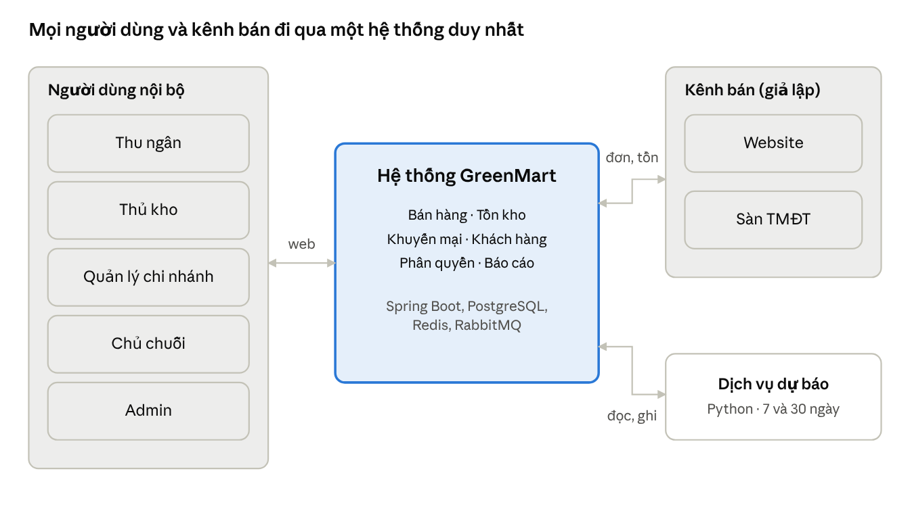

# SRS – Hệ thống GreenMart (DT03)

**Phiên bản:** 1.0 · **Ngày:** 27/10/2026 · **Người soạn:** Nguyễn Đỗ Khải (BA/Lead)

Tài liệu này đặc tả toàn bộ yêu cầu của hệ thống GreenMart: là căn cứ để 8 thành viên phát triển, để QA viết test và để hội đồng nghiệm thu. Mọi yêu cầu có mã định danh, độ ưu tiên và tiêu chí kiểm chứng; mọi thay đổi phải qua BA/Lead và được ghi vào lịch sử phiên bản ở cuối tài liệu.

## 1. Giới thiệu

### 1.1 Mục đích

Đặc tả yêu cầu chức năng, phi chức năng, dữ liệu và giao diện của hệ thống quản trị bán hàng đa kênh, tồn kho và dự báo nhu cầu cho chuỗi bán lẻ GreenMart (đề tài DT03). Người đọc: thành viên nhóm phát triển, giảng viên hướng dẫn, hội đồng chấm.

### 1.2 Phạm vi sản phẩm

GreenMart vận hành 3 cửa hàng và bán qua các kênh online nhưng đơn hàng, tồn kho mỗi nơi ghi riêng. Hệ thống mới đưa mọi kênh về một nguồn dữ liệu chung, ngăn bán vượt tồn kể cả khi nhiều đơn đồng thời, và dự báo nhu cầu 7 và 30 ngày để hỗ trợ nhập hàng.

| Trong phạm vi | Ngoài phạm vi |
| --- | --- |
| Sản phẩm, danh mục, khách hàng, khuyến mại | Kết nối thật với Shopee, Lazada, TikTok Shop |
| Bán tại quầy (POS) và đơn online qua mock connector | Thanh toán thật qua ngân hàng, ví điện tử |
| Thanh toán giả lập: tiền mặt, thẻ, QR | Kế toán, hóa đơn điện tử, giao vận |
| Tồn kho theo chi nhánh: nhập, xuất hủy, chuyển kho, kiểm kê | Ứng dụng di động riêng |
| Đồng bộ đơn và tồn với 2 kênh giả lập | Tự động đặt hàng nhà cung cấp |
| Dashboard doanh thu, cảnh báo tồn thấp | Chương trình tích điểm khách hàng |
| Dự báo nhu cầu 7/30 ngày, so sánh với baseline | Nhiều đơn vị tính, lô, hạn sử dụng theo lô |

### 1.3 Thuật ngữ và viết tắt

| Thuật ngữ | Định nghĩa |
| --- | --- |
| Chi nhánh (CN) | Một cửa hàng vật lý của GreenMart, đồng thời là một kho |
| Kênh bán | Nơi phát sinh đơn: POS, WEB (website), MARKET (sàn TMĐT) |
| SKU | Mã định danh duy nhất của một sản phẩm |
| Tồn thực (on\_hand) | Số lượng đang có vật lý tại chi nhánh |
| Tồn giữ chỗ (reserved) | Số lượng đã giữ cho đơn online chưa hoàn tất |
| Tồn khả dụng (available) | Tồn thực − tồn giữ chỗ; số lượng được phép bán |
| ROP | Điểm đặt hàng lại: ngưỡng tồn khả dụng mà dưới đó hệ thống cảnh báo |
| Connector | Thành phần chuyển đổi dữ liệu giữa hệ thống và một kênh bán |
| Mock connector | Connector giả lập kênh bán, có hợp đồng API cố định |
| Baseline | Phương pháp dự báo đơn giản làm mốc so sánh cho mô hình AI |
| MAE | Sai số tuyệt đối trung bình |
| WAPE | Tổng sai số tuyệt đối chia tổng thực tế, tính theo % |
| Idempotency-Key | Khóa gửi kèm yêu cầu để gửi lại nhiều lần vẫn chỉ xử lý một lần |
| FR / NFR / BR / AC | Yêu cầu chức năng / phi chức năng / quy tắc nghiệp vụ / tiêu chí nghiệm thu |

### 1.4 Tài liệu tham chiếu

- Đề bài DT03: Hệ thống quản trị bán hàng đa kênh, tồn kho và dự báo nhu cầu bằng AI cho SME.
- Tiêu chuẩn kỹ thuật chung và rubric đánh giá dự án tốt nghiệp.
- Tài liệu "DT03 – Phân tích nghiệp vụ chi tiết GreenMart": ví dụ số và luồng chi tiết.
- Tài liệu "DT03 – GreenMart Omnichannel: Tài liệu BA/Lead": kiến trúc và hợp đồng API.
- Tài liệu "DT03 – Kế hoạch 4 tuần" và Issues trên repo GitHub NguyenDokhai2005/GreenMart.
- IEEE 830-1998, Recommended Practice for Software Requirements Specifications.

## 2. Mô tả tổng quan

### 2.1 Bối cảnh sản phẩm

Hệ thống là sản phẩm mới, đứng giữa người dùng nội bộ của GreenMart và các kênh bán online; mọi đơn hàng và biến động kho đều đi qua một lõi xử lý chung.

Người dùng nội bộ dùng giao diện web; kênh bán gửi đơn và nhận tồn qua mock connector; dịch vụ dự báo đọc lịch sử bán và ghi kết quả vào cùng CSDL.

### 2.2 Chức năng chính

| Module | Chức năng |
| --- | --- |
| Xác thực và phân quyền | Đăng nhập, phân quyền theo vai trò và chi nhánh, nhật ký thao tác |
| Danh mục | Danh mục, sản phẩm, giá bán |
| Khách hàng | Hồ sơ khách hàng, lịch sử mua |
| Khuyến mại | Tạo chương trình, tự áp khuyến mại có lợi nhất |
| Bán hàng | Đơn POS, đơn online, thanh toán giả lập, hủy đơn, trả hàng |
| Tồn kho | Tồn theo chi nhánh, giữ chỗ, phiếu nhập/xuất/chuyển/kiểm kê, sổ giao dịch kho |
| Tích hợp kênh | Nhận đơn từ kênh, đẩy tồn và trạng thái đơn ra kênh |
| Báo cáo | Dashboard doanh thu, top sản phẩm, cảnh báo tồn thấp |
| Dự báo | Dự báo nhu cầu 7/30 ngày, gợi ý số lượng nhập |

### 2.3 Người dùng

| Vai trò | Mô tả | Phạm vi dữ liệu | Tần suất dùng |
| --- | --- | --- | --- |
| Admin | Quản trị người dùng, chi nhánh, kênh bán, cấu hình | Toàn chuỗi | Thỉnh thoảng |
| Chủ chuỗi (Owner) | Đặt giá, tạo khuyến mại, xem báo cáo và dự báo | Toàn chuỗi | Hằng ngày |
| Quản lý chi nhánh | Duyệt phiếu kho, xử lý đơn online, trả hàng, báo cáo | Chi nhánh được gán | Hằng ngày |
| Thu ngân | Bán tại quầy, tra cứu khách, tạo yêu cầu trả hàng | Chi nhánh được gán | Liên tục trong ca |
| Thủ kho | Lập phiếu nhập, xuất, chuyển, kiểm kê; đóng gói đơn online | Chi nhánh được gán | Hằng ngày |
| Kênh bán (hệ thống ngoài) | Gửi đơn, nhận cập nhật tồn và trạng thái | Theo cấu hình kênh | Tự động |

### 2.4 Môi trường vận hành

- Trình duyệt Chrome, Edge, Firefox bản mới; màn hình từ 360 px (điện thoại) đến máy tính quầy.
- Máy chủ chạy bằng Docker Compose: backend Spring Boot 3 (Java 21), PostgreSQL, Redis, RabbitMQ, dịch vụ Python (FastAPI) và frontend React.
- POS dùng được với bàn phím và máy quét mã vạch dạng bàn phím (USB HID).

### 2.5 Ràng buộc thiết kế và triển khai

- Công nghệ theo đề bài: Spring Boot, React, PostgreSQL, Redis, RabbitMQ, Python (scikit-learn/XGBoost/LightGBM), Docker.
- Thời gian 4 tuần (28/10 – 24/11/2026), 8 sinh viên.
- Kênh bán và thanh toán chỉ được giả lập; không dùng dữ liệu khách hàng thật.
- Mã nguồn quản lý trên GitHub, mọi thay đổi qua Pull Request có review.
- Giao diện tiếng Việt, tiền tệ VND (số nguyên), múi giờ Asia/Ho\_Chi\_Minh.

### 2.6 Giả định và phụ thuộc

- Giá bán đã gồm VAT; không xuất hóa đơn VAT.
- Mỗi sản phẩm có một đơn vị tính; không quản lý lô và hạn sử dụng theo lô.
- Dữ liệu lịch sử (3 chi nhánh, 1.000 sản phẩm, 10.000 đơn) được sinh giả lập có mùa vụ và khuyến mại.
- Đơn online được xử lý trọn tại một chi nhánh, không tách giao.
- Các giả định chưa được giảng viên xác nhận nằm trong Phụ lục A.

## 3. Yêu cầu chức năng

Hệ thống có 42 yêu cầu chức năng chia theo 10 nhóm; 33 yêu cầu mức Must bắt buộc phải có để nghiệm thu. Độ ưu tiên: **Must** bắt buộc, **Should** làm nếu còn thời gian ở tuần 4, **Could** chỉ làm khi dư thời gian.

### 3.1 Xác thực và phân quyền

| Mã | Yêu cầu | Ưu tiên |
| --- | --- | --- |
| AUTH-01 | Người dùng đăng nhập bằng tên đăng nhập và mật khẩu; hệ thống cấp access token (15 phút) và refresh token (7 ngày) | Must |
| AUTH-02 | Mọi API kiểm tra vai trò và chi nhánh được gán; người dùng chỉ đọc, ghi dữ liệu của chi nhánh mình (trừ Admin, Chủ chuỗi) | Must |
| AUTH-03 | Ghi nhật ký thao tác nhạy cảm: đổi giá, duyệt hoặc điều chỉnh kho, hủy đơn, đăng nhập thất bại | Must |
| AUTH-04 | Admin tạo, khóa tài khoản; gán vai trò và chi nhánh | Must |

### 3.2 Danh mục và sản phẩm

| Mã | Yêu cầu | Ưu tiên |
| --- | --- | --- |
| PRD-01 | Quản lý danh mục (có cấp cha–con) và sản phẩm: SKU duy nhất, barcode, tên, đơn vị, giá bán, giá vốn, trạng thái | Must |
| PRD-02 | Chỉ Chủ chuỗi được đổi giá bán; mọi lần đổi ghi nhật ký | Must |
| PRD-03 | Nhập hàng loạt sản phẩm từ file CSV | Could |

### 3.3 Khách hàng

| Mã | Yêu cầu | Ưu tiên |
| --- | --- | --- |
| CUS-01 | Quản lý khách hàng: tên, số điện thoại (duy nhất), email | Must |
| CUS-02 | Xem lịch sử mua hàng của khách trên mọi kênh | Must |

### 3.4 Khuyến mại

| Mã | Yêu cầu | Ưu tiên |
| --- | --- | --- |
| PRM-01 | Tạo chương trình: cấp đơn hoặc cấp sản phẩm, giảm % (có mức tối đa) hoặc số tiền, điều kiện tối thiểu, thời gian hiệu lực, phạm vi chi nhánh và kênh | Must |
| PRM-02 | Tự áp khuyến mại có lợi nhất cho khách khi tính tiền (BR-07) | Must |
| PRM-03 | Giới hạn tổng số lượt dùng một chương trình (BR-08) | Should |

### 3.5 Bán hàng và thanh toán

| Mã | Yêu cầu | Ưu tiên |
| --- | --- | --- |
| ORD-01 | Tạo đơn POS: quét sản phẩm, gắn khách, tính tiền, thanh toán và trừ tồn trong một giao dịch (UC-01) | Must |
| ORD-02 | Tiếp nhận đơn online từ kênh, phân bổ chi nhánh, giữ chỗ tồn (UC-02) | Must |
| ORD-03 | Quản lý vòng đời đơn online; tự chuyển EXPIRED và nhả giữ chỗ sau 15 phút chưa thanh toán | Must |
| ORD-04 | Hủy đơn chưa giao kèm lý do, nhả giữ chỗ, hoàn tiền giả lập (UC-03) | Must |
| ORD-05 | Trả hàng toàn phần hoặc một phần cho đơn đã hoàn tất (UC-04) | Should |
| ORD-06 | Tra cứu, lọc đơn theo kênh, chi nhánh, trạng thái, khoảng ngày, khách hàng | Must |
| ORD-07 | Hiển thị hóa đơn sau khi bán: mã đơn, chi nhánh, thu ngân, dòng hàng, chiết khấu, tổng, tiền thối | Must |
| PAY-01 | Thanh toán giả lập tiền mặt, thẻ, QR; giả lập được thành công, thất bại, quá thời gian (60 giây) | Must |

### 3.6 Tồn kho

| Mã | Yêu cầu | Ưu tiên |
| --- | --- | --- |
| INV-01 | Xem tồn thực, giữ chỗ, khả dụng theo sản phẩm × chi nhánh | Must |
| INV-02 | Phiếu nhập hàng từ nhà cung cấp, có bước duyệt (UC-05) | Must |
| INV-03 | Phiếu xuất hủy có lý do bắt buộc, không vượt tồn khả dụng (UC-06) | Must |
| INV-04 | Chuyển kho hai bước giữa chi nhánh, ghi chênh lệch khi nhận thiếu (UC-07) | Must |
| INV-05 | Kiểm kê và điều chỉnh theo chênh lệch, có duyệt (UC-08) | Should |
| INV-06 | Sổ giao dịch kho chỉ ghi thêm, truy vết tới chứng từ gốc (BR-06) | Must |
| INV-07 | Không để tồn khả dụng âm trong mọi tình huống đồng thời (BR-01, UC-09) | Must |

### 3.7 Tích hợp kênh bán

| Mã | Yêu cầu | Ưu tiên |
| --- | --- | --- |
| SYNC-01 | Mock connector cho 2 kênh WEB và MARKET, có giao diện đơn giản để tạo đơn giả | Must |
| SYNC-02 | Nhận đơn qua webhook có chữ ký HMAC; chống trùng theo (kênh, mã đơn kênh) | Must |
| SYNC-03 | Đẩy tồn khả dụng ra các kênh mỗi khi tồn thay đổi, kèm số phiên bản | Must |
| SYNC-04 | Báo trạng thái đơn về kênh khi trạng thái thay đổi | Must |
| SYNC-05 | Thử lại khi kênh lỗi (5 lần), ghi nhật ký đồng bộ, màn hình xem và gửi lại | Should |

### 3.8 Báo cáo và cảnh báo

| Mã | Yêu cầu | Ưu tiên |
| --- | --- | --- |
| DASH-01 | Dashboard doanh thu theo ngày, tuần, tháng; lọc theo chi nhánh và kênh | Must |
| DASH-02 | Top 10 sản phẩm bán chạy và bán chậm | Should |
| DASH-03 | Cảnh báo tồn thấp và hết hàng theo chi nhánh (BR-09) | Must |
| DASH-04 | Xuất báo cáo ra CSV | Could |

### 3.9 Dữ liệu và dự báo

| Mã | Yêu cầu | Ưu tiên |
| --- | --- | --- |
| AI-01 | Sinh dữ liệu lịch sử 12 tháng: 3 chi nhánh, 1.000 sản phẩm, 10.000 đơn, có mùa vụ và khuyến mại | Must |
| AI-02 | Tổng hợp bán ròng theo ngày × sản phẩm × chi nhánh (bảng `daily_sales`) | Must |
| AI-03 | Dự báo nhu cầu 7 và 30 ngày theo sản phẩm × chi nhánh, chạy tự động hằng đêm và theo yêu cầu | Must |
| AI-04 | Baseline và báo cáo MAE, WAPE của mô hình so với baseline | Must |
| AI-05 | Tính ROP và gợi ý số lượng nhập từ kết quả dự báo | Should |
| AI-06 | Màn hình dự báo so với thực tế và bảng gợi ý nhập | Should |

## 4. User story và tiêu chí chấp nhận

10 user story dưới đây bao các chức năng cốt lõi; tiêu chí dạng Given/When/Then được dùng trực tiếp làm test case. User story cho các yêu cầu còn lại nằm trong từng issue trên GitHub.

**US-01 · Bán tại quầy (ORD-01, PAY-01)** Là thu ngân, tôi muốn quét hàng và thu tiền trong một màn hình để khách không phải chờ.

- Given sản phẩm X có khả dụng 10, When tôi bán 2 và thanh toán tiền mặt, Then đơn COMPLETED, khả dụng còn 8, sổ kho có 1 giao dịch SALE −2.
- Given giỏ hàng 238.000 đ có KM giảm 15.000 đ cho gạo và KM 10% cho đơn từ 200.000 đ, When tôi tính tiền, Then tổng phải trả là 200.700 đ.
- Given mạng chập chờn, When tôi bấm Hoàn tất hai lần với cùng Idempotency-Key, Then chỉ có 1 đơn được tạo.

**US-02 · Không bán vượt tồn (INV-07)** Là chủ chuỗi, tôi muốn hệ thống không bao giờ nhận đơn vượt số hàng có để không phải hủy đơn của khách.

- Given sản phẩm còn khả dụng 5, When 100 yêu cầu mỗi cái mua 1 được gửi đồng thời từ POS và các kênh, Then đúng 5 yêu cầu thành công, 95 nhận lỗi 409 INSUFFICIENT\_STOCK, khả dụng = 0.
- Given hai đơn cùng chứa sản phẩm A và B theo thứ tự ngược nhau, When gửi đồng thời, Then không xảy ra deadlock và cả hai thành công nếu đủ tồn.

**US-03 · Nhận đơn online (ORD-02, SYNC-02)** Là quản lý chi nhánh, tôi muốn đơn từ website và sàn tự vào hệ thống và được giữ hàng để không phải nhập tay.

- Given khả dụng 10, When kênh WEB gửi đơn 3 cái hợp lệ, Then đơn RESERVED, giữ chỗ = 3, khả dụng = 7.
- Given đơn WEB-100 đã nhận, When kênh gửi lại WEB-100 lần nữa, Then không tạo đơn mới và không giữ chỗ thêm.
- Given chữ ký HMAC sai, When kênh gửi đơn, Then hệ thống trả 401 và không ghi gì.

**US-04 · Hết hạn giữ chỗ (ORD-03)** Là chủ chuỗi, tôi muốn hàng giữ cho đơn không thanh toán được trả lại để bán cho khách khác.

- Given đơn RESERVED giữ 3 cái lúc 10:00, When đến 10:15 chưa thanh toán, Then đơn EXPIRED, giữ chỗ giảm 3 trong vòng 1 phút, các kênh nhận tồn mới.

**US-05 · Đồng bộ tồn ra kênh (SYNC-03)** Là khách mua online, tôi muốn thấy đúng số hàng còn lại để không đặt phải món đã hết.

- Given tồn khả dụng thay đổi, When giao dịch commit, Then mỗi kênh nhận số tồn mới (tổng khả dụng các chi nhánh phục vụ − tồn an toàn 2) trong vòng 1 phút.
- Given RabbitMQ dừng 5 phút, When chạy lại, Then mọi cập nhật bị chậm được gửi bù, không mất cập nhật nào.

**US-06 · Chuyển kho (INV-04)** Là thủ kho, tôi muốn chuyển hàng sang chi nhánh khác có chứng từ để truy được trách nhiệm khi thiếu.

- Given CN1 có khả dụng 80, When phiếu chuyển 50 sang CN2 được duyệt xuất, Then tồn thực CN1 giảm 50, phiếu IN\_TRANSIT.
- Given phiếu IN\_TRANSIT 50 cái, When CN2 nhập số thực nhận 48, Then tồn CN2 tăng 48, phiếu RECEIVED với chênh lệch −2.

**US-07 · Duyệt phiếu kho (INV-02, BR-13)** Là quản lý chi nhánh, tôi muốn mọi thay đổi kho phải qua tôi duyệt để tránh sai sót và gian lận.

- Given phiếu nhập DRAFT do thủ kho A lập, When A tự duyệt, Then hệ thống từ chối.
- Given phiếu nhập 24 cái, When quản lý duyệt, Then tồn thực tăng 24 và sổ kho có giao dịch IMPORT +24.

**US-08 · Phân quyền theo chi nhánh (AUTH-02)** Là chủ chuỗi, tôi muốn nhân viên chỉ thao tác trên chi nhánh của họ để bảo vệ dữ liệu.

- Given thu ngân được gán CN1, When gọi API xem hoặc tạo đơn cho CN2, Then nhận 403 và nhật ký ghi lại lần truy cập bị từ chối.

**US-09 · Cảnh báo tồn thấp (DASH-03)** Là quản lý chi nhánh, tôi muốn biết món nào sắp hết để nhập kịp.

- Given ROP của sữa tại CN1 là 34, When khả dụng giảm từ 35 xuống 30, Then dashboard hiện cảnh báo "Tồn thấp".
- Given đang có cảnh báo, When nhập thêm 96 và khả dụng lên 126, Then cảnh báo tự đóng.

**US-10 · Dự báo nhu cầu (AI-03, AI-04)** Là chủ chuỗi, tôi muốn biết mỗi món sẽ bán bao nhiêu trong 7 và 30 ngày tới để lập kế hoạch nhập.

- Given dữ liệu 12 tháng, When chạy dự báo, Then mỗi sản phẩm × chi nhánh có số dự báo cho từng ngày trong 7 và 30 ngày tới.
- Given tập kiểm tra là 30 ngày cuối, When so sánh, Then WAPE của mô hình thấp hơn baseline tốt nhất ở cả hai tầm 7 và 30 ngày.

## 5. Đặc tả use case

Hệ thống có 10 use case chính; 3 use case quan trọng nhất được đặc tả đầy đủ bên dưới, các use case còn lại có luồng chi tiết và ví dụ số trong tài liệu Phân tích nghiệp vụ.

| Mã | Use case | Tác nhân chính | Yêu cầu |
| --- | --- | --- | --- |
| UC-01 | Bán tại quầy | Thu ngân | ORD-01, ORD-07, PAY-01, PRM-02 |
| UC-02 | Xử lý đơn online | Kênh bán, QL chi nhánh, Thủ kho | ORD-02, ORD-03, SYNC-02..04 |
| UC-03 | Hủy đơn | QL chi nhánh, Kênh bán | ORD-04 |
| UC-04 | Trả hàng | Thu ngân, QL chi nhánh | ORD-05 |
| UC-05 | Nhập hàng | Thủ kho, QL chi nhánh | INV-02 |
| UC-06 | Xuất hủy | Thủ kho, QL chi nhánh | INV-03 |
| UC-07 | Chuyển kho | Thủ kho, QL hai chi nhánh | INV-04 |
| UC-08 | Kiểm kê | Thủ kho, QL chi nhánh | INV-05 |
| UC-09 | Bán đồng thời sản phẩm sắp hết | Thu ngân, Kênh bán | INV-07 |
| UC-10 | Dự báo và gợi ý nhập | Hệ thống (hẹn giờ), Chủ chuỗi | AI-02..06, DASH-03 |

### 5.1 UC-01 · Bán tại quầy

| Mục | Nội dung |
| --- | --- |
| Tiền điều kiện | Thu ngân đã đăng nhập tại chi nhánh được gán |
| Hậu điều kiện thành công | Đơn COMPLETED, có bản ghi thanh toán, tồn thực giảm, sổ kho có giao dịch SALE cho từng dòng |
| Hậu điều kiện thất bại | Không có đơn, không thay đổi tồn |

**Luồng chính**

1. Thu ngân quét mã vạch hoặc tìm theo tên/SKU; hệ thống thêm dòng với giá hiện hành và hiện tồn khả dụng. Quét lại cùng mã thì tăng số lượng.
2. Thu ngân nhập số điện thoại khách (tuỳ chọn); chưa có thì tạo nhanh.
3. Sau mỗi thay đổi, hệ thống tính lại tạm tính, khuyến mại và tổng.
4. Thu ngân chọn phương thức thanh toán; tiền mặt thì nhập số khách đưa.
5. Thu ngân bấm Hoàn tất; trong một transaction hệ thống trừ tồn từng dòng, tạo đơn, ghi thanh toán, ghi sổ kho, tăng lượt dùng khuyến mại.
6. Hệ thống hiển thị hóa đơn.

**Luồng ngoại lệ**

| Mã | Tình huống | Xử lý |
| --- | --- | --- |
| 1a | Mã vạch không tồn tại hoặc sản phẩm ngừng bán | Báo lỗi, không thêm dòng |
| 1b | Số lượng lớn hơn tồn khả dụng | Cảnh báo ở dòng đó, không cho hoàn tất |
| 4a | Thẻ/QR thất bại hoặc quá 60 giây | Không tạo đơn, cho chọn phương thức khác |
| 4b | Tiền khách đưa nhỏ hơn tổng | Không cho hoàn tất |
| 5a | Tồn đã bị đơn khác lấy lúc bấm Hoàn tất | Huỷ transaction, trả 409 kèm dòng thiếu, giữ nguyên giỏ hàng |
| 5b | Khuyến mại hết hạn hoặc hết lượt đúng lúc hoàn tất | Tính lại tổng, yêu cầu xác nhận lại |
| 5c | Gửi lại do mất mạng | Cùng Idempotency-Key trả về đơn cũ |

### 5.2 UC-02 · Xử lý đơn online

| Mục | Nội dung |
| --- | --- |
| Tiền điều kiện | Kênh đã cấu hình: mã, khóa ký HMAC, chi nhánh mặc định, danh sách chi nhánh phục vụ; SKU của kênh đã ánh xạ |
| Hậu điều kiện thành công | Đơn COMPLETED, tồn thực giảm, giữ chỗ về 0, kênh nhận trạng thái và tồn mới |

**Luồng chính**

1. Connector nhận đơn, kiểm tra chữ ký, kiểm tra trùng theo (kênh, mã đơn kênh).
2. Đổi SKU kênh sang SKU nội bộ, gắn khách theo số điện thoại; đơn NEW.
3. Chọn chi nhánh theo BR-14, giữ chỗ mọi dòng trong một transaction; đơn RESERVED, hạn giữ chỗ = lúc nhận + 15 phút.
4. Thanh toán thành công trong hạn hoặc đơn COD; đơn CONFIRMED.
5. Thủ kho đóng gói, bàn giao và bấm Hoàn tất; đơn COMPLETED, tồn thực và giữ chỗ cùng giảm.
6. Mỗi lần đổi trạng thái, báo về kênh; mỗi lần tồn đổi, đẩy tồn mới ra mọi kênh.

**Bảng chuyển trạng thái đơn online**

| Từ | Sang | Điều kiện | Tác động kho |
| --- | --- | --- | --- |
| (mới) | NEW | Webhook hợp lệ, không trùng | Không |
| NEW | RESERVED | Giữ chỗ đủ mọi dòng | reserved tăng |
| NEW | REJECTED | Không chi nhánh nào đủ hàng, hoặc SKU chưa ánh xạ | Không |
| RESERVED | CONFIRMED | Đã thanh toán hoặc COD | Không |
| RESERVED | EXPIRED | Quá 15 phút chưa thanh toán | reserved giảm |
| RESERVED, CONFIRMED | CANCELLED | Kênh, khách hoặc QL huỷ kèm lý do | reserved giảm |
| CONFIRMED | COMPLETED | Đã bàn giao | on\_hand và reserved cùng giảm |
| COMPLETED | RETURNED | Trả toàn bộ đơn | on\_hand tăng (nếu hàng bán lại được) |

### 5.3 UC-09 · Bán đồng thời sản phẩm sắp hết

| Mục | Nội dung |
| --- | --- |
| Tình huống | Sản phẩm X tại chi nhánh A còn khả dụng 5; nhiều yêu cầu mua từ POS và các kênh đến cùng lúc |
| Kết quả bắt buộc | Tổng số lượng được chấp nhận ≤ 5; khả dụng không bao giờ âm; số giao dịch trong sổ kho khớp số đơn thành công |
| Cách đáp ứng | Mỗi yêu cầu kiểm tra và trừ tồn trong một câu lệnh cập nhật có điều kiện (khả dụng ≥ số lượng); 0 dòng được cập nhật = hết hàng. Đơn nhiều dòng cập nhật theo thứ tự mã sản phẩm tăng dần để tránh deadlock. Ràng buộc CHECK trong CSDL là lớp bảo vệ cuối. |
| Kiểm chứng | 100 yêu cầu song song mỗi cái mua 1 → đúng 5 thành công, 95 nhận 409; lặp lại với số lượng lẫn 1–3 và trộn POS với online |

## 6. Quy tắc nghiệp vụ

19 quy tắc dưới đây áp dụng cho mọi kênh và mọi module; code vi phạm quy tắc nào được xem là lỗi, kể cả khi giao diện chạy đúng.

| Mã | Nhóm | Quy tắc |
| --- | --- | --- |
| BR-01 | Tồn kho | Tồn khả dụng = tồn thực − tồn giữ chỗ và không bao giờ âm; kiểm tra và cập nhật trong một câu lệnh nguyên tử. Ràng buộc: on\_hand ≥ 0, reserved ≥ 0, reserved ≤ on\_hand |
| BR-02 | Bán hàng | Đơn POS trừ tồn thực ngay khi hoàn tất, không qua giữ chỗ |
| BR-03 | Bán hàng | Đơn online giữ chỗ khi tạo; hạn giữ chỗ cho đơn chưa thanh toán là 15 phút (cấu hình được) |
| BR-04 | Bán hàng | Hủy, hết hạn hoặc bị từ chối → nhả toàn bộ giữ chỗ của đơn; hoàn lượt dùng khuyến mại |
| BR-05 | Tích hợp | Mỗi đơn từ kênh là duy nhất theo cặp (kênh, mã đơn của kênh); gửi lại trả về đơn cũ |
| BR-06 | Tồn kho | Sổ giao dịch kho chỉ ghi thêm, không sửa, không xóa; sai sót sửa bằng phiếu điều chỉnh |
| BR-07 | Khuyến mại | Mỗi dòng áp tối đa 1 KM cấp sản phẩm; mỗi đơn áp tối đa 1 KM cấp đơn, tính trên tổng sau giảm dòng; chọn cái giảm nhiều nhất, hòa thì chọn cái hết hạn sớm hơn; số tiền giảm làm tròn xuống đến đồng |
| BR-08 | Khuyến mại | Lượt dùng khuyến mại có giới hạn được trừ nguyên tử như tồn kho |
| BR-09 | Cảnh báo | Hết hàng khi khả dụng = 0; tồn thấp khi 0 < khả dụng ≤ ROP. Mỗi sản phẩm × chi nhánh có tối đa 1 cảnh báo mở, tự đóng khi khả dụng > ROP |
| BR-10 | Trả hàng | Trả trong 7 ngày kể từ khi hoàn tất; hàng tươi sống chỉ nhận trả khi lỗi chất lượng. Tiền hoàn theo giá thực trả của dòng, KM cấp đơn phân bổ theo tỷ lệ giá trị dòng. Hàng bán lại được thì cộng tồn chi nhánh nhận trả |
| BR-11 | Phân quyền | Người dùng chỉ thao tác dữ liệu của chi nhánh được gán, trừ Admin và Chủ chuỗi |
| BR-12 | Bán hàng | Giá bán và chiết khấu được chụp vào dòng đơn tại thời điểm bán; đổi giá sau đó không ảnh hưởng đơn cũ |
| BR-13 | Tồn kho | Người lập phiếu không được tự duyệt phiếu của mình; tồn chỉ thay đổi tại bước duyệt (hoặc bước nhận với chuyển kho) |
| BR-14 | Tích hợp | Phân bổ đơn online: chi nhánh mặc định của kênh nếu đủ hàng cho cả đơn; nếu không, chi nhánh phục vụ có đủ hàng và tổng khả dụng cao nhất; không có thì REJECTED. Không tách đơn |
| BR-15 | Tích hợp | Tồn đẩy ra kênh = tổng khả dụng của các chi nhánh phục vụ kênh − tồn an toàn (mặc định 2), không âm; kênh bỏ qua bản cập nhật có số phiên bản cũ hơn |
| BR-16 | Tồn kho | Chuyển kho: tồn nguồn giảm khi xuất, tồn đích tăng theo số thực nhận; chênh lệch ghi trên phiếu và vào báo cáo hao hụt |
| BR-17 | Tồn kho | Kiểm kê điều chỉnh bằng chênh lệch so với số đã chụp lúc tạo phiếu, không ghi đè trực tiếp |
| BR-18 | Báo cáo | Doanh thu và dữ liệu dự báo chỉ tính đơn COMPLETED theo ngày hoàn tất; trả hàng trừ vào ngày trả; đơn CANCELLED, EXPIRED, REJECTED không tính |
| BR-19 | Bán hàng | Thu ngân không sửa được giá trên đơn; giảm giá ngoài chương trình chỉ QL chi nhánh làm và phải nhập lý do |

## 7. Yêu cầu dữ liệu

Dữ liệu lưu trong PostgreSQL, quản lý schema bằng migration Flyway; backend sở hữu các bảng nghiệp vụ, dịch vụ dự báo sở hữu 3 bảng `daily_sales`, `forecast_run`, `forecast_result` và chỉ đọc phần còn lại.

### 7.1 Thực thể chính

| Thực thể | Trường chính | Ràng buộc |
| --- | --- | --- |
| branch | id, code, name, address, is\_active | code duy nhất |
| app\_user | id, username, password\_hash, full\_name, role, is\_active | username duy nhất; gán chi nhánh qua user\_branch |
| category | id, name, parent\_id | cha–con, không tạo vòng lặp |
| product | id, sku, barcode, name, unit, category\_id, sale\_price, cost\_price, is\_active | sku duy nhất; giá ≥ 0 |
| customer | id, phone, name, email | phone duy nhất |
| promotion | id, code, type, level, value, max\_discount, min\_order, start\_at, end\_at, usage\_limit, used\_count, status | end\_at > start\_at; used\_count ≤ usage\_limit |
| sales\_channel | id, code (POS/WEB/MARKET), default\_branch\_id, webhook\_secret, safety\_stock | code duy nhất |
| channel\_product | channel\_id, product\_id, external\_sku | duy nhất theo (channel\_id, external\_sku) |
| sales\_order | id, code, channel\_id, external\_order\_id, branch\_id, customer\_id, status, subtotal, discount, total, reserved\_until, completed\_at | duy nhất theo (channel\_id, external\_order\_id) |
| order\_item | id, order\_id, product\_id, quantity, unit\_price, discount, line\_total, promotion\_id | quantity > 0 |
| payment | id, order\_id, method, amount, status, paid\_at | amount ≥ 0 |
| inventory | branch\_id, product\_id, on\_hand, reserved, reorder\_point, version | khóa (branch\_id, product\_id); CHECK on\_hand ≥ 0, reserved ≥ 0, reserved ≤ on\_hand |
| inventory\_transaction | id, branch\_id, product\_id, type, quantity, balance\_after, ref\_type, ref\_id, created\_by, created\_at | chỉ INSERT |
| stock\_document (+ item) | id, code, type, branch\_id, to\_branch\_id, status, created\_by, approved\_by; dòng: product\_id, quantity, received\_quantity, unit\_cost | approved\_by ≠ created\_by |
| return\_document (+ item) | id, order\_id, branch\_id, reason, refund\_amount, status; dòng: order\_item\_id, quantity, condition | tổng số trả ≤ số đã mua |
| audit\_log | id, user\_id, action, entity, entity\_id, detail, created\_at | chỉ INSERT |
| outbox\_event, sync\_log | sự kiện chờ gửi; nhật ký đồng bộ với kênh |  |
| daily\_sales | sale\_date, branch\_id, product\_id, qty\_sold, qty\_returned, qty\_net, revenue, promo\_flag, promo\_discount\_pct, stockout | khóa (sale\_date, branch\_id, product\_id) |
| forecast\_run, forecast\_result | lần chạy (model, MAE, WAPE của mô hình và baseline); kết quả (run\_id, branch\_id, product\_id, horizon 7/30, target\_date, predicted\_qty) |  |

### 7.2 Giá trị liệt kê

- `sales_order.status`: NEW, RESERVED, CONFIRMED, COMPLETED, CANCELLED, EXPIRED, REJECTED, RETURNED.
- `inventory_transaction.type`: IMPORT, EXPORT, SALE, RESERVE, RELEASE, RETURN, TRANSFER\_OUT, TRANSFER\_IN, ADJUST.
- `stock_document.type`: IMPORT, EXPORT, TRANSFER, ADJUST; `status`: DRAFT, APPROVED, IN\_TRANSIT, RECEIVED, CANCELLED.
- `promotion.type`: PERCENT, AMOUNT; `level`: ORDER, ITEM; `status`: DRAFT, ACTIVE, PAUSED, ENDED.
- `payment.method`: CASH, CARD, QR; `app_user.role`: ADMIN, OWNER, BRANCH\_MANAGER, CASHIER, STOREKEEPER.

### 7.3 Quy ước dữ liệu

- Tiền là số nguyên VND (BIGINT), không dùng số thực.
- Thời gian lưu dạng `timestamptz`; ngày báo cáo và dự báo tính theo giờ Việt Nam.
- Không xóa cứng sản phẩm, khách hàng, người dùng đã có giao dịch; chỉ chuyển `is_active = false`.

### 7.4 Dữ liệu mẫu và sao lưu

- Script seed tạo 3 chi nhánh (tỷ lệ đơn 45/35/20%), 1.000 sản phẩm (quy luật 80/20), 10.000 đơn COMPLETED trong 12 tháng có mùa vụ, trước Tết và khuyến mại; tài khoản demo cho 5 vai trò × 3 chi nhánh.
- Seed chạy lại được bằng một lệnh với random seed cố định, cho kết quả giống nhau mỗi lần.
- Có script sao lưu (`pg_dump`) và khôi phục, đã thử khôi phục vào CSDL trống.

## 8. Yêu cầu giao diện ngoài

Hệ thống có 4 loại giao diện: màn hình người dùng, REST API nội bộ, hợp đồng với kênh bán và hợp đồng với dịch vụ dự báo. Chi tiết từng endpoint nằm trong file `openapi.yaml` trên repo; phần này chỉ nêu yêu cầu.

### 8.1 Giao diện người dùng

| Khu vực | Màn hình | Người dùng |
| --- | --- | --- |
| Chung | Đăng nhập, đổi mật khẩu, chọn chi nhánh làm việc | Tất cả |
| POS | Bán hàng, hóa đơn, trả hàng, tra cứu khách | Thu ngân, QL chi nhánh |
| Đơn hàng | Danh sách đơn, chi tiết đơn, xử lý đơn online | QL chi nhánh, Thủ kho, Owner |
| Danh mục | Sản phẩm, danh mục, khách hàng, khuyến mại | Owner (sửa), các vai trò khác (xem) |
| Kho | Tồn kho, phiếu nhập, xuất hủy, chuyển kho, kiểm kê, sổ giao dịch | Thủ kho, QL chi nhánh |
| Báo cáo | Dashboard, cảnh báo tồn thấp, dự báo và gợi ý nhập | Owner, QL chi nhánh |
| Quản trị | Người dùng, chi nhánh, kênh bán, nhật ký đồng bộ | Admin |

Yêu cầu chung: giao diện tiếng Việt; ẩn chức năng không đủ quyền và chặn truy cập thẳng qua URL; kiểm tra dữ liệu nhập trước khi gửi; thông báo lỗi nói rõ cần làm gì; màn POS thao tác được hoàn toàn bằng bàn phím và máy quét.

### 8.2 REST API nội bộ

- Base path `/api/v1`, JSON, tên trường camelCase, thời gian ISO 8601 có múi giờ.
- Xác thực bằng header `Authorization: Bearer <JWT>`.
- Phân trang `?page=&size=&sort=`; trả về `content`, `page`, `size`, `totalElements`.
- API tạo đơn và thanh toán nhận header `Idempotency-Key`, lưu 24 giờ.
- Lỗi theo một định dạng: `code`, `message`, `details`, `traceId`. Mã HTTP: 400 dữ liệu sai, 401 chưa đăng nhập, 403 không đủ quyền, 404 không tìm thấy, 409 xung đột (hết hàng, trùng), 422 vi phạm quy tắc nghiệp vụ.

### 8.3 Giao diện với kênh bán (mock connector)

| Chiều | Giao diện | Nội dung |
| --- | --- | --- |
| Kênh → hệ thống | `POST /api/v1/integrations/{channelCode}/orders` | Mã đơn kênh, thời gian, khách (tên, sĐT), dòng hàng (SKU kênh, số lượng, đơn giá), phí giao, phương thức thanh toán; chữ ký HMAC-SHA256 ở header `X-Signature`. Trả 202 khi nhận, 200 kèm đơn cũ nếu trùng, 409 nếu hết hàng |
| Hệ thống → kênh | `PUT /mock/{channelCode}/stock` | Danh sách (SKU kênh, số khả dụng, số phiên bản) |
| Hệ thống → kênh | `PUT /mock/{channelCode}/orders/{externalOrderId}/status` | Trạng thái mới và lý do (nếu hủy, từ chối) |

Gửi ra kênh thất bại thì thử lại 5 lần (1, 2, 4, 8, 16 giây), sau đó chuyển vào hàng đợi lỗi.

### 8.4 Giao diện với dịch vụ dự báo

- Dịch vụ Python đọc dữ liệu trực tiếp từ PostgreSQL bằng tài khoản chỉ đọc và ghi kết quả vào `forecast_run`, `forecast_result`.
- Tự chạy lúc 02:00 hằng đêm. Chạy theo yêu cầu: `POST /forecast/run` trả `runId` ngay và chạy nền; `GET /forecast/runs/{runId}` trả trạng thái và MAE, WAPE.
- Chạy xong phát sự kiện `forecast.completed` lên RabbitMQ.

### 8.5 Sự kiện nội bộ (RabbitMQ)

| Sự kiện | Phát bởi | Nhận bởi |
| --- | --- | --- |
| order.created, order.completed, order.cancelled | Bán hàng | Báo cáo, tích hợp kênh |
| stock.changed | Tồn kho | Tích hợp kênh, báo cáo |
| stock.low | Tồn kho | Báo cáo (cảnh báo) |
| forecast.completed | Dịch vụ dự báo | Backend (đọc kết quả, tính ROP) |

Sự kiện được ghi vào bảng outbox trong cùng transaction với thay đổi dữ liệu rồi mới đẩy đi, nên không mất sự kiện khi RabbitMQ tạm lỗi.

## 9. Yêu cầu phi chức năng

Các ngưỡng hiệu năng là giả định của nhóm, đo trên môi trường Docker Compose với dữ liệu 10.000 đơn; các yêu cầu còn lại bám theo tiêu chuẩn kỹ thuật chung của môn học.

| Mã | Nhóm | Yêu cầu | Cách đo |
| --- | --- | --- | --- |
| NFR-01 | Hiệu năng | API đọc p95 < 300 ms, API tạo đơn p95 < 500 ms với 50 người dùng đồng thời | k6 |
| NFR-02 | Hiệu năng | Tồn mới đến kênh và đơn hết hạn được nhả giữ chỗ trong vòng 1 phút | Test tích hợp |
| NFR-03 | Nhất quán | Không tồn âm trong mọi tình huống đồng thời; không tạo đơn trùng | k6, test UC-09 |
| NFR-04 | Tin cậy | Sự kiện gửi ít nhất một lần qua outbox; phía nhận xử lý idempotent; không mất cập nhật khi RabbitMQ dừng 5 phút | Test tắt RabbitMQ |
| NFR-05 | Bảo mật | Mật khẩu BCrypt; JWT 15 phút, refresh 7 ngày; kiểm tra quyền ở backend cho mọi API | Test phân quyền |
| NFR-06 | Bảo mật | Chống SQL injection (truy vấn tham số), không lộ stack trace trong lỗi, CORS giới hạn nguồn, khóa 15 phút sau 5 lần đăng nhập sai | Kiểm tra OWASP cơ bản |
| NFR-07 | Bảo mật | Không commit mật khẩu, khóa vào repo; secrets qua biến môi trường; CI quét bằng gitleaks | CI |
| NFR-08 | Truy vết | Nhật ký thao tác nhạy cảm (AUTH-03); log JSON có correlation ID xuyên suốt HTTP và RabbitMQ | Xem log |
| NFR-09 | Vận hành | Khởi động toàn bộ bằng `docker compose up`; health check cho mọi service; có hướng dẫn triển khai và khôi phục sự cố | Demo |
| NFR-10 | Triển khai | Môi trường staging tự cập nhật khi merge vào `develop`; CI build và test mọi PR | GitHub Actions |
| NFR-11 | Chất lượng mã | Unit test cho nghiệp vụ lõi ≥ 70% dòng ở module bán hàng và tồn kho; có integration test, E2E cho 2 luồng chính và negative test | Báo cáo coverage |
| NFR-12 | Khả dụng | Giao diện dùng được từ màn 360 px; POS hoàn tất một đơn 3 món trong dưới 30 giây | Thử thủ công |
| NFR-13 | Bảo trì | Code theo module, chỉ gọi nhau qua interface hoặc sự kiện; mọi thay đổi qua PR có review, commit gắn mã issue | Review |
| NFR-14 | Dữ liệu | Schema quản lý bằng migration; có sao lưu và khôi phục đã thử | Demo khôi phục |

## 10. Tiêu chí nghiệm thu và ma trận truy vết

Sản phẩm đạt khi cả 6 tiêu chí dưới đây được chứng minh trước hội đồng; mỗi tiêu chí truy ngược về yêu cầu, user story và thành viên phụ trách.

| Mã | Tiêu chí | Cách chứng minh | Yêu cầu liên quan | User story | Phụ trách |
| --- | --- | --- | --- | --- | --- |
| AC-01 | Có 3 chi nhánh, 1.000 sản phẩm, 10.000 đơn lịch sử | Chạy script seed, truy vấn đếm trước hội đồng | AI-01 | — | SV06 |
| AC-02 | Không tồn âm khi giao dịch đồng thời | k6: 100 yêu cầu song song vào sản phẩm còn 5 → đúng 5 thành công | INV-07, ORD-01, ORD-02 | US-02 | SV03, SV08 |
| AC-03 | Đơn online đồng bộ hai chiều | Kênh gửi đơn → tồn giảm → kênh khác nhận tồn mới; gửi trùng không tạo đơn thứ hai | SYNC-01..04, ORD-02, ORD-03 | US-03, US-04, US-05 | SV07, SV02 |
| AC-04 | Phân quyền đúng | Thu ngân CN1 gọi API của CN2 → 403 | AUTH-01, AUTH-02 | US-08 | SV08 |
| AC-05 | Dự báo 7 và 30 ngày tốt hơn baseline | Báo cáo MAE, WAPE của mô hình và baseline trên 30 ngày cuối | AI-02, AI-03, AI-04 | US-10 | SV06 |
| AC-06 | Dashboard và cảnh báo tồn thấp | Bán đến dưới ROP → cảnh báo hiện; nhập thêm → cảnh báo đóng | DASH-01, DASH-03, INV-02 | US-07, US-09 | SV05, SV03 |

Ngoài 6 tiêu chí, hội đồng đánh giá theo rubric: đáp ứng nghiệp vụ, tích hợp hệ thống, chất lượng/kiểm thử/bảo mật (NFR-01..14), kỹ thuật và minh chứng cá nhân, bảo vệ, quản lý dự án và tác phong. Ma trận chi tiết yêu cầu ↔ issue ↔ test case do BA/Lead và QA cập nhật trong tuần 3.

## Phụ lục A. Câu hỏi mở

Các giá trị dưới đây đang là giả định của nhóm; khi giảng viên hoặc buổi họp nhóm chốt khác, cập nhật cột Quyết định và các mục liên quan.

| Câu hỏi | Giả định hiện tại | Mục bị ảnh hưởng | Quyết định |
| --- | --- | --- | --- |
| Thời hạn giữ chỗ đơn online chưa thanh toán? | 15 phút | BR-03, ORD-03 |  |
| Đơn online có được tách giao từ nhiều chi nhánh? | Không | BR-14 |  |
| Thời hạn và điều kiện trả hàng? | 7 ngày, hàng tươi sống chỉ trả khi lỗi | BR-10, ORD-05 |  |
| Có cộng dồn nhiều khuyến mại cấp đơn? | Không | BR-07 |  |
| Giá đã gồm VAT, có xuất hóa đơn VAT? | Đã gồm, không xuất | 2.6 |  |
| Tồn an toàn khi đẩy ra kênh? | 2 đơn vị | BR-15 |  |
| Thời gian chờ hàng về và chu kỳ đặt hàng khi tính ROP? | 2 ngày và 7 ngày | AI-05 |  |
| Dữ liệu lịch sử tự sinh hay do giảng viên cung cấp? | Tự sinh | AI-01 |  |
| Ngưỡng hiệu năng có theo con số cụ thể của giảng viên? | p95 < 300/500 ms | NFR-01 |  |
| Giả lập những kênh nào? | Website riêng và một sàn TMĐT | SYNC-01 |  |

## Phụ lục B. Lịch sử phiên bản

| Phiên bản | Ngày | Người sửa | Nội dung |
| --- | --- | --- | --- |
| 1.0 | 27/10/2026 | BA/Lead | Phiên bản đầu tiên: 42 yêu cầu chức năng, 14 phi chức năng, 19 quy tắc nghiệp vụ, 10 use case, 6 tiêu chí nghiệm thu |
