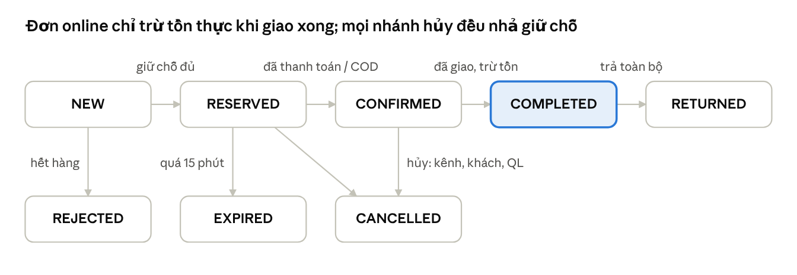

# DT03 – Phân tích nghiệp vụ chi tiết GreenMart

**Ngày:** 26/10/2026 · **Người soạn:** Nguyễn Đỗ Khải (BA/Lead)

Tài liệu đặc tả từng nghiệp vụ của GreenMart đủ chi tiết để backend, frontend và QA làm và kiểm thử mà không phải hỏi lại: mỗi quy trình có tác nhân, điều kiện, các bước, ngoại lệ, quy tắc và ví dụ số. Mã quy tắc (BR) và trạng thái dùng thống nhất với tài liệu SRS tổng.

## 1. Hiện trạng và mục tiêu

GreenMart có 3 cửa hàng và bán thêm qua website, sàn TMĐT; mỗi nơi ghi đơn và tồn riêng, nên thường bán vượt số hàng thực có và nhập hàng theo cảm tính.

| Vấn đề hiện tại (giả định)                              | Hậu quả                                         | Hệ thống mới giải quyết                                            |
|---------------------------------------------------------|-------------------------------------------------|--------------------------------------------------------------------|
| Tồn kho mỗi kênh ghi riêng, cập nhật thủ công cuối ngày | Bán vượt tồn, phải hủy đơn online, mất khách    | Một nguồn tồn duy nhất; tồn khả dụng đẩy ra kênh ngay khi thay đổi |
| Đơn online nhập tay vào sổ cửa hàng                     | Sai sót, trễ xử lý, trùng đơn                   | Đơn từ kênh vào thẳng hệ thống, chống trùng theo mã đơn của kênh   |
| Chuyển hàng giữa cửa hàng không có chứng từ             | Lệch số, không truy được ai chuyển              | Phiếu chuyển kho hai bước có duyệt và ghi chênh lệch               |
| Khuyến mại áp tay tại quầy                              | Áp sai, áp chồng, không đo được hiệu quả        | Hệ thống tự áp theo quy tắc, ghi lại trên từng đơn                 |
| Nhập hàng theo kinh nghiệm                              | Lúc thiếu hàng bán chạy, lúc tồn đọng hàng chậm | Dự báo 7/30 ngày và gợi ý số lượng nhập                            |
| Báo cáo doanh thu tổng hợp bằng Excel                   | Chậm, không xem theo kênh hay chi nhánh         | Dashboard theo ngày, chi nhánh, kênh, sản phẩm                     |

**Mục tiêu nghiệp vụ**

1.  Không còn đơn bị hủy vì hết hàng sau khi đã nhận (tồn khả dụng không bao giờ âm).

2.  Mọi biến động kho đều có chứng từ và truy được người thực hiện.

3.  Quản lý xem được doanh thu và cảnh báo tồn thấp theo thời gian thực.

4.  Gợi ý nhập hàng dựa trên dự báo có sai số thấp hơn cách làm đơn giản hiện nay (baseline).

## 2. Tác nhân và ma trận phân quyền

Có 5 vai trò người dùng và 1 tác nhân hệ thống; quyền được giới hạn theo chi nhánh được gán, trừ Admin và Quản lý chuỗi xem toàn chuỗi.

| Vai trò               | Mô tả                                                               | Phạm vi dữ liệu    |
|-----------------------|---------------------------------------------------------------------|--------------------|
| Admin                 | Quản trị kỹ thuật: người dùng, chi nhánh, kênh bán, cấu hình        | Toàn chuỗi         |
| Quản lý chuỗi (Owner) | Chủ GreenMart: giá, khuyến mại, báo cáo, dự báo                     | Toàn chuỗi         |
| Quản lý chi nhánh     | Điều hành một cửa hàng: duyệt phiếu kho, xử lý đơn online, trả hàng | Chi nhánh được gán |
| Thu ngân              | Bán tại quầy, tra cứu khách, tạo yêu cầu trả hàng                   | Chi nhánh được gán |
| Thủ kho               | Lập phiếu nhập, xuất, chuyển, kiểm kê; đóng gói đơn online          | Chi nhánh được gán |
| Kênh bán (hệ thống)   | Gửi đơn, nhận cập nhật tồn qua connector                            | Theo cấu hình kênh |

**Ma trận quyền** (X = được phép toàn chuỗi, CN = chỉ chi nhánh mình, D = được duyệt, Xem = chỉ xem, trống = không)

| Chức năng                                       | Admin | Owner | QL chi nhánh | Thu ngân         | Thủ kho    |
|-------------------------------------------------|-------|-------|--------------|------------------|------------|
| Quản lý người dùng, chi nhánh, kênh             | X     | Xem   |              |                  |            |
| Tạo/sửa sản phẩm, danh mục                      | X     | X     | Xem          | Xem              | Xem        |
| Sửa giá bán                                     |       | X     |              |                  |            |
| Tạo/sửa khách hàng                              |       | X     | CN           | CN               |            |
| Tạo/sửa khuyến mại                              |       | X     | Xem          | Xem              |            |
| Bán tại quầy (POS)                              |       |       | CN           | CN               |            |
| Xử lý đơn online (xác nhận, đóng gói, hoàn tất) |       | X     | CN           |                  | CN         |
| Hủy đơn                                         |       | X     | CN           |                  |            |
| Trả hàng                                        |       | X     | CN, D        | CN (tạo yêu cầu) |            |
| Lập phiếu nhập, xuất hủy, kiểm kê               |       |       | CN           |                  | CN         |
| Duyệt phiếu nhập, xuất hủy, kiểm kê             |       | X     | CN, D        |                  |            |
| Lập phiếu chuyển kho                            |       |       | CN           |                  | CN (nguồn) |
| Nhận hàng chuyển kho                            |       |       | CN           |                  | CN (đích)  |
| Xem tồn kho                                     | X     | X     | CN           | CN               | CN         |
| Xem dashboard, báo cáo doanh thu                |       | X     | CN           |                  |            |
| Xem dự báo, gợi ý nhập                          |       | X     | CN           |                  | CN         |
| Chạy lại dự báo                                 | X     | X     |              |                  |            |
| Xem sync log, gửi lại đồng bộ                   | X     | Xem   |              |                  |            |

Người lập phiếu không được tự duyệt phiếu của mình (tách người lập và người duyệt).

## 3. Bán tại quầy (POS) – UC-01

Đơn POS được tạo, thanh toán và trừ tồn trong một bước duy nhất; nếu bất kỳ dòng nào thiếu tồn thì toàn bộ đơn không được tạo.

| Mục                      | Nội dung                                                                                                 |
|--------------------------|----------------------------------------------------------------------------------------------------------|
| Tác nhân                 | Thu ngân (chính), Quản lý chi nhánh                                                                      |
| Kích hoạt                | Khách mang hàng ra quầy thanh toán                                                                       |
| Tiền điều kiện           | Thu ngân đã đăng nhập, đã mở ca tại chi nhánh được gán                                                   |
| Hậu điều kiện thành công | Đơn ở trạng thái COMPLETED, có bản ghi thanh toán, tồn thực giảm, sổ kho có giao dịch SALE cho từng dòng |
| Hậu điều kiện thất bại   | Không có đơn, không có thay đổi tồn                                                                      |

**Luồng chính**

1.  Thu ngân quét mã vạch hoặc tìm theo tên/SKU. Hệ thống thêm dòng với giá bán hiện hành, số lượng 1, và hiển thị tồn khả dụng tại chi nhánh.

2.  Quét lại cùng sản phẩm thì tăng số lượng dòng đó, không tạo dòng mới.

3.  Thu ngân nhập số điện thoại khách (tùy chọn). Có trong hệ thống thì gắn khách; chưa có thì tạo nhanh với tên + số điện thoại.

4.  Sau mỗi thay đổi giỏ hàng, hệ thống tính lại tạm tính, khuyến mại và tổng tiền (xem mục 7).

5.  Thu ngân chọn phương thức: tiền mặt, thẻ hoặc QR.

6.  Tiền mặt: nhập số tiền khách đưa, hệ thống tính tiền thối. Thẻ/QR: hệ thống gọi thanh toán giả lập và chờ kết quả.

7.  Thu ngân bấm Hoàn tất. Hệ thống trong cùng một transaction: kiểm tra và trừ tồn từng dòng, tạo đơn và dòng đơn, ghi thanh toán, ghi sổ kho, tăng lượt dùng khuyến mại.

8.  Hệ thống hiển thị hóa đơn (mã đơn, chi nhánh, thu ngân, thời gian, dòng hàng, chiết khấu, tổng, phương thức, tiền thối).

**Luồng ngoại lệ**

| Mã  | Tình huống                                          | Xử lý                                                                                      |
|-----|-----------------------------------------------------|--------------------------------------------------------------------------------------------|
| E1  | Mã vạch không tồn tại hoặc sản phẩm ngừng bán       | Báo lỗi, không thêm dòng                                                                   |
| E2  | Số lượng nhập lớn hơn tồn khả dụng                  | Cảnh báo ngay ở dòng đó; không cho hoàn tất cho tới khi giảm số lượng                      |
| E3  | Lúc bấm Hoàn tất tồn đã bị đơn khác lấy mất         | Hủy toàn bộ transaction, báo dòng thiếu và số còn lại; giỏ hàng giữ nguyên để thu ngân sửa |
| E4  | Thanh toán thẻ/QR giả lập thất bại hoặc quá 60 giây | Không tạo đơn; cho chọn phương thức khác                                                   |
| E5  | Tiền khách đưa nhỏ hơn tổng                         | Không cho hoàn tất                                                                         |
| E6  | Khuyến mại hết hạn hoặc hết lượt ngay lúc hoàn tất  | Tính lại tổng, hiển thị số mới, yêu cầu thu ngân xác nhận lại                              |
| E7  | Mất mạng giữa chừng, thu ngân bấm lại               | Yêu cầu gửi kèm cùng Idempotency-Key nên không tạo đơn thứ hai                             |

**Quy tắc riêng của POS**

- Giá bán đã gồm VAT (giả định); tiền là số nguyên VND.

- Thu ngân không được sửa giá trên đơn; giảm giá ngoài chương trình chỉ Quản lý chi nhánh làm và phải nhập lý do (ghi nhật ký).

- Giá và chiết khấu được chụp vào dòng đơn khi hoàn tất (BR-12).

**Ví dụ hóa đơn**

Khuyến mại đang chạy: KM-GAO giảm 15.000 đ cho Gạo ST25 5kg; KM-10 giảm 10% đơn từ 200.000 đ, tối đa 30.000 đ.

| Sản phẩm     | Đơn giá (đ) | SL  | Thành tiền (đ) | Giảm dòng (đ) |
|--------------|-------------|-----|----------------|---------------|
| Sữa tươi 1L  | 32.000      | 2   | 64.000         | 0             |
| Rau cải 500g | 18.000      | 3   | 54.000         | 0             |
| Gạo ST25 5kg | 120.000     | 1   | 120.000        | 15.000        |

Tạm tính 238.000 đ → trừ giảm dòng còn 223.000 đ → KM-10 giảm 10% × 223.000 = 22.300 đ (dưới mức tối đa) → **khách trả 200.700 đ**. Khách đưa 250.000 đ, tiền thối 49.300 đ.

## 4. Đơn online đa kênh – UC-02

Đơn online giữ chỗ tồn ngay khi vào hệ thống, chỉ trừ tồn thực khi giao xong, và được xử lý trọn tại một chi nhánh (không tách đơn).

| Mục                      | Nội dung                                                                                                                     |
|--------------------------|------------------------------------------------------------------------------------------------------------------------------|
| Tác nhân                 | Kênh bán (qua connector), Quản lý chi nhánh, Thủ kho                                                                         |
| Kích hoạt                | Kênh gửi đơn mới tới webhook                                                                                                 |
| Tiền điều kiện           | Kênh đã được cấu hình (mã, khóa ký, danh sách chi nhánh phục vụ, chi nhánh mặc định); SKU của kênh đã ánh xạ sang SKU nội bộ |
| Hậu điều kiện thành công | Đơn COMPLETED, tồn thực giảm, giữ chỗ về 0, kênh nhận trạng thái và tồn mới                                                  |

**Luồng chính**

1.  Connector nhận đơn, kiểm tra chữ ký. Sai chữ ký → từ chối 401, không ghi đơn.

2.  Kiểm tra trùng theo (kênh, mã đơn kênh). Đã có → trả lại đơn cũ, không xử lý tiếp.

3.  Đổi SKU kênh sang SKU nội bộ; tạo/gắn khách theo số điện thoại; đơn ở trạng thái NEW.

4.  Chọn chi nhánh xử lý theo quy tắc phân bổ (bên dưới).

5.  Giữ chỗ tất cả dòng tại chi nhánh đó trong một transaction → đơn RESERVED, hạn giữ chỗ = thời điểm nhận + 15 phút.

6.  Thanh toán online thành công trong hạn → CONFIRMED. Đơn COD → CONFIRMED ngay sau khi giữ chỗ.

7.  Quản lý chi nhánh hoặc thủ kho thấy đơn trong danh sách "Cần xử lý", đóng gói, bàn giao vận chuyển và bấm Hoàn tất → COMPLETED: tồn thực giảm, giữ chỗ giảm tương ứng, ghi sổ SALE.

8.  Mỗi lần đổi trạng thái, hệ thống báo về kênh; mỗi lần tồn đổi, đẩy tồn mới ra mọi kênh.

**Quy tắc phân bổ chi nhánh**

1.  Chi nhánh mặc định của kênh có đủ tồn khả dụng cho toàn bộ đơn → chọn chi nhánh này.

2.  Nếu không, chọn chi nhánh phục vụ kênh có đủ tồn cho toàn bộ đơn và có tổng tồn khả dụng của các sản phẩm trong đơn cao nhất.

3.  Không chi nhánh nào đủ → đơn REJECTED, lý do OUT_OF_STOCK, báo về kênh.

**Số tồn đẩy ra kênh** = tổng tồn khả dụng của các chi nhánh phục vụ kênh − tồn an toàn của kênh (mặc định 2, không âm). Tồn an toàn giảm rủi ro kênh nhận đơn khi số liệu chưa kịp cập nhật.

**Bảng chuyển trạng thái**

| Từ                  | Sang      | Điều kiện / sự kiện                             | Ai thực hiện          | Tác động kho                                |
|---------------------|-----------|-------------------------------------------------|-----------------------|---------------------------------------------|
| (mới)               | NEW       | Webhook hợp lệ, không trùng                     | Hệ thống              | Không                                       |
| NEW                 | RESERVED  | Giữ chỗ đủ cho mọi dòng                         | Hệ thống              | reserved tăng                               |
| NEW                 | REJECTED  | Thiếu tồn hoặc SKU chưa ánh xạ                  | Hệ thống              | Không                                       |
| RESERVED            | CONFIRMED | Thanh toán thành công, hoặc đơn COD             | Hệ thống              | Không                                       |
| RESERVED            | EXPIRED   | Quá 15 phút chưa thanh toán (job chạy mỗi phút) | Hệ thống              | reserved giảm (RELEASE)                     |
| RESERVED, CONFIRMED | CANCELLED | Kênh hoặc khách hủy; QL chi nhánh hủy kèm lý do | Kênh, QL chi nhánh    | reserved giảm; hoàn tiền giả lập nếu đã trả |
| CONFIRMED           | COMPLETED | Thủ kho/QL xác nhận đã bàn giao                 | Thủ kho, QL chi nhánh | on_hand và reserved cùng giảm (SALE)        |
| COMPLETED           | RETURNED  | Trả toàn bộ đơn (mục 5)                         | QL chi nhánh          | on_hand tăng (RETURN)                       |



Hàng trên là luồng thành công; ba trạng thái hàng dưới là điểm dừng và đều trả lại tồn đã giữ.

**Luồng ngoại lệ**

| Mã  | Tình huống                                       | Xử lý                                                                                |
|-----|--------------------------------------------------|--------------------------------------------------------------------------------------|
| E1  | Kênh gửi lại cùng đơn nhiều lần                  | Trả đơn đã có, không giữ chỗ thêm                                                    |
| E2  | Thanh toán thành công đến sau khi đơn đã EXPIRED | Thử giữ chỗ lại; đủ → CONFIRMED, không đủ → CANCELLED và hoàn tiền giả lập           |
| E3  | Kênh không nhận được cập nhật                    | Thử lại 5 lần (1, 2, 4, 8, 16 giây), sau đó vào hàng đợi lỗi, Admin gửi lại thủ công |
| E4  | Giá trên đơn kênh khác giá nội bộ                | Ghi nhận giá của kênh (khách đã trả giá đó), đánh dấu chênh lệch để Owner xem        |

## 5. Hủy đơn và trả hàng – UC-03, UC-04

Hủy chỉ áp dụng cho đơn chưa giao (nhả giữ chỗ); trả hàng áp dụng cho đơn đã COMPLETED trong 7 ngày và cộng lại tồn của chi nhánh nhận trả.

### 5.1 Hủy đơn

1.  QL chi nhánh mở đơn RESERVED hoặc CONFIRMED, chọn Hủy và lý do (khách đổi ý, hết hàng thực tế, sai thông tin, khác).

2.  Hệ thống nhả toàn bộ giữ chỗ (RELEASE), đơn CANCELLED, hoàn tiền giả lập nếu đã thanh toán, hoàn lượt dùng khuyến mại.

3.  Báo trạng thái về kênh và đẩy tồn mới.

Đơn POS đã COMPLETED không hủy được; muốn hoàn thì đi theo quy trình trả hàng.

### 5.2 Trả hàng

1.  Thu ngân tìm đơn gốc theo mã đơn hoặc số điện thoại khách.

2.  Chọn dòng và số lượng trả (không vượt số đã mua trừ số đã trả trước đó), chọn lý do và tình trạng hàng: Bán lại được hoặc Hỏng.

3.  Hệ thống tính số tiền hoàn theo giá thực trả của dòng (đã trừ khuyến mại, xem công thức dưới).

4.  QL chi nhánh duyệt. Hệ thống tạo phiếu trả, hoàn tiền giả lập theo phương thức gốc.

5.  Hàng Bán lại được → on_hand tăng (RETURN). Hàng Hỏng → ghi RETURN rồi EXPORT hủy ngay, tồn không đổi nhưng có dấu vết.

6.  Trả hết mọi dòng → đơn RETURNED; trả một phần → đơn giữ COMPLETED, có phiếu trả gắn kèm.

**Quy tắc**

- Thời hạn trả: 7 ngày kể từ khi COMPLETED (giả định). Hàng tươi sống (rau, thịt, cá) không nhận trả trừ khi lỗi chất lượng, QL chi nhánh quyết định.

- Được trả tại bất kỳ chi nhánh nào; tồn cộng vào chi nhánh nhận trả.

- Chiết khấu cấp đơn được phân bổ về từng dòng theo tỷ lệ giá trị dòng để tính tiền hoàn.

**Công thức tiền hoàn của một dòng**

```math
\text{Hoàn} = \frac{\text{SL trả}}{\text{SL mua}} \times \Big( \text{Thành tiền dòng} - \text{Giảm dòng} - \text{KM đơn} \times \frac{\text{Thành tiền dòng} - \text{Giảm dòng}}{\text{Tổng sau giảm dòng}} \Big)
```

Ví dụ với hóa đơn mục 3: khách trả 1 trong 3 bó rau cải. Phần KM đơn phân bổ cho dòng rau = 22.300 × 54.000 / 223.000 = 5.400 đ. Tiền hoàn = 1/3 × (54.000 − 0 − 5.400) = **16.200 đ**.

## 6. Quy trình kho – UC-05 đến UC-08

Mọi phiếu kho đi qua Nháp → Duyệt; tồn chỉ thay đổi tại bước duyệt (hoặc bước nhận với chuyển kho), và người lập không tự duyệt phiếu của mình.

| Phiếu              | Người lập        | Người duyệt  | Trạng thái                               | Tồn thay đổi khi                  | Giao dịch sổ kho          |
|--------------------|------------------|--------------|------------------------------------------|-----------------------------------|---------------------------|
| Nhập hàng (UC-05)  | Thủ kho          | QL chi nhánh | DRAFT → APPROVED / CANCELLED             | Duyệt: on_hand tăng               | IMPORT                    |
| Xuất hủy (UC-06)   | Thủ kho          | QL chi nhánh | DRAFT → APPROVED / CANCELLED             | Duyệt: on_hand giảm               | EXPORT                    |
| Chuyển kho (UC-07) | Thủ kho CN nguồn | QL CN nguồn  | DRAFT → APPROVED → IN_TRANSIT → RECEIVED | Xuất: nguồn giảm; Nhận: đích tăng | TRANSFER_OUT, TRANSFER_IN |
| Kiểm kê (UC-08)    | Thủ kho          | QL chi nhánh | DRAFT → APPROVED                         | Duyệt: on_hand = số đếm           | ADJUST (±chênh lệch)      |

### 6.1 Nhập hàng

1.  Thủ kho tạo phiếu: nhà cung cấp, ngày nhận, danh sách sản phẩm, số lượng, giá nhập.

2.  QL chi nhánh kiểm tra và duyệt. Hệ thống cộng on_hand, ghi IMPORT, cập nhật giá vốn bình quân, gỡ cảnh báo tồn thấp nếu đã vượt ngưỡng.

Giá vốn bình quân mới = (tồn cũ × giá vốn cũ + SL nhập × giá nhập) / (tồn cũ + SL nhập). Ví dụ: tồn 20 gói giá vốn 10.000 đ, nhập 30 gói giá 11.000 đ → (200.000 + 330.000) / 50 = 10.600 đ.

### 6.2 Xuất hủy

1.  Thủ kho lập phiếu, chọn lý do bắt buộc: hết hạn, hư hỏng, mất mát, khác (ghi chú).

2.  Số lượng xuất không vượt tồn khả dụng (không được hủy phần đang giữ cho đơn).

3.  Duyệt → on_hand giảm, ghi EXPORT; giá trị hủy = SL × giá vốn để báo cáo hao hụt.

### 6.3 Chuyển kho

1.  Thủ kho CN nguồn lập phiếu: CN đích, sản phẩm, số lượng (≤ tồn khả dụng nguồn).

2.  QL CN nguồn duyệt và xác nhận xuất → phiếu IN_TRANSIT, on_hand nguồn giảm (TRANSFER_OUT). Hàng đang đi đường không thuộc tồn của chi nhánh nào, nhưng hiện ở báo cáo "Hàng đang chuyển".

3.  Thủ kho CN đích đếm và nhập số thực nhận từng dòng → RECEIVED, on_hand đích tăng theo số thực nhận (TRANSFER_IN).

4.  Số thực nhận khác số xuất → phiếu đánh dấu Có chênh lệch; QL CN nguồn và đích cùng xem, phần thiếu ghi hao hụt.

Ví dụ: CN1 chuyển 50 chai nước mắm sang CN2. Sau xuất: CN1 giảm 50. CN2 đếm được 48 (2 chai vỡ) → CN2 tăng 48, phiếu ghi chênh lệch −2.

### 6.4 Kiểm kê

1.  Thủ kho tạo phiếu kiểm kê cho một nhóm sản phẩm hoặc toàn chi nhánh; hệ thống chụp on_hand tại thời điểm tạo.

2.  Thủ kho nhập số đếm thực tế; hệ thống tính chênh lệch = số đếm − on_hand đã chụp.

3.  Duyệt → ghi ADJUST bằng đúng chênh lệch (không ghi đè trực tiếp, để không làm mất các giao dịch phát sinh trong lúc đếm).

## 7. Khuyến mại – UC-09

Hệ thống áp khuyến mại cấp sản phẩm trước, rồi áp đúng một khuyến mại cấp đơn có lợi nhất cho khách; thu ngân không chọn tay.

**Thuộc tính của một chương trình**

| Thuộc tính    | Giá trị                                                  | Ghi chú                            |
|---------------|----------------------------------------------------------|------------------------------------|
| Cấp áp dụng   | ORDER (cả đơn) hoặc ITEM (sản phẩm/danh mục)             |                                    |
| Kiểu giảm     | PERCENT hoặc AMOUNT                                      | PERCENT có thể kèm mức giảm tối đa |
| Điều kiện     | Giá trị đơn tối thiểu (ORDER), số lượng tối thiểu (ITEM) |                                    |
| Hiệu lực      | Từ – đến (giờ Việt Nam)                                  | Ngoài khoảng → không áp            |
| Phạm vi       | Danh sách chi nhánh, danh sách kênh                      | Trống = tất cả                     |
| Giới hạn lượt | Tổng lượt dùng tối đa                                    | Trừ nguyên tử khi hoàn tất đơn     |
| Trạng thái    | DRAFT → ACTIVE ⇄ PAUSED → ENDED                          | Chỉ ACTIVE mới được áp             |

**Thứ tự tính**

1.  Với mỗi dòng: lấy các KM cấp ITEM hợp lệ, chọn KM giảm nhiều nhất cho dòng đó (mỗi dòng tối đa 1 KM). Giảm dòng không vượt thành tiền dòng.

2.  Tổng sau giảm dòng = Σ(thành tiền − giảm dòng).

3.  Lấy các KM cấp ORDER hợp lệ với tổng ở bước 2, tính số giảm của từng cái (đã áp mức tối đa), chọn cái lớn nhất. Hòa nhau → chọn KM hết hạn sớm hơn.

4.  Tổng phải trả = tổng bước 2 − giảm cấp đơn. Số tiền làm tròn xuống đến đồng.

5.  Ghi mã KM và số giảm vào từng dòng và vào đơn để báo cáo hiệu quả.

**Ví dụ chọn KM cấp đơn**

Hai chương trình: KM-10 giảm 10% cho đơn từ 200.000 đ, tối đa 30.000 đ; KM-25K giảm 25.000 đ cho đơn từ 300.000 đ.

| Tổng sau giảm dòng                              | KM-10 giảm             | KM-25K giảm        | Hệ thống chọn |
|-------------------------------------------------|------------------------|--------------------|---------------|
| 180.000 đ                                       | Không đủ điều kiện     | Không đủ điều kiện | Không có      |
| 223.000 đ                                       | 22.300 đ               | Không đủ điều kiện | KM-10         |
| 260.000 đ                                       | 26.000 đ               | Không đủ điều kiện | KM-10         |
| 350.000 đ                                       | 30.000 đ (chạm tối đa) | 25.000 đ           | KM-10         |
| 240.000 đ, đơn ở kênh không thuộc phạm vi KM-10 | Không áp               | Không đủ điều kiện | Không có      |

**Đầu vào cho AI:** mỗi ngày × sản phẩm × chi nhánh có cờ đang khuyến mại và mức giảm %, để mô hình học được tác động của khuyến mại lên lượng bán.

## 8. Tồn kho và cảnh báo tồn thấp

Mỗi sản phẩm tại mỗi chi nhánh có ba con số: tồn thực, tồn giữ chỗ và tồn khả dụng; chỉ tồn khả dụng được dùng để bán và để cảnh báo.

### 8.1 Ba con số tồn và cách chúng thay đổi

Tồn khả dụng = tồn thực (on_hand) − tồn giữ chỗ (reserved); ràng buộc: on_hand ≥ 0, reserved ≥ 0, reserved ≤ on_hand.

Ví dụ sổ kho của Sữa tươi 1L tại CN1, bắt đầu với tồn thực 10:

| \#  | Sự kiện                      | Giao dịch                   | Tồn thực | Giữ chỗ | Khả dụng |
|-----|------------------------------|-----------------------------|----------|---------|----------|
| 0   | Đầu ngày                     |                             | 10       | 0       | 10       |
| 1   | Đơn web W1 đặt 3             | RESERVE +3                  | 10       | 3       | 7        |
| 2   | Khách mua tại quầy 4         | SALE −4                     | 6        | 3       | 3        |
| 3   | W1 giao xong                 | SALE −3 (giữ chỗ −3)        | 3        | 0       | 3        |
| 4   | Đơn web W2 đặt 2             | RESERVE +2                  | 3        | 2       | 1        |
| 5   | Khách quầy muốn mua 2        | Bị từ chối: khả dụng 1 \< 2 | 3        | 2       | 1        |
| 6   | W2 quá 15 phút chưa trả tiền | RELEASE −2                  | 3        | 0       | 3        |
| 7   | Nhập 24 chai                 | IMPORT +24                  | 27       | 0       | 27       |

### 8.2 Điểm đặt hàng lại và tồn an toàn

Điểm đặt hàng lại (ROP) tính lại hằng đêm từ dự báo, cho từng sản phẩm × chi nhánh:

```math
\text{ROP} = \bar{d} \times L + SS \qquad SS = z \times \sigma_d \times \sqrt{L}
```

Trong đó d̄ là nhu cầu dự báo trung bình mỗi ngày (từ dự báo 7 ngày), L là thời gian chờ hàng về tính bằng ngày (mặc định 2), σ_d là độ lệch chuẩn sai số dự báo theo ngày, z = 1,65 ứng với mức phục vụ 95%. Chưa có dự báo → dùng ROP do quản lý nhập tay.

**Cảnh báo**

| Mức      | Điều kiện           | Hiển thị          |
|----------|---------------------|-------------------|
| Hết hàng | Khả dụng = 0        | Đỏ, đầu danh sách |
| Tồn thấp | 0 \< khả dụng ≤ ROP | Cam               |

Mỗi sản phẩm × chi nhánh chỉ có một cảnh báo đang mở; cảnh báo tự đóng khi khả dụng vượt ROP (thường sau khi nhập hoặc nhận chuyển kho).

### 8.3 Gợi ý số lượng nhập

Số gợi ý = nhu cầu dự báo trong (L + R) ngày + SS − khả dụng − hàng đang về, không âm, làm tròn lên theo quy cách đóng gói. R là chu kỳ đặt hàng (mặc định 7 ngày).

Ví dụ Sữa tươi 1L tại CN1: dự báo 7 ngày = 84 chai → d̄ = 12 chai/ngày; σ_d = 4; L = 2.

- SS = 1,65 × 4 × √2 ≈ 9,3 → làm tròn lên 10 chai.

- ROP = 12 × 2 + 10 = 34 chai. Khả dụng hiện tại 30 → **cảnh báo tồn thấp**.

- Gợi ý nhập = 12 × (2 + 7) + 10 − 30 − 0 = 88 → làm tròn lên thùng 12 chai = **96 chai (8 thùng)**.

## 9. Dự báo nhu cầu – UC-10

Dự báo chạy lúc 02:00 hằng đêm cho từng sản phẩm × chi nhánh, tầm 7 và 30 ngày; kết quả dùng để tính ROP, gợi ý nhập và được so với baseline bằng MAE/WAPE.

**Dữ liệu đầu vào và quy tắc làm sạch**

| Dữ liệu                              | Quy tắc                                                                            |
|--------------------------------------|------------------------------------------------------------------------------------|
| Lượng bán ngày                       | Tính từ đơn COMPLETED theo ngày hoàn tất, trừ số trả hàng (bán ròng); gồm mọi kênh |
| Ngày không có giao dịch              | Ghi 0, không bỏ trống                                                              |
| Ngày hết hàng (khả dụng = 0 cả ngày) | Đánh dấu stockout; không dùng làm nhãn huấn luyện vì nhu cầu thật bị che           |
| Khuyến mại                           | Cờ có KM và mức giảm % theo ngày × sản phẩm × chi nhánh                            |
| Lịch                                 | Thứ trong tuần, ngày trong tháng, tháng, ngày lễ, giai đoạn trước Tết (14 ngày)    |
| Sản phẩm mới (dưới 28 ngày dữ liệu)  | Không chạy mô hình; dùng trung bình của danh mục tại chi nhánh                     |

**Kết quả và người dùng**

- Quản lý chi nhánh và thủ kho: bảng gợi ý nhập theo mục 8.3, sắp theo mức thiếu hụt.

- Owner: biểu đồ dự báo so với thực tế theo sản phẩm, chỉ số sai số mỗi lần chạy.

- Người dùng có thể sửa số lượng gợi ý trước khi lập phiếu nhập; số đã sửa được lưu để đối chiếu.

**Đánh giá**

- Baseline 1: naive theo tuần (bán ngày D = bán ngày D − 7). Baseline 2: trung bình trượt 28 ngày.

- Tập kiểm tra là 30 ngày cuối của dữ liệu; huấn luyện trên toàn bộ dữ liệu trước đó, không trộn ngẫu nhiên.

- Báo cáo MAE và WAPE tổng và theo nhóm (bán chạy, bán chậm) cho cả hai tầm 7 và 30 ngày.

- Đạt yêu cầu khi WAPE của mô hình thấp hơn baseline tốt nhất ở cả hai tầm.

**Yêu cầu với dữ liệu sinh giả** (vì đề tài cần 10.000 đơn lịch sử)

- Trải đều 12 tháng, 3 chi nhánh có quy mô khác nhau (ví dụ 45%, 35%, 20% số đơn).

- Lượng bán theo quy luật 80/20: khoảng 200 sản phẩm chiếm phần lớn doanh số, nhiều sản phẩm bán rất ít.

- Có tính mùa: cuối tuần cao hơn ngày thường, tăng mạnh trước Tết, khuyến mại làm tăng lượng bán.

- Ghi lại tham số sinh dữ liệu để giải thích kết quả mô hình trước hội đồng.

## 10. Chỉ số báo cáo và dashboard

Mọi chỉ số doanh thu tính từ đơn COMPLETED theo ngày hoàn tất, trừ phần trả hàng theo ngày trả; định nghĩa thống nhất để frontend, backend và báo cáo cho cùng một con số.

| Chỉ số                 | Công thức                                                                         | Bộ lọc                       | Ai xem       |
|------------------------|-----------------------------------------------------------------------------------|------------------------------|--------------|
| Doanh thu gộp          | Σ thành tiền dòng (trước khuyến mại) của đơn COMPLETED                            | Ngày, chi nhánh, kênh        | Owner, QL CN |
| Chiết khấu             | Σ giảm dòng + Σ giảm cấp đơn                                                      | Ngày, chi nhánh, kênh, mã KM | Owner, QL CN |
| Doanh thu thuần        | Doanh thu gộp − chiết khấu − tiền hoàn trả hàng                                   | Ngày, chi nhánh, kênh        | Owner, QL CN |
| Số đơn                 | Số đơn COMPLETED                                                                  | Ngày, chi nhánh, kênh        | Owner, QL CN |
| Giá trị đơn trung bình | Doanh thu thuần / số đơn                                                          | Ngày, chi nhánh, kênh        | Owner, QL CN |
| Lợi nhuận gộp          | Doanh thu thuần − Σ(SL bán ròng × giá vốn tại thời điểm bán)                      | Ngày, chi nhánh, danh mục    | Owner        |
| Top sản phẩm           | Xếp theo SL bán ròng hoặc doanh thu thuần, 10 đầu và 10 cuối                      | Khoảng ngày, chi nhánh       | Owner, QL CN |
| Tỷ lệ hủy online       | Đơn CANCELLED + EXPIRED + REJECTED / tổng đơn online nhận                         | Ngày, kênh                   | Owner        |
| Giá trị tồn kho        | Σ on_hand × giá vốn bình quân                                                     | Chi nhánh, danh mục          | Owner, QL CN |
| Hao hụt                | Σ giá trị xuất hủy + chênh lệch âm của chuyển kho và kiểm kê                      | Tháng, chi nhánh, lý do      | Owner, QL CN |
| Hiệu quả KM            | Doanh thu thuần và SL bán của sản phẩm trong thời gian KM so với 14 ngày trước KM | Mã KM                        | Owner        |

**Dashboard chính (màn hình đầu tiên của Owner và QL chi nhánh)**

1.  Bốn thẻ số hôm nay: doanh thu thuần, số đơn, giá trị đơn trung bình, số cảnh báo tồn đang mở — kèm % so với cùng ngày tuần trước.

2.  Biểu đồ đường doanh thu thuần 30 ngày, tách theo kênh.

3.  Cột doanh thu theo chi nhánh (chỉ Owner).

4.  Danh sách cảnh báo tồn thấp, bấm vào mở gợi ý nhập.

5.  Top 10 sản phẩm bán chạy trong 7 ngày.

Số liệu dashboard được làm mới khi có sự kiện `order.completed` hoặc tối đa mỗi 60 giây.

## 11. Tình huống ngoại lệ và cách xử lý

12 tình huống dưới đây là kịch bản kiểm thử bắt buộc cho QA; mỗi dòng có kết quả mong đợi để viết test case trực tiếp.

| Mã    | Tình huống                                                                | Kết quả mong đợi                                                                        |
|-------|---------------------------------------------------------------------------|-----------------------------------------------------------------------------------------|
| EX-01 | 100 yêu cầu (POS và online lẫn lộn) cùng mua sản phẩm còn 5               | Đúng 5 đơn vị được bán hoặc giữ chỗ; còn lại nhận lỗi hết hàng; khả dụng = 0, không âm  |
| EX-02 | Hai đơn cùng chứa sản phẩm A và B, gửi đồng thời theo thứ tự ngược nhau   | Không deadlock (khóa dòng theo product_id tăng dần); cả hai thành công nếu đủ tồn       |
| EX-03 | Kênh gửi cùng một đơn 3 lần do mạng chập chờn                             | Chỉ 1 đơn, giữ chỗ 1 lần                                                                |
| EX-04 | Thu ngân bấm Hoàn tất hai lần liên tiếp                                   | Chỉ 1 đơn (Idempotency-Key)                                                             |
| EX-05 | Đơn RESERVED quá 15 phút                                                  | Job chuyển EXPIRED, nhả giữ chỗ, kênh nhận tồn mới trong vòng 1 phút                    |
| EX-06 | Thanh toán đến muộn sau EXPIRED                                           | Giữ chỗ lại nếu còn hàng, nếu không thì CANCELLED và hoàn tiền giả lập                  |
| EX-07 | Xuất hủy số lượng lớn hơn tồn khả dụng (một phần đang giữ cho đơn online) | Từ chối; báo số tối đa được hủy                                                         |
| EX-08 | Kiểm kê trong lúc vẫn bán hàng                                            | Điều chỉnh theo chênh lệch so với số đã chụp, không xóa các giao dịch bán phát sinh     |
| EX-09 | Chuyển kho nhận thiếu                                                     | Đích cộng theo số thực nhận, phiếu ghi chênh lệch, báo cáo hao hụt có dòng tương ứng    |
| EX-10 | Khuyến mại hết lượt đúng lúc hai đơn cùng dùng lượt cuối                  | Chỉ 1 đơn được giảm; đơn kia tính lại tổng và yêu cầu xác nhận                          |
| EX-11 | Thu ngân CN1 gọi API xem hoặc sửa đơn của CN2                             | 403, ghi nhật ký truy cập bị từ chối                                                    |
| EX-12 | RabbitMQ dừng 5 phút rồi chạy lại                                         | Bán hàng vẫn hoạt động; sự kiện nằm trong outbox và được gửi bù, không mất cập nhật tồn |

## 12. Câu hỏi mở cần chốt

Các giá trị dưới đây là giả định của nhóm; chốt với giảng viên trước khi kết thúc Sprint 1 để không phải sửa lại code.

| Câu hỏi                                                | Giả định hiện tại                | Ảnh hưởng nếu đổi                    |
|--------------------------------------------------------|----------------------------------|--------------------------------------|
| Thời hạn giữ chỗ cho đơn online chưa thanh toán?       | 15 phút                          | Job hết hạn, cấu hình                |
| Đơn online có được tách giao từ nhiều chi nhánh không? | Không tách                       | Quy tắc phân bổ, mô hình dữ liệu đơn |
| Thời hạn và điều kiện trả hàng?                        | 7 ngày, hàng tươi sống không trả | Quy trình trả hàng                   |
| Giá đã gồm VAT chưa, có cần xuất hóa đơn VAT?          | Đã gồm, không xuất               | Hóa đơn, báo cáo                     |
| Có cộng dồn nhiều KM cấp đơn không?                    | Không, chọn cái có lợi nhất      | Bộ tính khuyến mại                   |
| Có chương trình tích điểm khách hàng không?            | Không                            | Thêm module mới                      |
| Tồn an toàn đẩy ra kênh?                               | 2 đơn vị                         | Số tồn kênh thấy                     |
| Thời gian chờ hàng về và chu kỳ đặt hàng?              | L = 2 ngày, R = 7 ngày           | ROP, gợi ý nhập                      |
| Có dữ liệu thật hay tự sinh?                           | Tự sinh theo mục 9               | Kết quả AI                           |
