# Báo cáo kiểm tra frontend GreenMart — 20/11/2026

- QA: **Huynh-Phuc-Dat (SV08)**. Nhánh kiểm thử `feature/158-ui-findings-1-21-20261120`; commit ứng dụng `4e45b443fb25424554aae68df9a58102335d8f67`; mốc `origin/develop` trên GitHub lúc đối chiếu xuất bản vẫn cùng commit. Đây là bằng chứng tại mốc kiểm thử, không xác nhận các PR đang mở đã được sửa/merge.
- Phạm vi: **26 mục frontend + phụ lục seed số 22**; giữ số 1–27 để tương ứng ảnh Lead và các bổ sung. Không đồng nghĩa có 26 lỗi vi phạm contract. Đây không phải kết quả toàn hệ thống PASS hay hoàn thành #158.
- Môi trường QA170 riêng: frontend `127.0.0.1:13211`, backend `127.0.0.1:18211/api/v1`, PostgreSQL 16.10, API thật; không seed/reset hoặc thay đổi môi trường trình duyệt 13210 của người dùng. Dashboard vẫn dùng mock của chính ứng dụng, không phải mock do QA thay API.
- Nguồn: CONTRIBUTING, README, CODEOWNERS, template PR/bug; SRS §8.1, BA, user-stories; OpenAPI là hợp đồng duy nhất; test-plan/security-checklist và issue/phân công/comments hiện hành. Catalog là #26, Customer là #27 (đã sửa tham chiếu catalog trong mục 2/15).
- Bằng chứng 1–21: 19 mục có hành vi đã quan sát (không tự đồng nghĩa bug); mục 4 chưa triển khai/tích hợp, mục 5 chưa xác minh bản in. Mục 23–26 tổng hợp bằng chứng UI/Figma đã chạy ngày 20/11 trên cùng commit/QA170, không chạy lại khi tổng hợp. Mục 27: ảnh người dùng + đọc source, chưa retest UI; ảnh không rõ commit của người dùng.
- Figma đối chiếu: [POS — section 641:5125](https://www.figma.com/design/m5cwuanAuUjX6QaTzrRCvP/frontend?node-id=641-5125), [phiếu kho — section 571:10474](https://www.figma.com/design/m5cwuanAuUjX6QaTzrRCvP/frontend?node-id=571-10474); comments Lead duyệt ở #174/#175. Không lấy giá/tên hàng/số phiếu demo làm oracle dữ liệu thật; chưa lấy lại Figma ở bước xuất bản.
- Tác động QA đã có: 1 đơn mô phỏng `POS-GM001-20261120-0003` (38.000đ, khách đưa 62.000đ, thừa 24.000đ), giảm 1 đơn vị tồn; 1 phiếu nhập DRAFT #5 chưa duyệt; thử khóa seed `thungan.gm003` 15 phút. Scratch database dùng kiểm tra seed đã dọn. Không tạo giao dịch mới khi bổ sung F4 hoặc xuất bản báo cáo.
- Giới hạn: chưa kiểm chứng bản in/PDF; chưa test toàn bộ Figma/OWASP; export picker còn phần suy luận code; F4 bị chặn công cụ ở bước khôi phục hướng dẫn và chưa có quyết định riêng về focus/mở dialog. Không ghi PASS hoặc đã sửa cho các mục này.
- Chỉ xuất bản báo cáo, dữ liệu kiểm chứng đã loại secrets và ảnh. Không có token, mật khẩu, khóa ký, `.env`, raw log, nhật ký cá nhân, quy tắc/skill hoặc helper local. Không thay source ứng dụng, migration, contract hay assignee của task có sẵn.

## Theo dõi, phân công và chống trùng

Đã rà 251 issue OPEN/CLOSED, các task và PR mở trước khi xuất bản. Bug có bằng chứng và enhancement/thiếu chức năng được phân loại riêng; SV03 chính phần backend liên quan SV02 theo điều phối của người dùng, SV02 phối hợp. Các phần UI vẫn do SV04/SV05 phụ trách theo task. Lead theo dõi: @NguyenDokhai2005. Không tự đóng task đã có.

| Mục | Xử lý trên GitHub |
| --- | --- |
| [01](#muc-01) | 01: chuẩn bị issue bug — @voxuanvy611-sys |
| [02](#muc-02) | 02: chuẩn bị issue enhancement — @Dat9161 |
| [03](#muc-03) | 03a: chuẩn bị issue bug — @TranVanVu2502; 03b: chuẩn bị issue enhancement — @voxuanvy611-sys |
| [04](#muc-04) | 04: chuẩn bị issue task — @TranVanVu2502; Phần lớn màn chưa tích hợp theo task #80, #81, #82, #97, #98, #99, #100 và cổng thiết kế #178/#180; PR #435/#436/#410 đang mở, chưa coi là đã có trên commit test. Issue mới chỉ theo dõi phần còn thiếu ngoài các task này. |
| [05](#muc-05) | Giữ chờ kiểm chứng bản in/PDF; chưa tạo issue bug khẳng định in sai từ ảnh chụp màn hình. |
| [06](#muc-06) | 06: chuẩn bị issue bug — @TranVanVu2502 |
| [07](#muc-07) | 07: chuẩn bị issue bug — @TranVanVu2502 |
| [08](#muc-08) | 08: chuẩn bị issue bug — @TranVanVu2502 |
| [09](#muc-09) | 09: chuẩn bị issue bug — @TranVanVu2502 |
| [10](#muc-10) | Theo dõi trực tiếp #101 (SV05); không tạo issue responsive 360px trùng. |
| [11](#muc-11) | 11: chuẩn bị issue enhancement — @voxuanvy611-sys |
| [12](#muc-12) | 12: chuẩn bị issue bug — @TranVanVu2502 |
| [13](#muc-13) | 13: chuẩn bị issue enhancement — @voxuanvy611-sys |
| [14](#muc-14) | 14: chuẩn bị issue enhancement — @voxuanvy611-sys |
| [15](#muc-15) | 15: chuẩn bị issue enhancement — @Dat9161 |
| [16](#muc-16) | 16: chuẩn bị issue enhancement — @voxuanvy611-sys |
| [17](#muc-17) | 17: chuẩn bị issue enhancement — @TranVanVu2502 |
| [18](#muc-18) | 18: chuẩn bị issue bug — @TranVanVu2502 |
| [19](#muc-19) | 19: chuẩn bị issue bug — @TranVanVu2502 |
| [20](#muc-20) | Ghi nhận trong phạm vi bố cục #91/#101 (SV05); cuộn bảng desktop chưa tự động là vi phạm AC mobile. |
| [21](#muc-21) | 21: chuẩn bị issue enhancement — @voxuanvy611-sys |
| [23](#muc-23) | 23: chuẩn bị issue bug — @TranVanVu2502 |
| [24](#muc-24) | 24: chuẩn bị issue enhancement — @voxuanvy611-sys |
| [25](#muc-25) | 25: chuẩn bị issue enhancement — @voxuanvy611-sys |
| [26](#muc-26) | 26: chuẩn bị issue enhancement — @TranVanVu2502 |
| [27](#muc-27) | 27: chuẩn bị issue enhancement — @voxuanvy611-sys |
| [22](#muc-22) | 22: chuẩn bị issue bug — @hongthienhao |

## Chi tiết và bằng chứng

### 01. POS mất giỏ hàng khi chuyển mục hoặc tải lại trang
- **Mức ảnh hưởng / phân loại:** Cao — Lỗi đã tái hiện.
- **Phụ trách:** SV04 @voxuanvy611-sys chính; không có bằng chứng backend làm mất đơn đã lưu. **Liên quan:** [#71](https://github.com/NguyenDokhai2005/GreenMart/issues/71), [#73](https://github.com/NguyenDokhai2005/GreenMart/issues/73), [#75](https://github.com/NguyenDokhai2005/GreenMart/issues/75), [#228](https://github.com/NguyenDokhai2005/GreenMart/issues/228).
- **Bước kiểm tra:** 1. Đăng nhập quản lý GM-001, mở /pos. → 2. Thêm Cơm sườn, Trà ô long và Lays: 3 loại hàng, tổng 65.000 đ. → 3. Mở Hóa đơn rồi quay lại Bán hàng. → 4. Đối chứng riêng: thêm một món vào giỏ mới rồi tải lại trang.
- **Thực tế:** Giỏ từ 3 loại hàng, tổng 65.000 đ trở về 0 loại, tổng 0 đ sau khi chuyển mục. Tải lại trang cũng làm mất giỏ chưa thanh toán và không có cảnh báo bảo toàn. Không phải đơn đã thanh toán bị xóa.
- **Mong đợi:** Đơn đang soạn được giữ khi xem hóa đơn/quay lại; có cơ chế phục hồi sau reload hoặc cảnh báo rõ trước khi bỏ. Không trộn giỏ giữa tài khoản/chi nhánh.
- **Phân tích nguyên nhân:** PosSalePage.tsx khởi tạo useReducer(cartReducer,[]) ở cấp trang. Unmount/remount tạo mảng mới; chưa thấy lưu draft bền theo phiên/chi nhánh.
- **Đề xuất sửa / retest:** Đưa draft vào state chung của POS; nếu lưu sessionStorage cần version và khóa theo user/branch. Sau phục hồi phải quote lại giá/tồn; chỉ xóa sau thanh toán thành công hoặc người dùng chủ động bỏ. Retest chuyển tab, reload, logout, đổi chi nhánh và thanh toán lỗi.
- **Giới hạn:** Ảnh toàn trang trước/sau là bằng chứng chính; ảnh reload là kiểm tra độc lập. Không đánh giá khả năng phục hồi nhiều thiết bị.
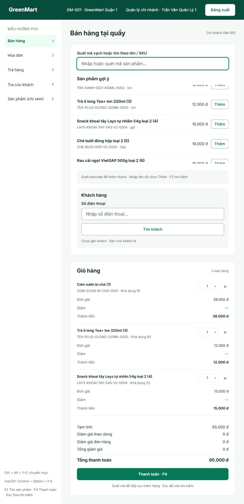 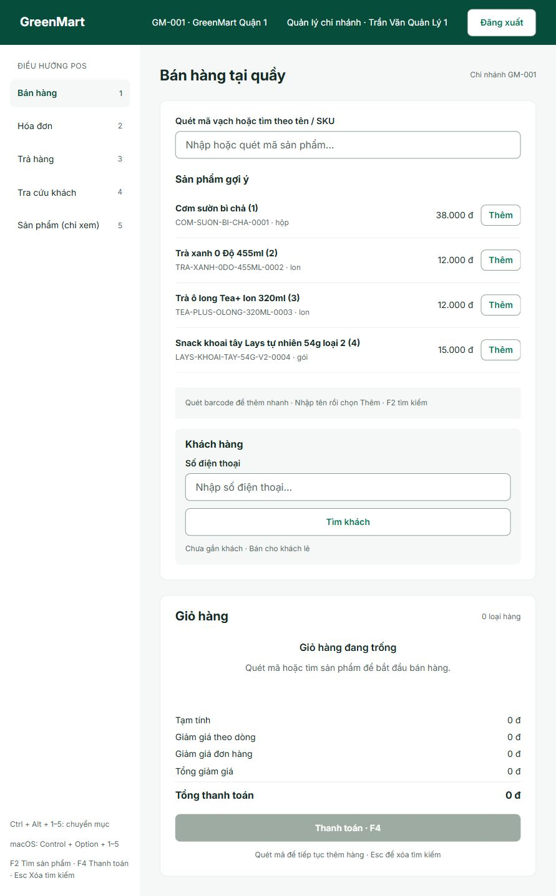 

### 02. Tìm sản phẩm không dấu không ra kết quả
- **Mức ảnh hưởng / phân loại:** Cao — Đã tái hiện; khoảng trống trải nghiệm tìm kiếm.
- **Phụ trách:** SV03 @Dat9161 chính phần tìm kiếm backend theo điều phối của người dùng; SV02 @t-boai liên quan catalog; SV04/SV05 phối hợp kiểm tra UI. **Liên quan:** [#26](https://github.com/NguyenDokhai2005/GreenMart/issues/26), [#73](https://github.com/NguyenDokhai2005/GreenMart/issues/73), [#91](https://github.com/NguyenDokhai2005/GreenMart/issues/91).
- **Bước kiểm tra:** 1. Tại POS tìm tra xanh, rồi đối chứng Trà xanh. → 2. Lặp lại hai chuỗi ở danh mục Sản phẩm và Tồn kho. → 3. Gọi API /products với đúng hai giá trị q, giữ các điều kiện khác như nhau.
- **Thực tế:** Cả ba màn đều không tìm được với “tra xanh”, trong khi “Trà xanh” có 4 sản phẩm. Đối chứng API /products trả HTTP 200 với totalElements=0 và totalElements=4 tương ứng.
- **Mong đợi:** Đề xuất tìm tiếng Việt bỏ dấu, không phân biệt hoa thường nhưng vẫn giữ SKU/barcode tra chính xác; cần ghi rõ quy tắc tìm trong AC nếu chưa có.
- **Phân tích nguyên nhân:** API cũng lệch kết quả nên không chỉ là lỗi render frontend. Cần rà cách chuẩn hóa q và cột tên/SKU trong query; chưa benchmark hay khẳng định đã chọn đúng kỹ thuật unaccent/index.
- **Đề xuất sửa / retest:** Thống nhất chuẩn hóa tiếng Việt, khoảng trắng và chữ đ/Đ; áp dụng nhất quán catalog/inventory/lookup theo contract. Retest tra xanh/Trà xanh, sua tuoi/sữa tươi, SKU, dấu kết hợp Unicode và phân trang.
- **Giới hạn:** Đã chạy cặp Trà xanh trên ba màn và API; chưa chạy riêng cặp sữa tươi trong ảnh Lead. Đây không phải lỗi 500 và không tự chứng minh vi phạm một AC tìm không dấu chưa được ghi nhận.
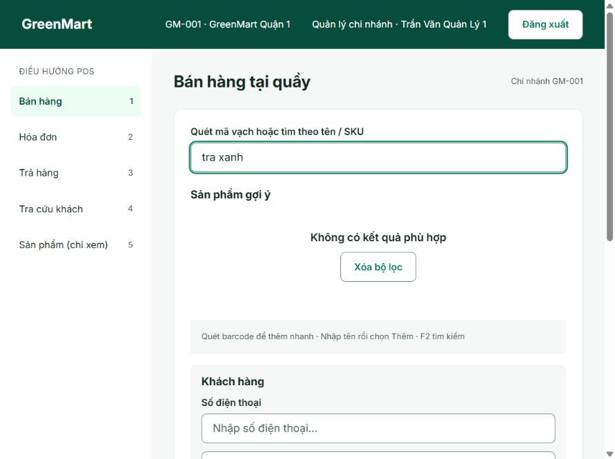 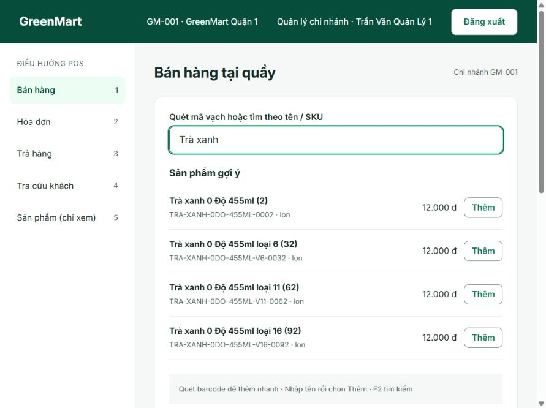 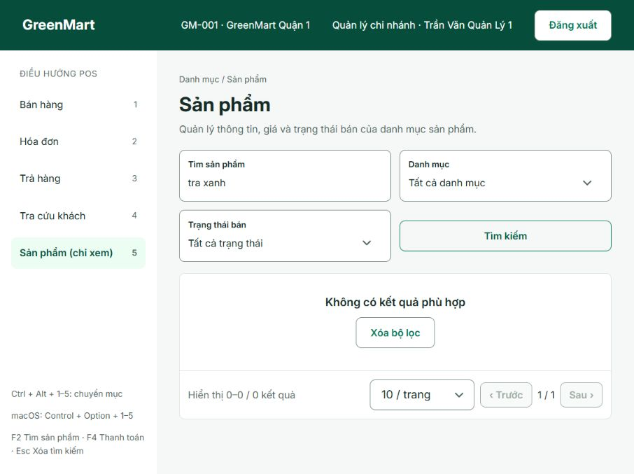 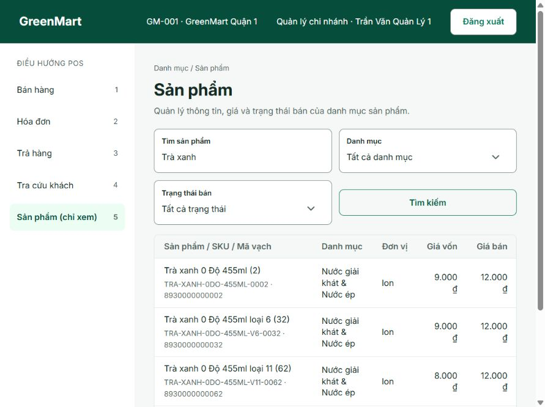 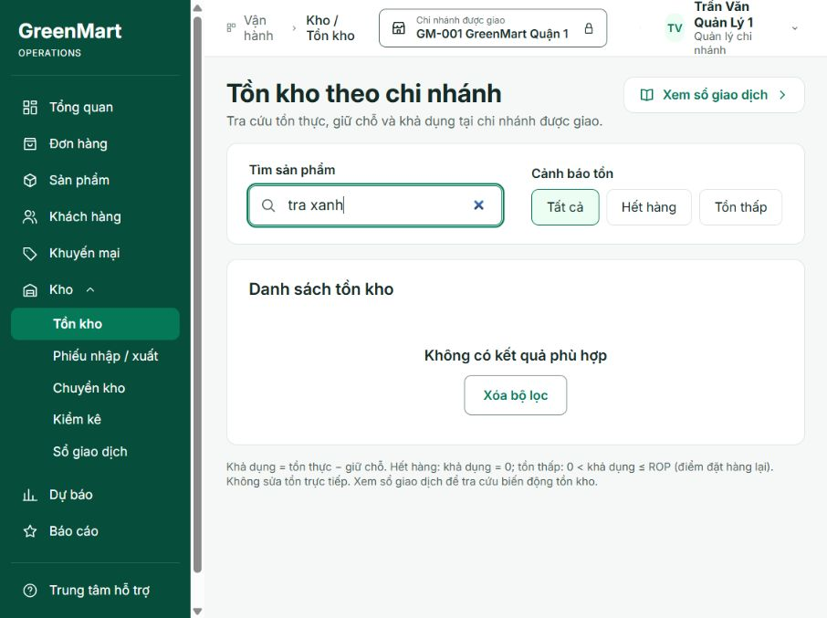 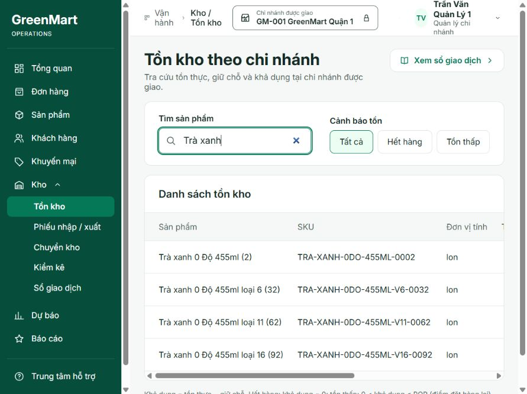

### 03. Quản lý thiếu đường vào POS và thiếu giảm giá thủ công
- **Mức ảnh hưởng / phân loại:** Cao — Lỗi điều hướng / thiếu chức năng.
- **Phụ trách:** 3a:SV05 @TranVanVu2502 chính menu Operations; SV04 phối hợp route. 3b:SV04 @voxuanvy611-sys chính form POS; SV03 @Dat9161 phối hợp API/BR-19, SV02 liên quan nếu cần. **Liên quan:** [#70](https://github.com/NguyenDokhai2005/GreenMart/issues/70), [#71](https://github.com/NguyenDokhai2005/GreenMart/issues/71), [#75](https://github.com/NguyenDokhai2005/GreenMart/issues/75), [#78](https://github.com/NguyenDokhai2005/GreenMart/issues/78), [#88](https://github.com/NguyenDokhai2005/GreenMart/issues/88).
- **Bước kiểm tra:** 1. Đăng nhập quanly.gm001; xem menu trái và menu tài khoản. → 2. Mở trực tiếp /pos. → 3. Thêm hàng, mở Thanh toán, rà ô giảm giá thủ công/lý do.
- **Thực tế:** Menu Operations và menu tài khoản không có link POS; menu tài khoản chỉ có Đăng xuất. Tuy nhiên mở /pos trực tiếp được, không bị 403. POS/Thanh toán có các tổng giảm khuyến mại nhưng không có trường giảm thủ công hoặc lý do.
- **Mong đợi:** Quản lý có lối vào POS phù hợp quyền. Theo BR-19, giảm giá ngoài chương trình chỉ quản lý chi nhánh được thực hiện và phải nhập lý do; Cashier không được sửa giá hoặc giảm thủ công.
- **Phân tích nguyên nhân:** MENU Operations không khai báo mục POS; form checkout chưa có input manualDiscount/reason. Hai phần khác module, không quy toàn bộ cho SV03.
- **Đề xuất sửa / retest:** Bổ sung đường chuyển khu có kiểm tra quyền. Thiết kế form giảm thủ công và lý do cho Manager; hiển thị trong quote, receipt và audit theo contract. Retest Manager/Cashier, mức giảm âm hoặc vượt tổng, thiếu lý do và tính lại khuyến mại.
- **Giới hạn:** Sửa lại tiêu đề gốc:quản lý vào được POS bằng URL; lỗi là thiếu đường dẫn, không phải backend chặn POS. Chưa thử gửi manualDiscount API trong lượt này.
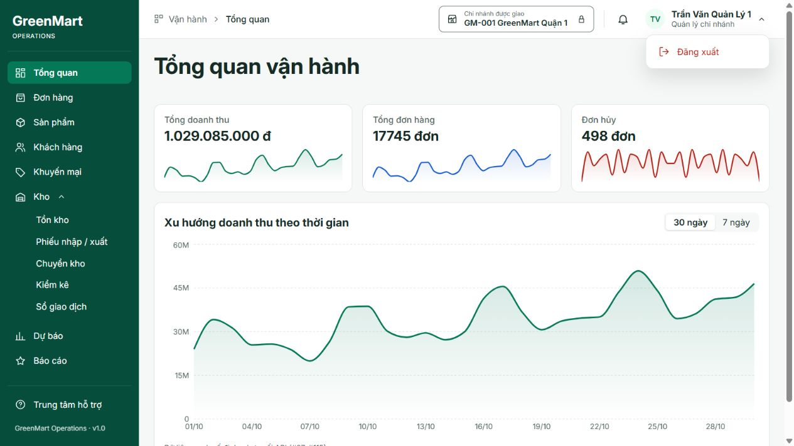 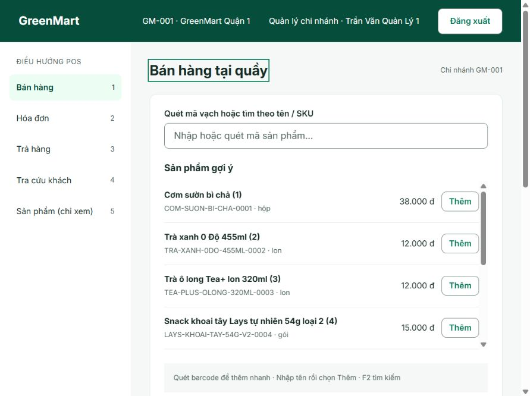 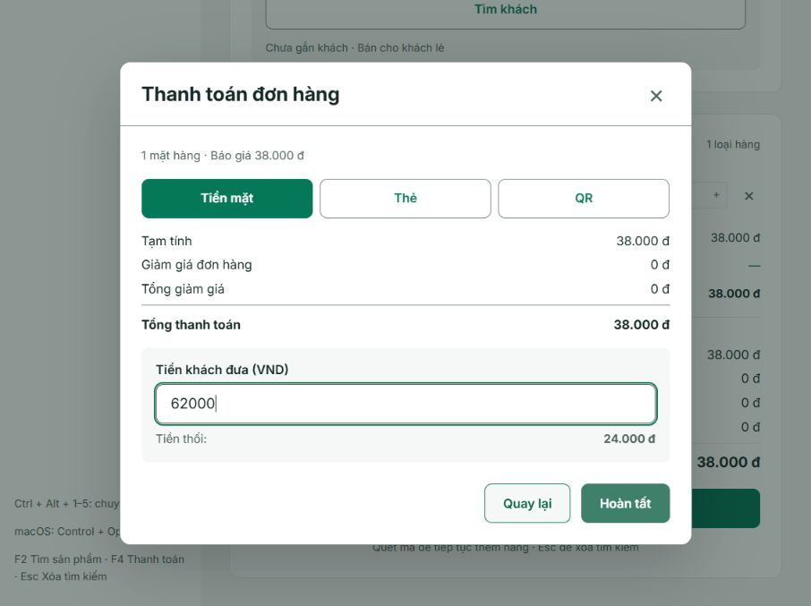

### 04. Nhiều màn chưa tích hợp; dashboard đang dùng dữ liệu mock
- **Mức ảnh hưởng / phân loại:** Cao — Chưa triển khai / chưa tích hợp, không mặc định là bug backend.
- **Phụ trách:** SV04 @voxuanvy611-sys:POS/đơn/trả hàng; SV05 @TranVanVu2502:Operations/Admin/dashboard. Backend chỉ phối hợp task thật sự thiếu; không quy mọi placeholder cho backend. **Liên quan:** [#80](https://github.com/NguyenDokhai2005/GreenMart/issues/80), [#81](https://github.com/NguyenDokhai2005/GreenMart/issues/81), [#82](https://github.com/NguyenDokhai2005/GreenMart/issues/82), [#88](https://github.com/NguyenDokhai2005/GreenMart/issues/88), [#97](https://github.com/NguyenDokhai2005/GreenMart/issues/97), [#100](https://github.com/NguyenDokhai2005/GreenMart/issues/100), [#180](https://github.com/NguyenDokhai2005/GreenMart/issues/180), [#424](https://github.com/NguyenDokhai2005/GreenMart/issues/424).
- **Bước kiểm tra:** 1. Owner/Manager mở Đơn hàng, Khuyến mại, Kiểm kê, Dự báo và Báo cáo. → 2. Admin mở đủ bảy mục quản trị. → 3. Mở Trả hàng POS và Tổng quan; đối chiếu nguồn chart, số đơn QA.
- **Thực tế:** Năm mục Operations và bảy mục Admin hiện “Chức năng đang phát triển”. Trả hàng POS hiện “Màn hình đang được chuẩn bị”. Tổng quan hiển thị 17.745 đơn và 1.029.085.000 đ, có nhãn “Dữ liệu mock cố định, chưa nối API (#97, #115)”. DB QA tại lúc đối chiếu có 10.203 đơn.
- **Mong đợi:** Hoàn tất từng task UI sau gate thiết kế/phụ thuộc; màn demo cần nhận diện rõ. Dashboard vận hành phải lấy dữ liệu thật và có loading/empty/error, không dùng số demo như số thực.
- **Phân tích nguyên nhân:** AppRoutes còn WorkspaceMountPoint/PosPlaceholderPage; OperationsHome tải RevenueChartTrial. Chênh số dashboard được giải thích bởi mock, không chứng minh query report backend tính sai.
- **Đề xuất sửa / retest:** Lập ma trận màn → thiết kế → API → người phụ trách → trạng thái. Tích hợp trên task hiện có, không mở bug trùng để thay nhiệm vụ. Chỉ so doanh thu khi cùng khoảng ngày, chi nhánh và trạng thái đơn.
- **Giới hạn:** Không khẳng định cả 13 màn đều đã có API: Users chưa đầy đủ trên develop, Returns còn phụ thuộc #43/PR #410. Chưa nghiệm thu mọi API của nhóm này. Dashboard có nhãn mock, không phải đang che giấu dữ liệu giả.
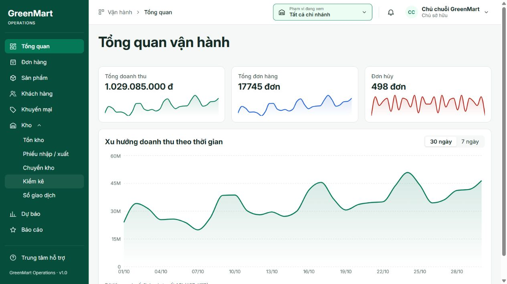 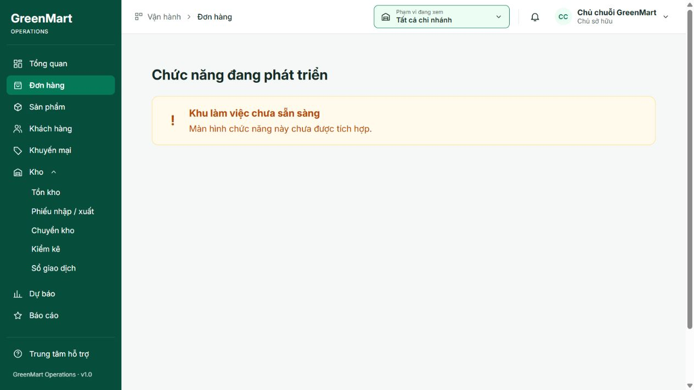 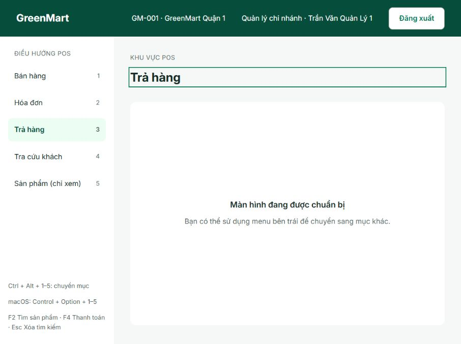 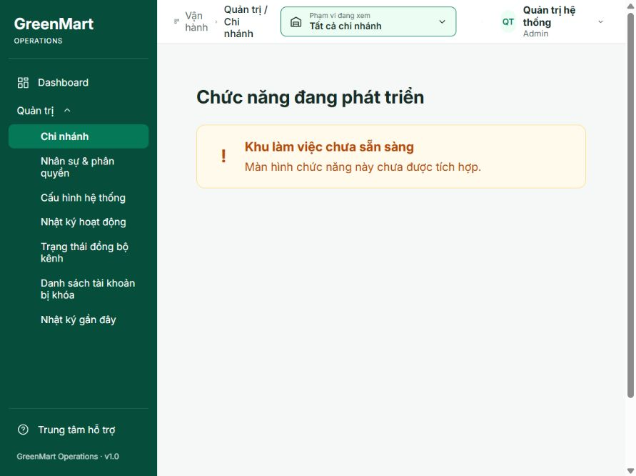 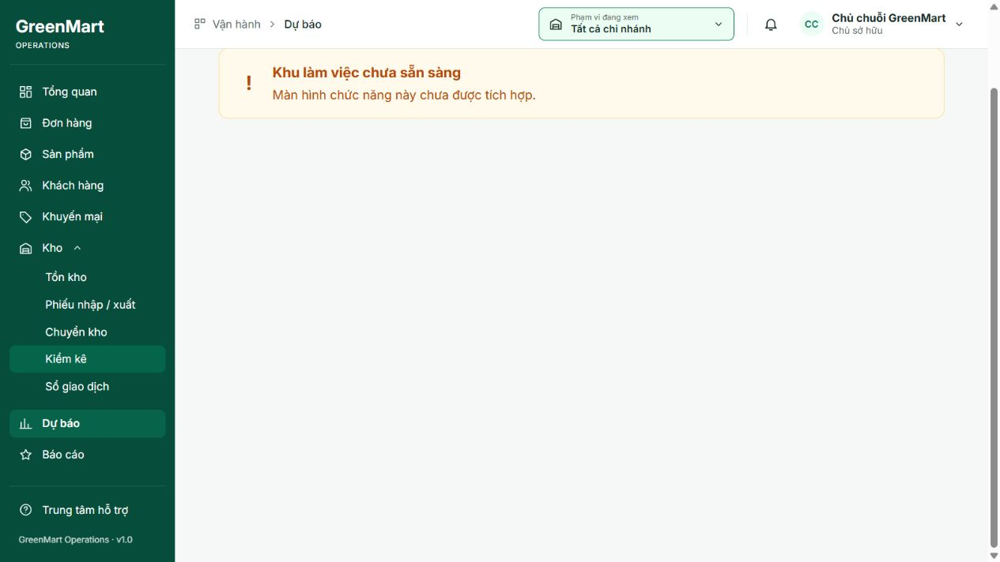 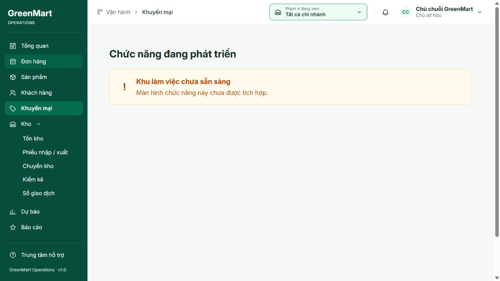 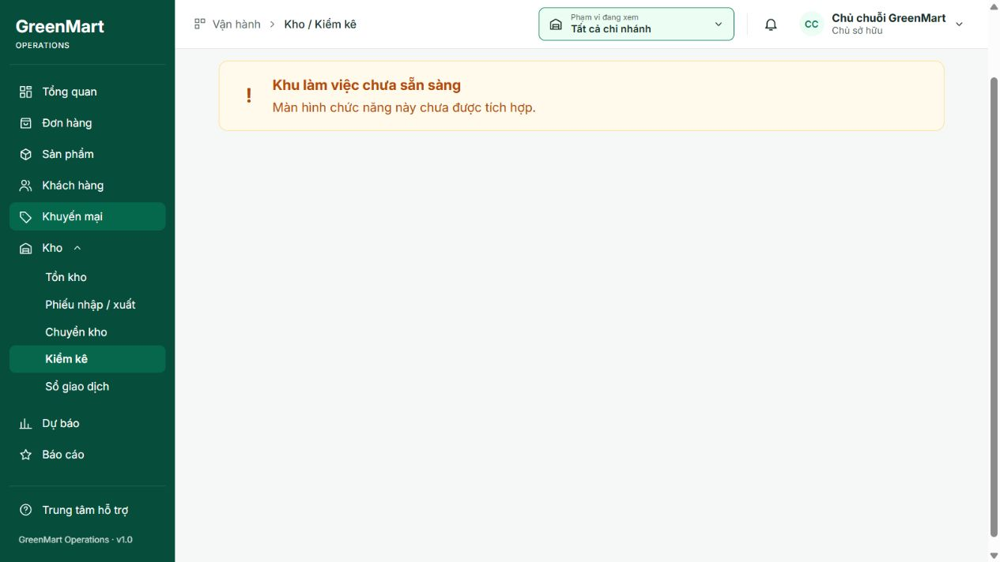 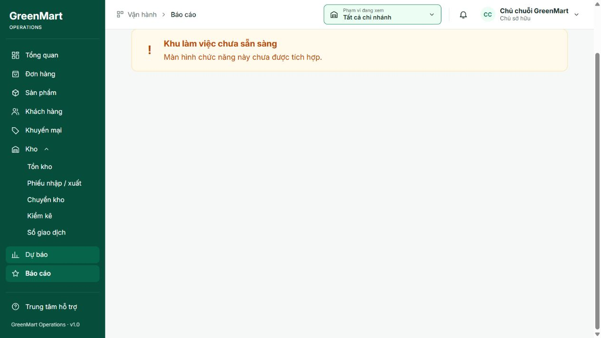 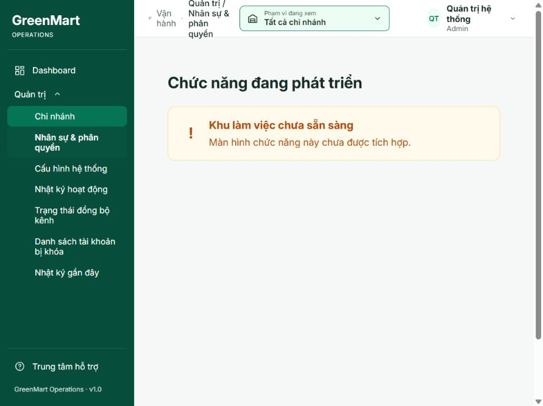 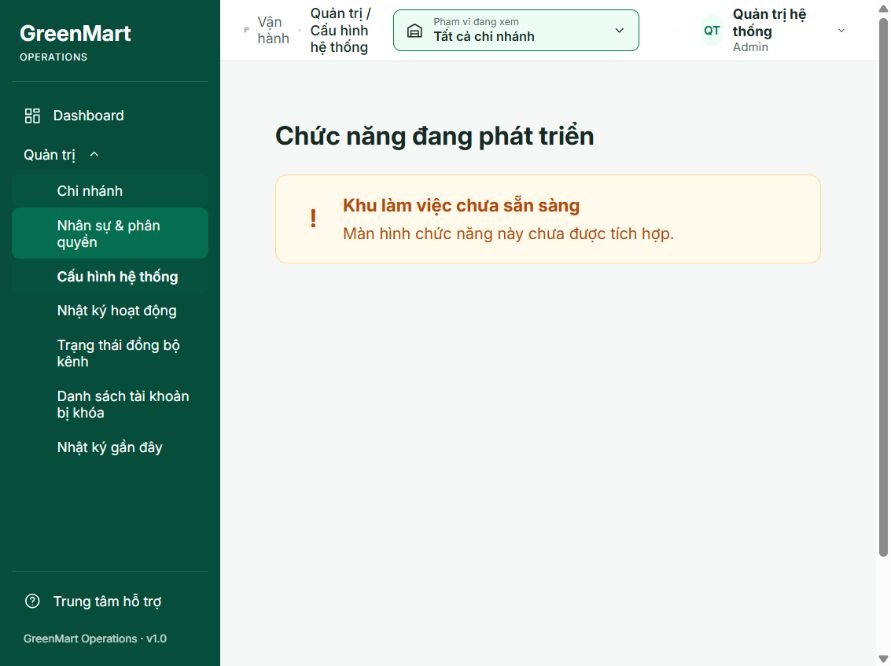 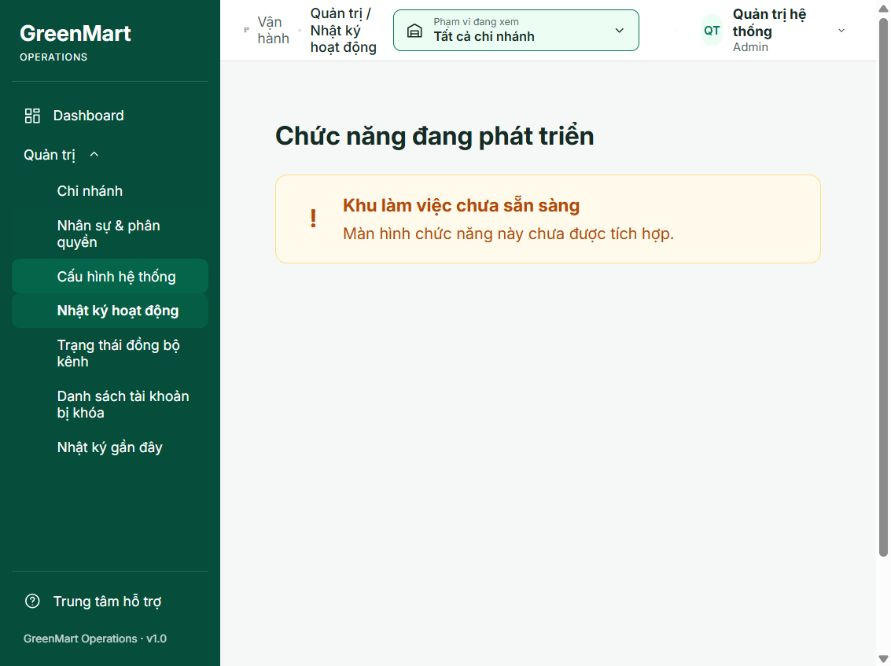 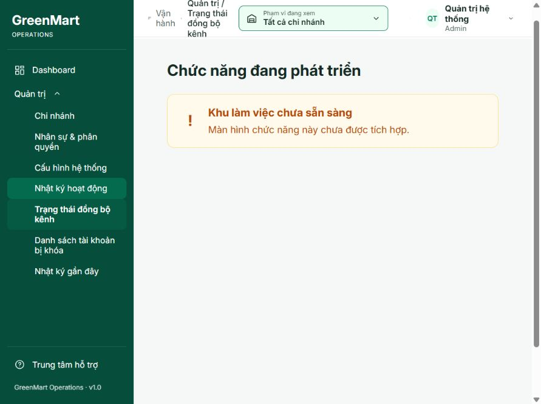 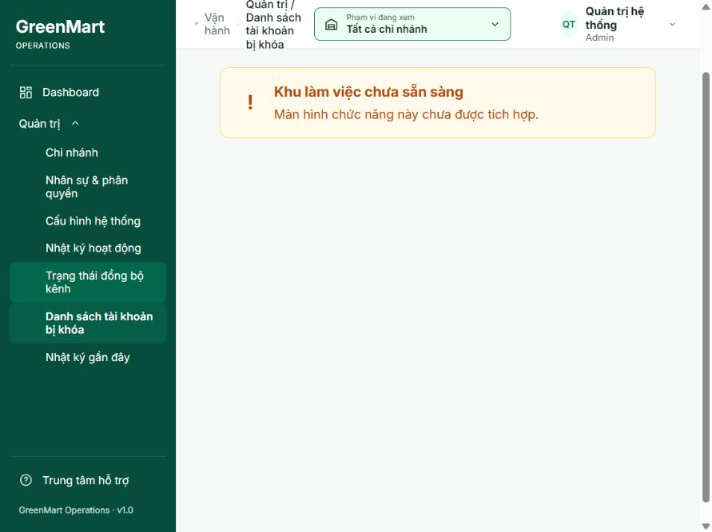 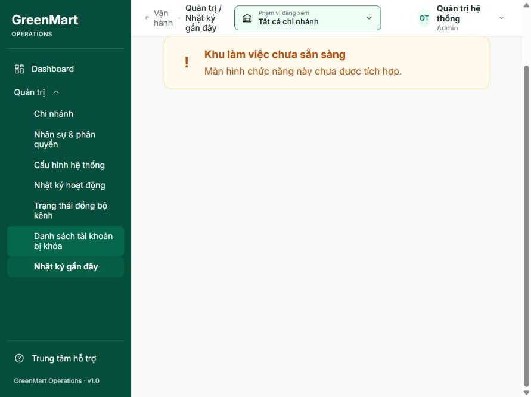

### 05. In ngay sau thanh toán có nguy cơ in cả trang POS
- **Mức ảnh hưởng / phân loại:** Trung bình — Kiểm chứng một phần — bản in chưa xác nhận.
- **Phụ trách:** SV04 @voxuanvy611-sys chính UI/in hóa đơn; chưa có bằng chứng cần sửa backend. **Liên quan:** [#75](https://github.com/NguyenDokhai2005/GreenMart/issues/75), [#77](https://github.com/NguyenDokhai2005/GreenMart/issues/77).
- **Bước kiểm tra:** 1. Tạo một đơn QA tiền mặt 38.000 đ; khách đưa 62.000 đ, tiền thừa 24.000 đ. → 2. Tại Thanh toán thành công bấm In hóa đơn. → 3. Mở lại cùng hóa đơn từ tab Hóa đơn để đối chiếu cấu trúc và CSS.
- **Thực tế:** Đã ghi nhận đơn POS-GM001-20261120-0003 thành công. Nút In gọi window.print(); thao tác mở in làm công cụ browser timeout, không thu được print-preview/PDF. Mở lại hóa đơn từ danh sách được bình thường.
- **Mong đợi:** Hai điểm in phải có cùng receipt layout:chỉ in thông tin hóa đơn, không menu/giỏ/nền overlay/trang trắng thừa.
- **Phân tích nguyên nhân:** Qua code:checkout gọi window.print() trên DOM POS; CSS @media print chuyên biệt nằm trong posReceipts.css của trang Hóa đơn. Đây là căn cứ nghi vấn, chưa thay cho kết quả in thực tế.
- **Đề xuất sửa / retest:** Dùng ReceiptPrintable chung hoặc route in riêng. Kiểm tra print-media và PDF từ hai điểm in, với nhiều dòng, nhiều trang, tiền mặt/thẻ/QR. Retest trên Chrome/Edge và máy in nếu có.
- **Giới hạn:** Ảnh chỉ minh họa hai màn xuất phát, KHÔNG phải ảnh bản in. Chưa xác nhận lại trang trắng hoặc vị trí cuối trang mà Lead mô tả; cần print-preview thực để kết luận.
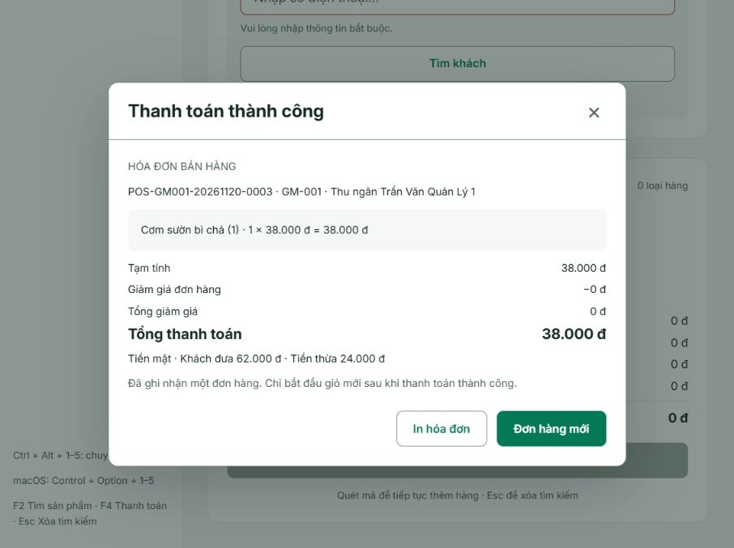 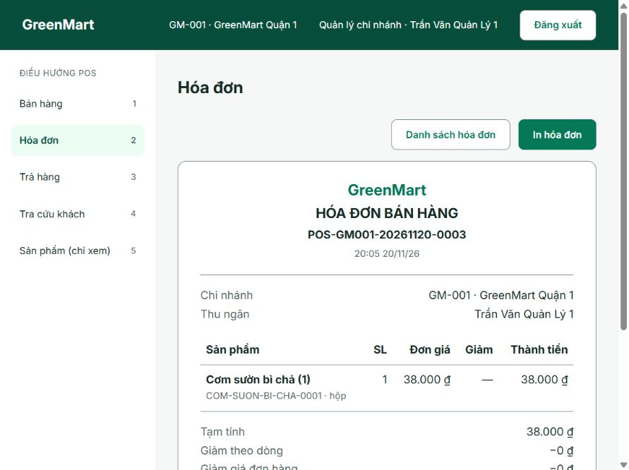

### 06. Khoảng ngày đảo ngược báo lỗi kỹ thuật và gợi ý thử lại không hữu ích
- **Mức ảnh hưởng / phân loại:** Trung bình — Lỗi đã tái hiện.
- **Phụ trách:** SV05 @TranVanVu2502 chính bộ lọc và error-state; SV03 @Dat9161 phối hợp message/validation API nếu cần. **Liên quan:** [#92](https://github.com/NguyenDokhai2005/GreenMart/issues/92), [#95](https://github.com/NguyenDokhai2005/GreenMart/issues/95), [#96](https://github.com/NguyenDokhai2005/GreenMart/issues/96), [#228](https://github.com/NguyenDokhai2005/GreenMart/issues/228).
- **Bước kiểm tra:** 1. Tại Phiếu kho chọn Từ ngày 20/11/2026, Đến ngày 01/11/2026. → 2. Đối chiếu bằng URL query from/to mà UI hỗ trợ để loại trừ sai thao tác nhập ngày. → 3. Mở Chuyển kho với cùng khoảng ngày.
- **Thực tế:** Phiếu kho hiện “from phải nhỏ hơn hoặc bằng to”, kèm lỗi chung “Đã có lỗi xảy ra. Vui lòng thử lại”. Chuyển kho chỉ báo lỗi chung với nút Thử lại. Giá trị sai vẫn giữ, nên retry không thể sửa khoảng ngày.
- **Mong đợi:** Báo cạnh trường bằng tiếng Việt:Từ ngày phải trước hoặc bằng Đến ngày; không trình bày như sự cố server. Không gửi request khi range sai nếu client biết điều kiện.
- **Phân tích nguyên nhân:** Bộ lọc truyền range xuống API; mapping lỗi chưa nhất quán giữa form và khối danh sách. Backend từ chối input sai là hành vi hợp lệ, phần lỗi là cách UI hỗ trợ sửa.
- **Đề xuất sửa / retest:** Validate from ≤ to ở client, báo cạnh trường bằng tiếng Việt và liên kết aria-describedby. Backend vẫn validate để phòng bypass. Retest hai ngày bằng nhau, đảo ngược, bỏ một đầu và ngày không hợp lệ.
- **Giới hạn:** Đã kiểm tra UI và URL bộ lọc. Không gọi lỗi validation 400 là lỗi server 500. Không thay hợp đồng để bỏ điều kiện ngày.
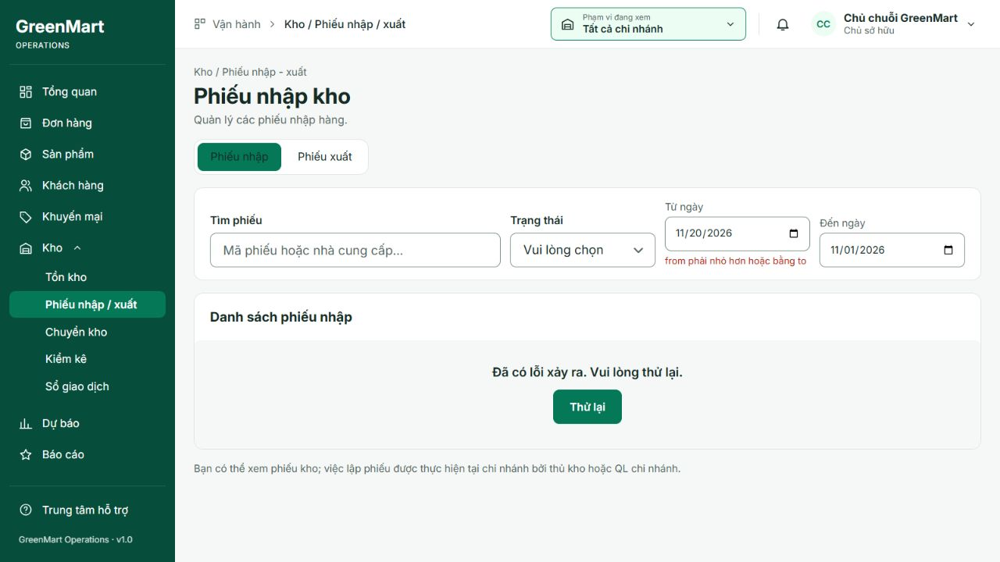 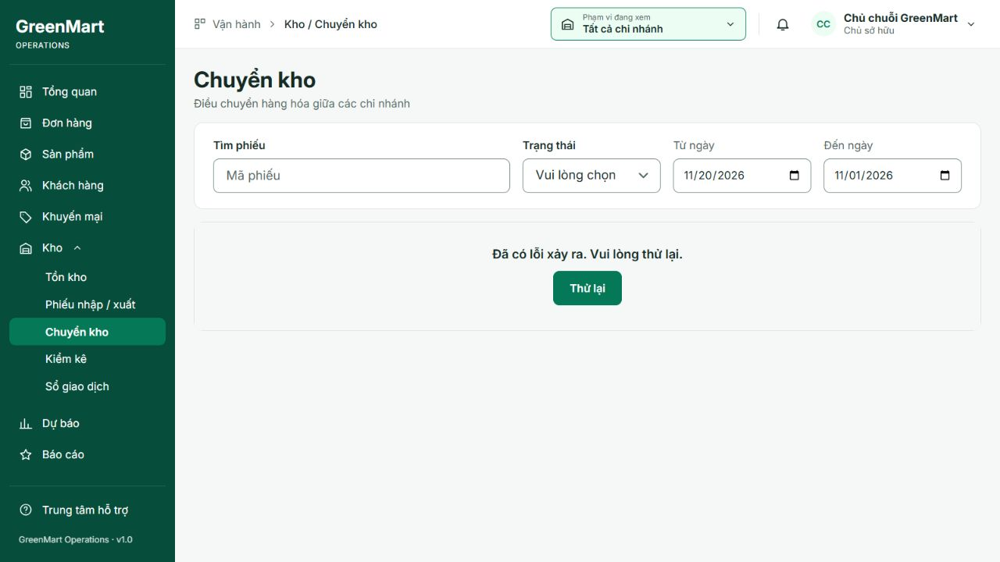

### 07. Số lượng vượt giới hạn nhận thông báo tiếng Anh
- **Mức ảnh hưởng / phân loại:** Trung bình — Lỗi đã tái hiện.
- **Phụ trách:** SV05 @TranVanVu2502 chính client validation; SV03 @Dat9161 phối hợp bản địa hóa validation backend. **Liên quan:** [#92](https://github.com/NguyenDokhai2005/GreenMart/issues/92), [#95](https://github.com/NguyenDokhai2005/GreenMart/issues/95).
- **Bước kiểm tra:** 1. Manager tạo phiếu nhập với một sản phẩm, nhà cung cấp QA và giá nhập 1.000 đ. → 2. Nhập số lượng 100000 rồi bấm Lưu phiếu nháp.
- **Thực tế:** Client cho nhập và gửi 100000; API từ chối. Ô số lượng hiện “must be less than or equal to 99999”. Phiếu không hợp lệ không được lưu, tồn kho không tăng.
- **Mong đợi:** Chặn hoặc báo ngay Số lượng tối đa99.999 bằng tiếng Việt; vẫn giữ số đã nhập và focus đúng trường.
- **Phân tích nguyên nhân:** Thông báo constraint từ server được hiển thị nguyên văn; client chưa kiểm đủ upper bound. Không phải backend nhận tồn100000.
- **Đề xuất sửa / retest:** Khớp min/max và kiểu số giữa OpenAPI, client và server; có thông báo constraint tiếng Việt. Retest 0, âm, lẻ, 99999, 100000, thiếu trường và số vượt giới hạn JavaScript.
- **Giới hạn:** Đã kiểm tra số lượng trong phiếu nhập; chưa lặp mọi field số lượng trong tất cả module.
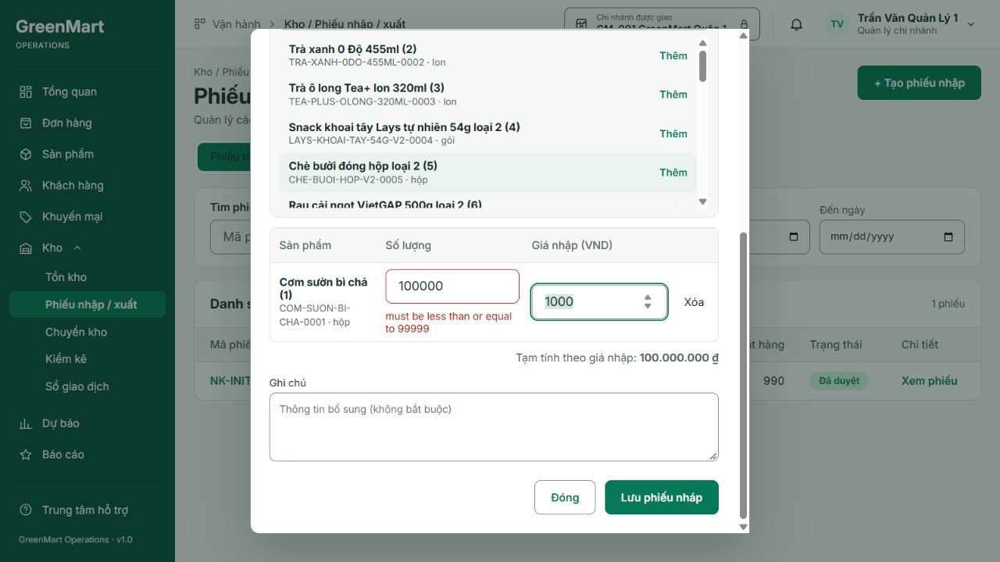 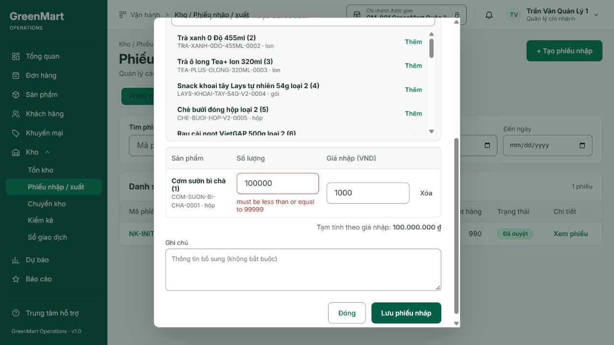

### 08. Bộ chọn hàng chỉ xét trang đầu, báo kho không còn hàng dù vẫn còn
- **Mức ảnh hưởng / phân loại:** Trung bình — Lỗi đã tái hiện; một phần còn đối chiếu code.
- **Phụ trách:** SV05 @TranVanVu2502 chính picker và phân trang; SV03 chỉ phối hợp nếu cần mở khả năng lọc API. **Liên quan:** [#93](https://github.com/NguyenDokhai2005/GreenMart/issues/93), [#95](https://github.com/NguyenDokhai2005/GreenMart/issues/95), [#96](https://github.com/NguyenDokhai2005/GreenMart/issues/96).
- **Bước kiểm tra:** 1. Manager tạo bản nháp Chuyển kho, mở Thêm sản phẩm. → 2. Chọn hết 9 SKU còn khả dụng trong 10 kết quả đầu; SKU thứ hai đang hết hàng. → 3. Mở lại bộ chọn khi chưa nhập từ khóa. → 4. Nhập SKU YEN-MACH-QUAKER-500G-V3-0011 để đối chứng.
- **Thực tế:** Bộ chọn báo “Kho gửi chưa có sản phẩm còn tồn để chuyển” sau khi chọn hết 9 sản phẩm còn hàng trong trang đầu. Nhưng tìm SKU YEN-MACH-QUAKER-500G-V3-0011 vẫn thấy Yến mạch còn 40 túi. Không có nút phân trang hoặc tải thêm. Bộ chọn phiếu xuất chỉ lấy 20 dòng rồi lọc khả dụng ở client.
- **Mong đợi:** Không kết luận cả kho hết hàng từ một trang đã lọc. Cho tải thêm/phân trang hoặc query backend lọc available và loại SKU đã chọn theo thiết kế.
- **Phân tích nguyên nhân:** ProductPicker.tsx gọi page=0, size=10 rồi lọc available>0 và loại các SKU đã chọn. StockDocumentFormDialog gọi page=0, size=20 rồi lọc tương tự. Số dòng nhìn thấy trong khung cuộn không đồng nghĩa tổng số đã fetch.
- **Đề xuất sửa / retest:** Phân trang theo kết quả hợp lệ, phân biệt “đã chọn hết trang” với “kho hết hàng”. Retest trang đầu toàn số 0, SKU đã chọn, dữ liệu trang hai, tải thêm và lỗi mạng.
- **Giới hạn:** Đã tái hiện false-empty thật ở Chuyển kho. Với phiếu xuất, đã quan sát danh sách và xác minh code lấy 20 dòng; chưa chọn hết các SKU để tái hiện false-empty riêng. Bản nháp chuyển 9 dòng thử không được lưu.
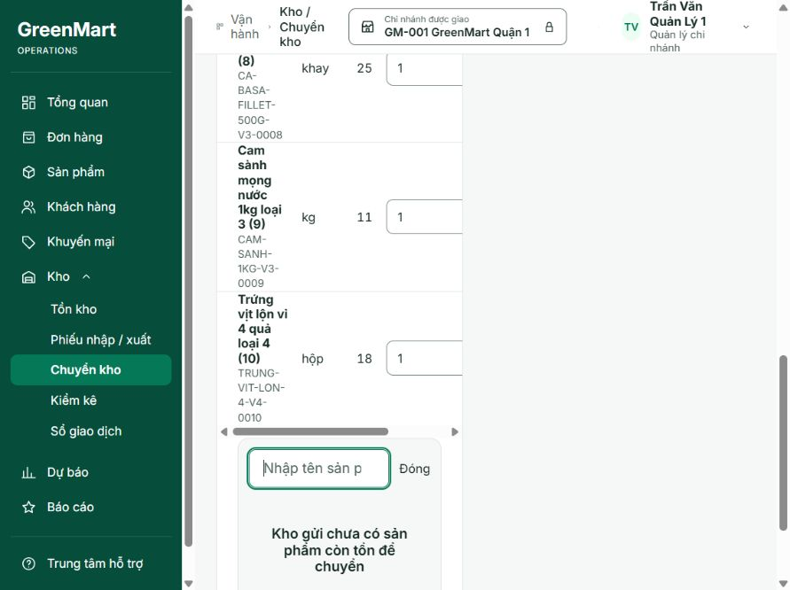 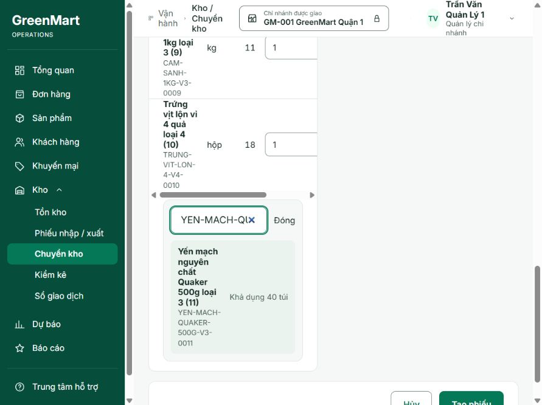 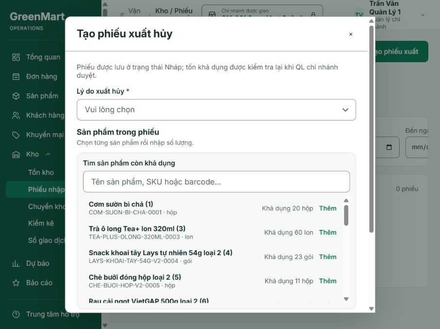

### 09. Đường dẫn Chuyển kho nhận nhầm phiếu nhập và render 990 dòng
- **Mức ảnh hưởng / phân loại:** Trung bình — Lỗi đã tái hiện.
- **Phụ trách:** SV05 @TranVanVu2502 chính kiểm tra type ở route/detail. API trả đúng chứng từ theo ID, chưa có bằng chứng backend nhận sai loại. **Liên quan:** [#92](https://github.com/NguyenDokhai2005/GreenMart/issues/92), [#96](https://github.com/NguyenDokhai2005/GreenMart/issues/96).
- **Bước kiểm tra:** 1. Xác nhận chứng từ 1 là phiếu nhập NK-INIT-GM001. → 2. Owner mở /operations/transfers/1; chỉ xem, không bấm nhận hoặc duyệt. → 3. Đối chiếu tiêu đề, bước quy trình, số dòng và chiều cao trang.
- **Thực tế:** Trang ghi “Phiếu chuyển kho NK-INIT-GM001”, “Bước 3 · Nhận hàng tại kho đích” dù chứng từ là IMPORT. DOM có 990 dòng tbody; chiều cao trang đo được là 55.833 px ở viewport 1280 px.
- **Mong đợi:** Đường dẫn chuyển kho chỉ chấp nhận chứng từ type=TRANSFER. Chứng từ khác loại phải được giải thích hoặc chuyển về đúng màn; không được dựng các bước nhận hàng chuyển kho.
- **Phân tích nguyên nhân:** getTransfer gọi API chung /stock-documents/{id}. TransferDetailPage chưa chặn loại chứng từ trước khi render TransferDetail. Màn chi tiết cũng chưa có phân trang hoặc virtualization cho chứng từ seed lớn.
- **Đề xuất sửa / retest:** Kiểm tra type ngay sau response; chặn cả hiển thị và hành động khi sai loại. Trả trạng thái không phù hợp hoặc đường dẫn đúng theo UX đã thống nhất. Retest IMPORT/EXPORT/TRANSFER, ID không tồn tại, quyền khác chi nhánh và chứng từ nhiều dòng.
- **Giới hạn:** Chưa bấm thao tác nghiệp vụ lên phiếu sai loại; không có bằng chứng đã nhận hàng hoặc thay đổi tồn sai. Chiều cao 55.833 px là số đo tại lượt kiểm tra, không phải giá trị cố định mọi viewport.
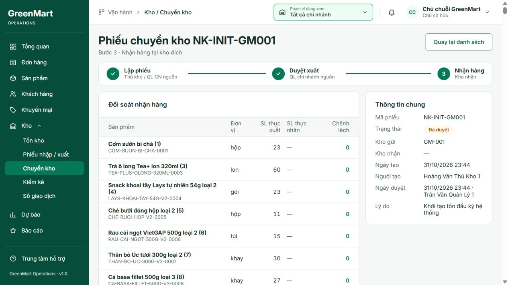

### 10. Operations tràn ngang ở 360 px
- **Mức ảnh hưởng / phân loại:** Trung bình — Chưa đáp ứng AC responsive của task đang mở.
- **Phụ trách:** SV05 @TranVanVu2502 chính. Task #101 đã có, không cần tạo issue trùng chỉ cho cùng công việc. **Liên quan:** [#101](https://github.com/NguyenDokhai2005/GreenMart/issues/101), [#88](https://github.com/NguyenDokhai2005/GreenMart/issues/88), [#91](https://github.com/NguyenDokhai2005/GreenMart/issues/91).
- **Bước kiểm tra:** 1. Đặt viewport 360 × 800, mở Tồn kho Operations. → 2. Đo innerWidth và document.scrollWidth. → 3. Đối chứng POS cùng kích thước, sau đó reset viewport override.
- **Thực tế:** Operations có innerWidth=360 nhưng document.scrollWidth=814 px. Sidebar chiếm phần lớn bề ngang; nội dung bị ép rất hẹp. POS cùng viewport có scrollWidth=345 px, không tràn ngang tương tự.
- **Mong đợi:** AC của #101 yêu cầu màn 360 px không cuộn ngang, bảng chuyển dạng thẻ. Menu cần đóng gọn hoặc có cách điều hướng phù hợp điện thoại.
- **Phân tích nguyên nhân:** Layout/sidebar và bề rộng tối thiểu của bảng, form Operations chưa đáp ứng breakpoint. Đây không phải Docker timeout hoặc API thiếu dữ liệu.
- **Đề xuất sửa / retest:** Hoàn thành #101 theo Figma đã duyệt. Kiểm tra 360/390/768 px, menu mở/đóng, bảng, form, chi tiết, dialog, focus và thao tác cảm ứng.
- **Giới hạn:** #101 đang OPEN, hạn 21/11. Báo cáo ghi thiếu nghiệm thu tại thời điểm này, không kết luận thành viên đã tuyên bố hoàn thành. Chưa test mọi trang tại mọi breakpoint.
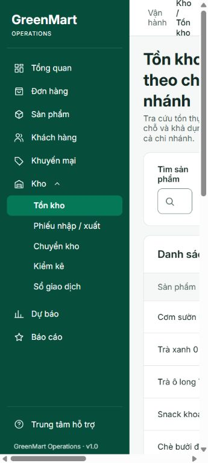 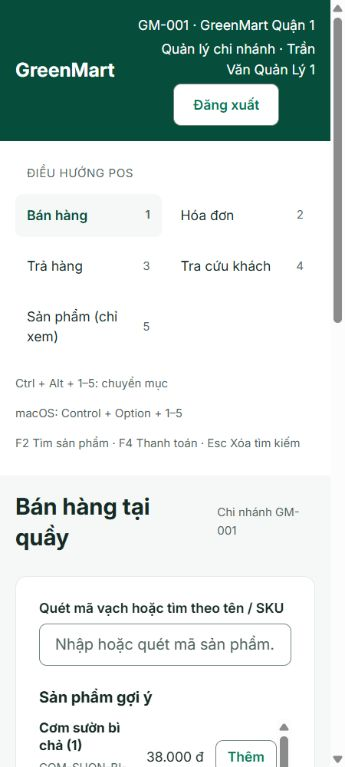

### 11. Ctrl+Alt+1–5 không hoạt động khi ô tìm kiếm giữ focus
- **Mức ảnh hưởng / phân loại:** Thấp — Đã quan sát; cần thống nhất UX phím tắt.
- **Phụ trách:** SV04 @voxuanvy611-sys chính. **Liên quan:** [#71](https://github.com/NguyenDokhai2005/GreenMart/issues/71), [#73](https://github.com/NguyenDokhai2005/GreenMart/issues/73), [#83](https://github.com/NguyenDokhai2005/GreenMart/issues/83).
- **Bước kiểm tra:** 1. Thêm một sản phẩm vào POS; ô tìm kiếm tự nhận focus. → 2. Nhấn Ctrl+Alt+2 trong ô tìm kiếm.
- **Thực tế:** Trang vẫn ở /pos, không chuyển sang Hóa đơn dù menu hướng dẫn Ctrl+Alt+1–5. Ô tìm kiếm thường nhận focus ngay sau mỗi lần thêm hàng.
- **Mong đợi:** Phím chuyển mục nên dùng được trong luồng bán phổ biến, hoặc hướng dẫn phải nêu rõ ngoại lệ. Không làm hỏng thao tác nhập liệu, máy quét hoặc IME.
- **Phân tích nguyên nhân:** usePosShortcuts chủ động bỏ qua sự kiện từ input, textarea, select hoặc contenteditable. Cách bảo vệ nhập liệu này xung đột với kỳ vọng từ hướng dẫn phím tắt.
- **Đề xuất sửa / retest:** Chốt riêng tổ hợp chuyển mục có thể dùng trong ô scanner. Vẫn bỏ qua khi IME đang ghép ký tự hoặc dialog đang mở. Retest khi focus ở search/body, các layout bàn phím và chế độ máy quét.
- **Giới hạn:** Đã thử Ctrl+Alt+2; chưa thử đủ 1–5 trên mọi trình duyệt. Ảnh cho thấy focus và trang cuối, phải đọc kèm bước test để hiểu bằng chứng. Task #83 còn OPEN.

### 12. Chữ trên tab Phiếu nhập đang chọn có tương phản 2,716:1
- **Mức ảnh hưởng / phân loại:** Thấp — Lỗi accessibility đã đo.
- **Phụ trách:** SV05 @TranVanVu2502 chính stylesheet/component phiếu kho. **Liên quan:** [#87](https://github.com/NguyenDokhai2005/GreenMart/issues/87), [#92](https://github.com/NguyenDokhai2005/GreenMart/issues/92), [#93](https://github.com/NguyenDokhai2005/GreenMart/issues/93).
- **Bước kiểm tra:** 1. Mở Phiếu nhập / xuất, giữ tab Phiếu nhập đang được chọn. → 2. Đọc computedStyle của nút thực tế và tính relative luminance theo WCAG.
- **Thực tế:** Màu chữ rgb(23,43,38), nền rgb(4,120,87), font 14 px, weight 400. Tỷ lệ tương phản là 2,715925:1, thấp hơn mức 4,5:1 cho chữ thường mức AA.
- **Mong đợi:** Chữ trên tab có thể tương tác phải đủ tương phản. Trạng thái selected vẫn cần aria-pressed và dấu hiệu phù hợp ngoài màu sắc.
- **Phân tích nguyên nhân:** Tab selected đổi nền sang xanh nhưng giữ màu chữ tối. Đây là trạng thái active, không thuộc ngoại lệ của control disabled.
- **Đề xuất sửa / retest:** Chọn cặp màu đạt ít nhất 4,5:1 bằng phép đo computedStyle, đồng bộ token màu. Retest active, inactive, hover, focus, disabled và tab Phiếu xuất. Nguồn chuẩn: W3C WCAG 2.2, SC 1.4.3.
- **Giới hạn:** Đã đo nút Phiếu nhập; chưa audit toàn bộ bảng màu. Phép tính dùng màu CSS thực tế, không suy từ pixel chữ đã antialias.
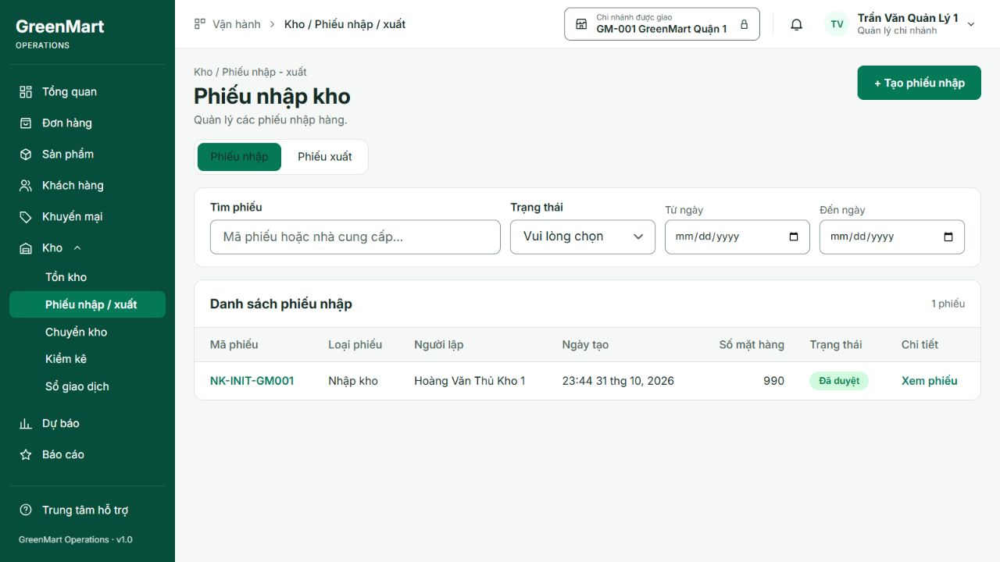

### 13. Ô Tiền khách đưa không nhận dấu chấm phân cách nghìn
- **Mức ảnh hưởng / phân loại:** Thấp — Đã quan sát; đề xuất cải thiện nhập tiền.
- **Phụ trách:** SV04 @voxuanvy611-sys chính; backend nhận số nguyên VND theo contract. **Liên quan:** [#75](https://github.com/NguyenDokhai2005/GreenMart/issues/75), [#76](https://github.com/NguyenDokhai2005/GreenMart/issues/76).
- **Bước kiểm tra:** 1. Với đơn 38.000 đ, nhập 62.000 vào Tiền khách đưa. → 2. Đối chứng bằng 62000 trong cùng ô.
- **Thực tế:** 62.000 bị báo “Nhập số tiền nguyên hợp lệ”, nút Hoàn tất bị khóa. 62000 hợp lệ, hiển thị tiền thối 24.000 đ và bật nút Hoàn tất.
- **Mong đợi:** Đề xuất hỗ trợ định dạng vi-VN hoặc đưa ví dụ rõ như 62000. Nếu hỗ trợ dấu phân cách, phải chuẩn hóa thành số nguyên trước khi gửi API.
- **Phân tích nguyên nhân:** Parser client chỉ nhận chuỗi chữ số. API quy định tiền là số nguyên, nên từ chối chuỗi có dấu chưa chứng minh backend sai.
- **Đề xuất sửa / retest:** Quy định cách nhập/paste dấu nghìn, dấu âm, dấu phẩy và khoảng trắng. Tránh hiểu 62.000 thành 62 đ; cho người dùng thấy giá trị đã chuẩn hóa trước khi xác nhận.
- **Giới hạn:** Đây là đề xuất UX nếu AC chưa yêu cầu hỗ trợ dấu chấm. Không đổi kiểu tiền API thành float hoặc string.
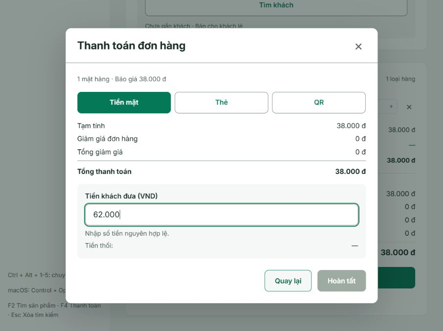 

### 14. Chưa trim tên đăng nhập và chuẩn hóa cách nhập SĐT
- **Mức ảnh hưởng / phân loại:** Thấp — Đã quan sát; một phần đúng ràng buộc API.
- **Phụ trách:** SV04 @voxuanvy611-sys chính form; SV03 @Dat9161 phối hợp quy tắc Auth/Customer. SV02 @t-boai liên quan Customer theo điều phối. **Liên quan:** [#70](https://github.com/NguyenDokhai2005/GreenMart/issues/70), [#74](https://github.com/NguyenDokhai2005/GreenMart/issues/74), [#76](https://github.com/NguyenDokhai2005/GreenMart/issues/76).
- **Bước kiểm tra:** 1. Đăng nhập bằng username owner có khoảng trắng hai đầu, với mật khẩu demo đúng. → 2. Trong POS nhập 0901 234 567 rồi bấm Tìm khách. → 3. Đối chứng định dạng +84901234567.
- **Thực tế:** Username có khoảng trắng nhận thông báo sai tên đăng nhập hoặc mật khẩu. SĐT có khoảng trắng và +84 bị client chặn; UI yêu cầu 10–11 chữ số bắt đầu bằng 0.
- **Mong đợi:** Đề xuất trim username, tuyệt đối không tự trim mật khẩu. Có thể bỏ khoảng trắng SĐT; chỉ hỗ trợ +84 sau khi thống nhất chuyển về đầu 0 và tránh trùng định danh.
- **Phân tích nguyên nhân:** Form chưa chuẩn hóa các biến thể. Contract hiện yêu cầu SĐT bắt đầu bằng 0, vì vậy chặn +84 là đúng contract, không phải lỗi backend đã được chứng minh.
- **Đề xuất sửa / retest:** Nếu mở rộng normalization, ghi rõ trong BA/OpenAPI; chuẩn hóa trước validation và kiểm tra uniqueness. Retest SĐT trùng, khách inactive, Unicode whitespace và quy tắc hoa/thường của username.
- **Giới hạn:** Không đề xuất thay đổi quy tắc mật khẩu. Tài khoản owner không bị khóa bởi ca này; chỉ thử một lần với biến thể username.
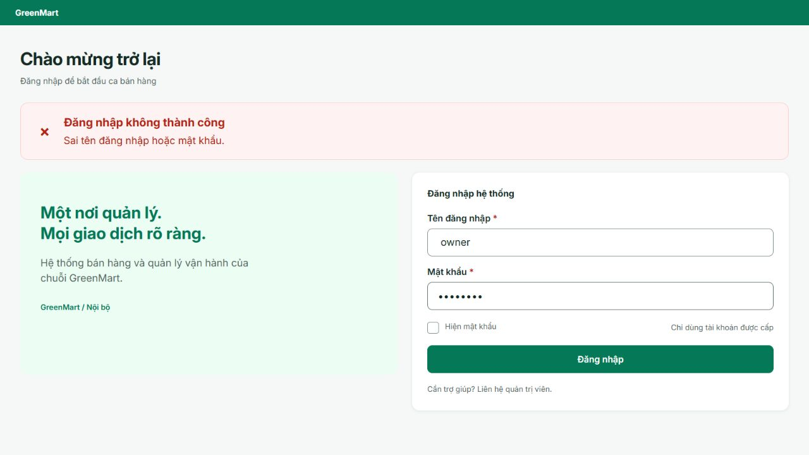  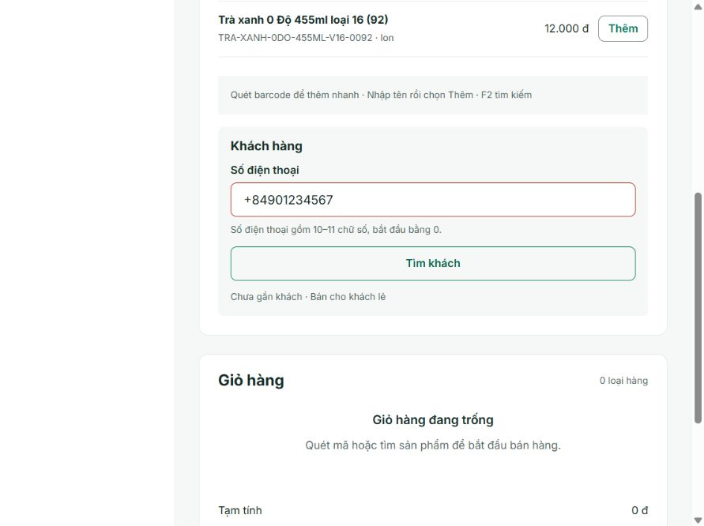

### 15. Tìm chỉ khoảng trắng trả 0; ký tự % được hiểu là wildcard
- **Mức ảnh hưởng / phân loại:** Thấp — Đã tái hiện; cần chốt quy tắc tìm literal.
- **Phụ trách:** SV03 @Dat9161 chính backend theo điều phối; SV02 @t-boai liên quan catalog; SV04 @voxuanvy611-sys phối hợp trim UI. **Liên quan:** [#26](https://github.com/NguyenDokhai2005/GreenMart/issues/26), [#72](https://github.com/NguyenDokhai2005/GreenMart/issues/72).
- **Bước kiểm tra:** 1. Trong Sản phẩm nhập ba khoảng trắng rồi Tìm kiếm. → 2. Nhập % rồi Tìm kiếm. → 3. Đối chứng API /products với cùng q.
- **Thực tế:** q gồm ba khoảng trắng trả HTTP 200, totalElements=0. q=% trả HTTP 200, totalElements=1002. UI phản ánh đúng hai kết quả này.
- **Mong đợi:** Đề xuất q.trim() rỗng tương đương bỏ lọc. Nếu tìm literal, phải escape %, _ và escape character đúng trên backend, không chỉ frontend.
- **Phân tích nguyên nhân:** Hành vi phù hợp với q chưa trim và mẫu LIKE coi % là wildcard. Đây không phải bằng chứng SQL injection; chưa thực hiện khai thác SQL.
- **Đề xuất sửa / retest:** Chốt tìm literal hay wildcard trong contract, chuẩn hóa ở cả API/UI. Retest %, _, backslash, dấu nháy, khoảng trắng, Unicode; giữ parameterized query và pagination.
- **Giới hạn:** Không kết luận lộ 1.002 bản ghi trái quyền: đây là danh mục trong phạm vi người dùng được xem. Có hành vi cần cải thiện, không tự nâng thành lỗ hổng bảo mật.
 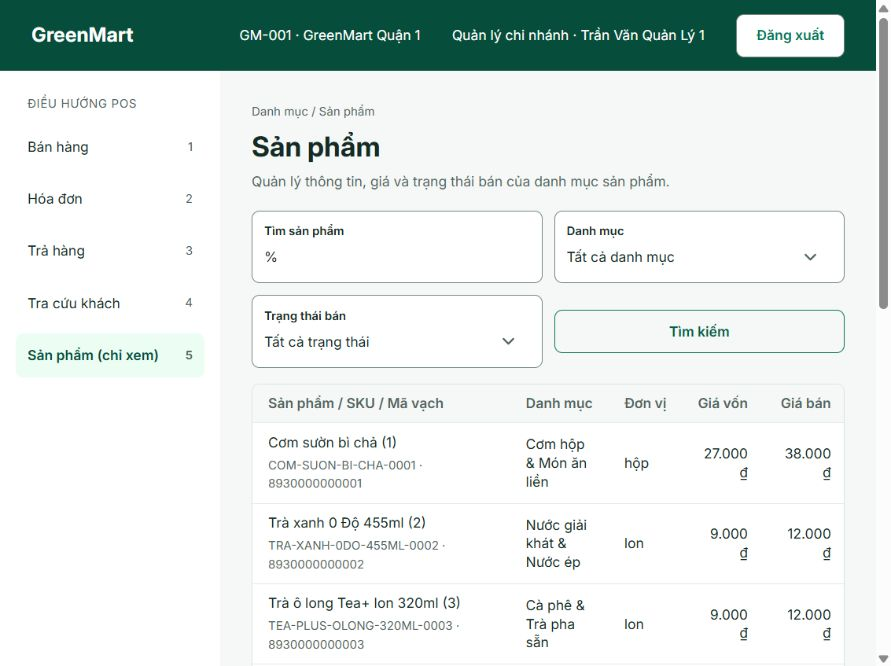

### 16. Thông báo khóa dùng mm:ss dễ nhầm với giờ trong ngày
- **Mức ảnh hưởng / phân loại:** Thấp — Đã quan sát; cải thiện nội dung thông báo.
- **Phụ trách:** SV04 @voxuanvy611-sys chính message/countdown; SV03 phối hợp nếu cần đối chiếu đồng hồ API. **Liên quan:** [#70](https://github.com/NguyenDokhai2005/GreenMart/issues/70), [#145](https://github.com/NguyenDokhai2005/GreenMart/issues/145).
- **Bước kiểm tra:** 1. Trên QA170, thử sai năm lần với tài khoản seed thungan.gm003. → 2. Đọc lockedUntil và câu Thử lại sau 15:xx. → 3. Đổi username sang Manager để tiếp tục kiểm tra.
- **Thực tế:** Lần đọc đầu, UI hiện giờ hết khóa 20:27 ngày 20/11 và “Thử lại sau 15:16”. Giá trị 15:16 là mm:ss đếm ngược, không phải 15 giờ 16. Ảnh chụp sau đó ghi thời gian còn lại đã giảm.
- **Mong đợi:** Hiện “Còn 15 phút 16 giây” hoặc “Thử lại sau 15 phút 16 giây”. Nếu hiển thị mốc hết khóa, ghi ngày/giờ và múi giờ rõ ràng.
- **Phân tích nguyên nhân:** Cách format countdown chỉ có mm:ss dễ gây hiểu nhầm. Không đủ căn cứ kết luận backend khóa sai thời lượng chỉ từ câu chữ này.
- **Đề xuất sửa / retest:** Tách mốc hết khóa và thời gian chờ; nội dung accessible không nên đọc lại mỗi giây. Retest hết khóa, đổi username và clock skew.
- **Giới hạn:** Tài khoản QA CN3 tạm khóa theo luồng test; không sửa DB để mở khóa. Không tác động QA169 cổng 13210. PR #434 chưa nằm trong commit đang kiểm tra, nên nội dung này có thể thay đổi sau khi merge.
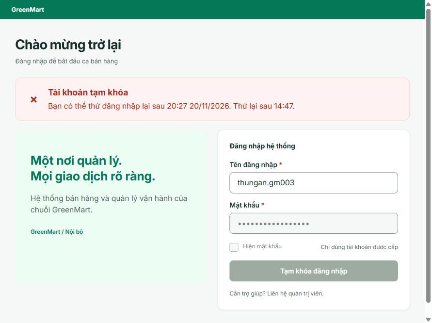

### 17. Thông báo lưu phiếu thành công vẫn còn sau 31 giây
- **Mức ảnh hưởng / phân loại:** Thấp — Đã quan sát; đề xuất vòng đời thông báo.
- **Phụ trách:** SV05 @TranVanVu2502 chính Toast và nơi gọi trong Phiếu kho. **Liên quan:** [#87](https://github.com/NguyenDokhai2005/GreenMart/issues/87), [#92](https://github.com/NguyenDokhai2005/GreenMart/issues/92).
- **Bước kiểm tra:** 1. Manager lưu phiếu nhập nháp, NCC QA UI toast 20261120, một sản phẩm, số lượng 1, giá nhập 1.000 đ. → 2. Không đóng Toast, quan sát lại sau thời gian chờ.
- **Thực tế:** Sau 31 giây, role=status vẫn hiển thị “Đã lưu phiếu nháp PN-588453ed337e4ac3b6d2a547”. Có nút đóng nhưng không tự tắt.
- **Mong đợi:** Đề xuất thông báo thành công tự ẩn sau thời gian được thống nhất, ví dụ 5–8 giây; pause khi focus/hover và có nút đóng. Lỗi cần người dùng xử lý không nên tự ẩn mất.
- **Phân tích nguyên nhân:** Toast.tsx không có timer; StockDocumentsPage giữ success cho tới khi onClose/setSuccess. Chưa thấy AC hiện hành bắt buộc một mốc tự tắt cụ thể.
- **Đề xuất sửa / retest:** Quy định autoDismiss theo loại thông báo và reset khi có hành động mới, tránh thông báo cũ bị hiểu là kết quả thao tác sau. Kiểm tra timer, focus và accessibility.
- **Giới hạn:** Đây là đề xuất UX khi chưa có quy ước thời gian. Phiếu #5 vẫn DRAFT, chưa approve nên không tăng tồn. Giữ nguyên dữ liệu thử đã lưu.
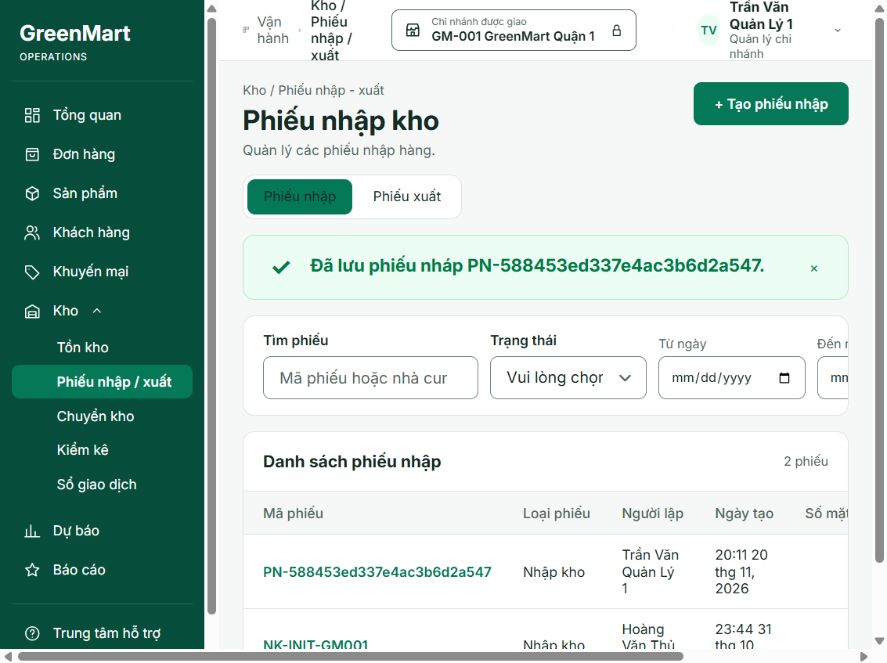

### 18. Chi tiết chuyển kho/đơn khác chi nhánh có nút Thử lại không phù hợp
- **Mức ảnh hưởng / phân loại:** Thấp — Thiếu nhất quán error-state; backend trả 403 đúng.
- **Phụ trách:** SV05 @TranVanVu2502 chính màn detail/AsyncBlock; chưa có bằng chứng cần sửa RBAC backend. **Liên quan:** [#94](https://github.com/NguyenDokhai2005/GreenMart/issues/94), [#96](https://github.com/NguyenDokhai2005/GreenMart/issues/96), [#102](https://github.com/NguyenDokhai2005/GreenMart/issues/102), [#228](https://github.com/NguyenDokhai2005/GreenMart/issues/228).
- **Bước kiểm tra:** 1. Manager CN1 mở /operations/transfers/2; chứng từ 2 thuộc CN2. → 2. Mở /operations/ledger/orders/2681; đơn thuộc CN2. → 3. Bấm Thử lại và đối chiếu response API riêng.
- **Thực tế:** Cả hai API trả 403 BRANCH_FORBIDDEN. UI thực ra có hiện đúng thông báo từ chối quyền, nhưng vẫn kèm Thử lại. Bấm lại vẫn 403, chỉ đổi traceId.
- **Mong đợi:** Lỗi thiếu quyền không nên gợi ý retry vô hạn. Theo #228, lỗi 403 cả trang có đường về trang chủ hoặc đổi chi nhánh; dialog có thể đóng và giải thích rõ quyền.
- **Phân tích nguyên nhân:** TransferDetailPage và LedgerOrderDetailDialog đều truyền error/onRetry vào AsyncBlock chung, chưa chọn hành động theo loại 403.
- **Đề xuất sửa / retest:** Dùng mapping lỗi chung để phân biệt 401/403/404/500 và lỗi mạng. Chỉ retry lỗi có thể phục hồi. Test vai trò, phạm vi nguồn/đích, không lộ chi tiết tài nguyên trái quyền.
- **Giới hạn:** Điều chỉnh nhận định ảnh Lead: UI không chỉ có thông báo lỗi chung, đã có câu từ chối rõ. Không phát hiện vượt quyền hoặc đọc thành công dữ liệu đơn CN2.
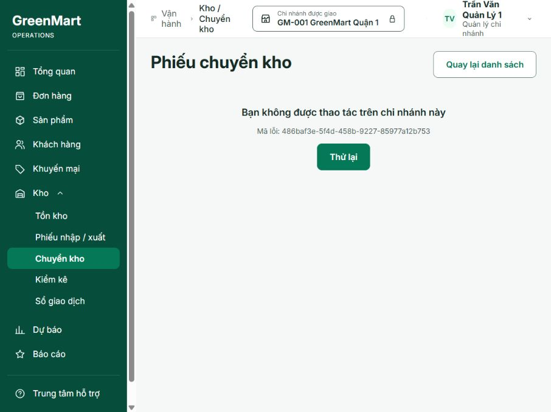 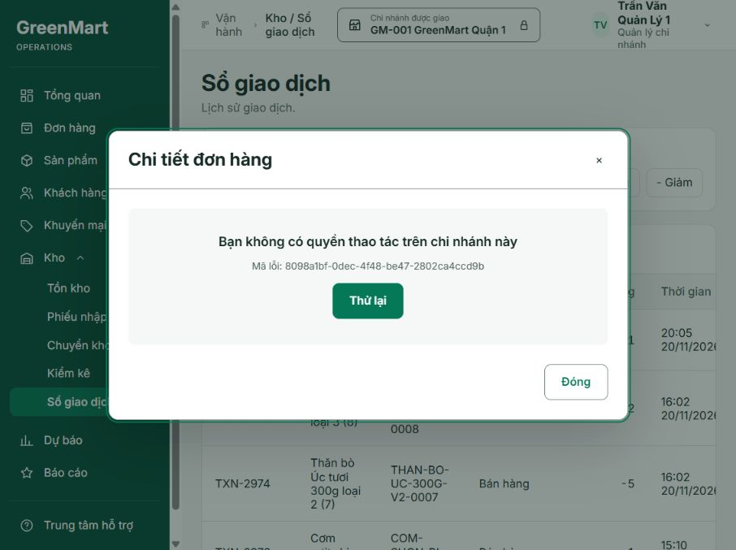

### 19. Ký hiệu tiền, số 0 giảm giá và nhãn trạng thái chưa nhất quán
- **Mức ảnh hưởng / phân loại:** Thấp — Lỗi nhãn đã tái hiện + thiếu nhất quán trình bày.
- **Phụ trách:** SV05 @TranVanVu2502 chính Select chung/bộ lọc kho; SV04 @voxuanvy611-sys phối hợp formatter POS/receipt. **Liên quan:** [#72](https://github.com/NguyenDokhai2005/GreenMart/issues/72), [#75](https://github.com/NguyenDokhai2005/GreenMart/issues/75), [#77](https://github.com/NguyenDokhai2005/GreenMart/issues/77), [#87](https://github.com/NguyenDokhai2005/GreenMart/issues/87), [#90](https://github.com/NguyenDokhai2005/GreenMart/issues/90), [#92](https://github.com/NguyenDokhai2005/GreenMart/issues/92), [#96](https://github.com/NguyenDokhai2005/GreenMart/issues/96).
- **Bước kiểm tra:** 1. So sánh POS với Hóa đơn và Sản phẩm. → 2. Ở Phiếu kho, chọn Nháp rồi Tất cả trạng thái. → 3. Xem receipt của đơn không có giảm giá.
- **Thực tế:** POS dùng “đ”, Hóa đơn/Sản phẩm dùng “₫”. Receipt có dòng “−0 ₫” hoặc popup “−0 đ”. Select Phiếu kho/Chuyển kho hiện “Vui lòng chọn” tại giá trị rỗng thay vì “Tất cả trạng thái”.
- **Mong đợi:** Dùng formatter tiền thống nhất; giá trị 0 không có dấu âm. Giá trị ALL phải hiện đúng nhãn, không bị nhầm với placeholder của trường bắt buộc.
- **Phân tích nguyên nhân:** Có nhiều formatter tiền riêng. Placeholder và option ALL dùng cùng giá trị rỗng khiến hiển thị lựa chọn không rõ.
- **Đề xuất sửa / retest:** Chuẩn hóa formatter/token; phân biệt ALL và chưa chọn trong component mà không đổi contract filter. Retest reset, tải lại URL, keyboard, screen reader và các màn cùng dùng Select.
- **Giới hạn:** Ký hiệu đ/₫ không làm đổi số tiền API. Lỗi chính là nhãn ALL; phần tiền là thiếu nhất quán trình bày. Chưa rà mọi formatter toàn dự án.
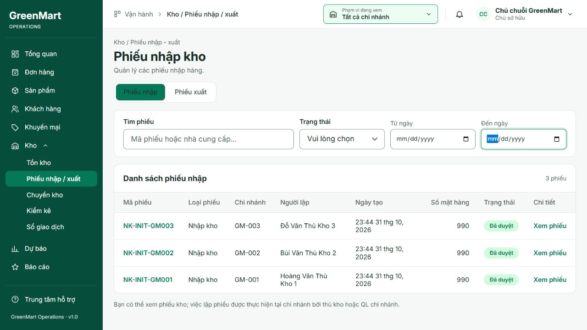  

### 20. Bảng tồn kho ở 1366 px cần cuộn ngang để xem đủ cột
- **Mức ảnh hưởng / phân loại:** Thấp — Đã đo; đề xuất cải thiện bố cục desktop.
- **Phụ trách:** SV05 @TranVanVu2502 chính bố cục bảng tồn kho. **Liên quan:** [#91](https://github.com/NguyenDokhai2005/GreenMart/issues/91), [#101](https://github.com/NguyenDokhai2005/GreenMart/issues/101).
- **Bước kiểm tra:** 1. Đặt viewport 1366 × 768, mở Tồn kho bằng Manager CN1. → 2. Đo bề rộng container/table và quan sát cột Cảnh báo. → 3. Reset viewport sau khi kiểm tra.
- **Thực tế:** Lượt đo cuối: container bảng 1.078 px, scrollWidth 1.171 px. Cột Cảnh báo bị cắt ở mép phải, cần cuộn ngang. Owner xem tất cả chi nhánh còn thêm cột Chi nhánh nên bảng rộng hơn.
- **Mong đợi:** Ưu tiên các chỉ số giúp quyết định: Tồn thực, Giữ chỗ, Khả dụng, ROP, Cảnh báo. Có thể giảm bề rộng SKU hoặc dùng cột sticky/ẩn thông tin phụ.
- **Phân tích nguyên nhân:** Tên/SKU dài và bề rộng tối thiểu các cột đẩy bảng vượt container. Cuộn ngang bảng desktop không tự động là vi phạm WCAG hoặc lỗi API.
- **Đề xuất sửa / retest:** Đối chiếu design 1366/1440, dùng wrap/clamp, tooltip khi phù hợp, giữ cột tên/cảnh báo dễ xem. Retest tên rất dài và chế độ tất cả chi nhánh.
- **Giới hạn:** Không đánh đồng với mục 10: #101 có AC 360 px không cuộn ngang; chưa thấy cấm cuộn bảng desktop 1366 px tuyệt đối. Đây là khuyến nghị UX có số đo thực tế.
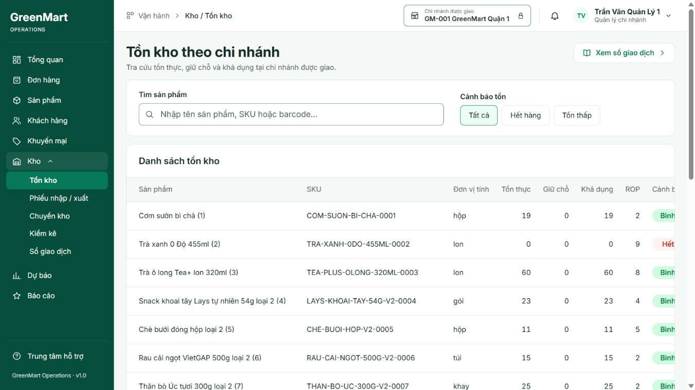

### 21. Danh sách Hóa đơn POS chưa có tìm mã đơn hoặc SĐT
- **Mức ảnh hưởng / phân loại:** Thấp — Thiếu tính năng tra cứu; đã kiểm tra UI hiện có.
- **Phụ trách:** SV04 @voxuanvy611-sys chính màn Hóa đơn; SV03 phối hợp query nếu contract cần bổ sung; SV02 liên quan Sales. **Liên quan:** [#77](https://github.com/NguyenDokhai2005/GreenMart/issues/77), [#80](https://github.com/NguyenDokhai2005/GreenMart/issues/80).
- **Bước kiểm tra:** 1. Mở Hóa đơn POS tại chi nhánh có dữ liệu seed. → 2. Rà ô tìm kiếm, bộ lọc và phân trang. → 3. Đối chiếu code ReceiptList.
- **Thực tế:** UI chỉ có danh sách, nút mở hóa đơn và Trước/Sau; lượt kiểm tra hiện 135 trang. Không có ô nhập mã đơn hoặc SĐT để tìm nhanh.
- **Mong đợi:** Có cách tra cứu nhanh trong đúng phạm vi được phép. Giữ phân trang server, không lọc chỉ trang hiện tại.
- **Phân tích nguyên nhân:** ReceiptList gọi listOrders và render danh sách, chưa có input query. Không phải đã gửi query nhưng backend bỏ qua.
- **Đề xuất sửa / retest:** Làm rõ task #80 hoặc bổ sung AC tra cứu receipt. Dùng field OpenAPI hỗ trợ, không tự thêm tham số ngoài contract. Test mã chính xác/một phần, SĐT, sai quyền và kết quả ở trang xa.
- **Giới hạn:** Đã mở lại hóa đơn mới thành công, không phải màn Hóa đơn hỏng toàn bộ. Cần chốt chức năng tìm ở màn này nếu #77 chỉ yêu cầu xem/in receipt.
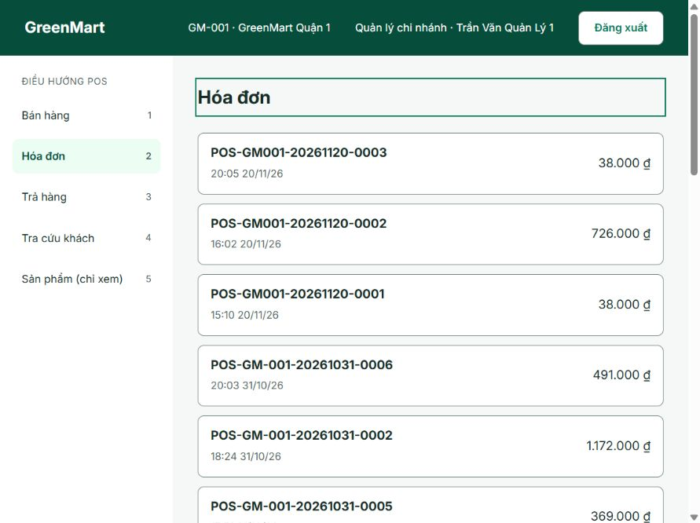

### 23. Tìm kiếm Sổ kho bỏ sót giao dịch ở trang khác
- **Mức ảnh hưởng / phân loại:** Trung bình — Lỗi UI đã tái hiện trong lượt kiểm thử trước.
- **Phụ trách:** SV05 @TranVanVu2502 chính màn Sổ giao dịch (#94). Chưa có bằng chứng backend trả sai hợp đồng; chỉ cần phối hợp SV03 nếu nhóm mở rộng contract tìm tự do. **Liên quan:** [#94](https://github.com/NguyenDokhai2005/GreenMart/issues/94), [#173](https://github.com/NguyenDokhai2005/GreenMart/issues/173), [#228](https://github.com/NguyenDokhai2005/GreenMart/issues/228).
- **Bước kiểm tra:** 1. Đăng nhập thukho.gm002 trên QA170; mở Kho → Sổ giao dịch. → 2. Ở trang 2 có TXN-1961, SKU OISHI-BAP-NGOT-40G-V246-0981, tham chiếu NK-INIT-GM002. → 3. Nhập nguyên SKU vào Tìm kiếm giao dịch; UI tự về trang 1. → 4. Quan sát Không có kết quả phù hợp. Giữ nguyên q rồi bấm Trang 2.
- **Thực tế:** Trang 1 báo không có kết quả nhưng trang 2 lại hiện đúng TXN-1961 với cùng từ khóa. Dòng này có biến động nhập +22. Tổng số trang vẫn dựa trên danh sách chưa lọc, không phải kết quả tìm kiếm.
- **Mong đợi:** Tìm trong danh sách thuộc phạm vi chi nhánh phải trả giao dịch tồn tại và phân trang theo kết quả đã lọc. Nếu chỉ hỗ trợ tìm trên trang hiện tại thì phải được nhóm chốt phạm vi và ghi rõ, không gây cảm giác dữ liệu không tồn tại.
- **Phân tích nguyên nhân:** InventoryLedgerPage tải từng trang 20 dòng; queryKey chỉ theo chi nhánh/trang rồi lọc data.content của trang đang có. OpenAPI GET /inventory/transactions có productId/type/refType/refId/from/to/page/size, chưa có q tự do. Vì vậy không quy backend bỏ qua tham số q mà contract không hỗ trợ.
- **Đề xuất sửa / retest:** SV05 đề xuất chuyển từ khóa hợp lệ sang filter API hiện có, hoặc xin Lead thống nhất tìm tự do và thay contract trước. Tính tổng/trang theo tập đã lọc. Retest dữ liệu ở trang đầu, trang 2 và trang cuối, không có kết quả, xóa lọc và phạm vi chi nhánh.
- **Giới hạn:** Không có bằng chứng DB mất giao dịch. Khác mục 8: đây là tìm giao dịch kho trên endpoint/route riêng, không phải bộ chọn SKU chuyển/xuất. Đây là bằng chứng đã chạy ngày 20/11, không tuyên bố vừa chạy lại trong lượt bổ sung.
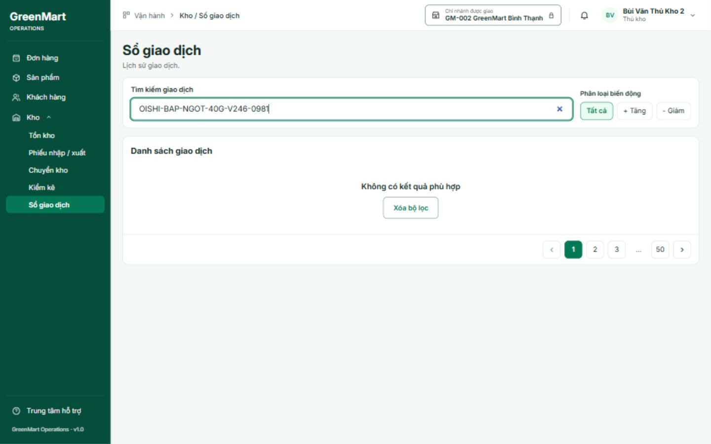 

### 24. POS thiếu Tồn khả dụng dưới từng sản phẩm gợi ý so với Figma
- **Mức ảnh hưởng / phân loại:** Trung bình — Sai khác thiết kế đã đối chiếu; không phải lỗi số tồn.
- **Phụ trách:** SV04 @voxuanvy611-sys chính POS và thiết kế #174. SV03 chỉ phối hợp dữ liệu tồn nếu endpoint/hiệu năng cần điều chỉnh; chưa quy là lỗi backend. **Liên quan:** [#73](https://github.com/NguyenDokhai2005/GreenMart/issues/73), [#174](https://github.com/NguyenDokhai2005/GreenMart/issues/174).
- **Bước kiểm tra:** 1. Đối chiếu frame normal 677:2011, kích thước 1440×872, thuộc section POS đã duyệt trong #174. → 2. Trên UI QA170 cùng bố cục desktop, xem từng sản phẩm gợi ý trước khi thêm vào giỏ. → 3. Phân biệt dữ liệu mẫu trong thiết kế với thông tin mà mỗi thẻ phải hiển thị.
- **Thực tế:** Figma hiển thị SKU và Tồn khả dụng ngay dưới tên sản phẩm. UI hiện chỉ có SKU/đơn vị, giá và nút Thêm. Tồn xuất hiện sau khi đưa sản phẩm vào giỏ, nên người bán không biết tồn ngay tại vị trí gợi ý trước khi chọn.
- **Mong đợi:** Hiển thị khả dụng theo chi nhánh ở thẻ gợi ý đúng thiết kế được duyệt; dữ liệu chưa tải hoặc không có quyền phải có trạng thái rõ. Không dùng con số demo Figma làm dữ liệu thật.
- **Phân tích nguyên nhân:** Danh sách gợi ý chưa render thông tin tồn theo vị trí thiết kế. Đây là thiếu một trường hiển thị, khác mục 2 tìm kiếm không dấu và mục 8 bộ chọn hàng bị giới hạn trang.
- **Đề xuất sửa / retest:** Bổ sung dữ liệu tồn đúng chi nhánh bằng endpoint được phép; chốt phương án batch nếu cần, tránh gọi N+1 quá nhiều. Hiển thị tồn 0/loading/lỗi đúng thiết kế và quote lại khi thanh toán. Retest đổi chi nhánh và tồn thay đổi trong lúc mở POS.
- **Giới hạn:** Chưa chứng minh số tồn backend sai hoặc có thể bán vượt tồn. Chưa xác nhận có quyết định duyệt lại thiết kế ở nguồn khác; nếu có, cần cập nhật mốc thiết kế trước khi kết luận vi phạm. Ảnh thiết kế và ảnh UI được ghi nhãn riêng.
 

### 25. Nút Thêm sản phẩm POS cao 34 px thay vì 44 px trong Figma
- **Mức ảnh hưởng / phân loại:** Thấp — Sai khác kích thước thiết kế đã đo.
- **Phụ trách:** SV04 @voxuanvy611-sys chính style của sản phẩm gợi ý POS. **Liên quan:** [#73](https://github.com/NguyenDokhai2005/GreenMart/issues/73), [#83](https://github.com/NguyenDokhai2005/GreenMart/issues/83), [#174](https://github.com/NguyenDokhai2005/GreenMart/issues/174).
- **Bước kiểm tra:** 1. Đối chiếu nút Thêm ở frame POS 677:2011. → 2. Đọc kích thước render của 8 nút Thêm trên UI QA170, desktop 1440 px. → 3. Kiểm tra dữ liệu đo đã lưu trong pos-figma-evidence.json.
- **Thực tế:** Cả 8 nút Thêm được đo cao 34 px; thiết kế đối chiếu dùng 44 px. Nút vẫn bấm và thêm hàng được; chưa có bằng chứng chức năng bị chặn.
- **Mong đợi:** Kích thước nút khớp design/component đã duyệt hoặc có quyết định thay đổi được ghi nhận; vùng bấm và focus phải thuận tiện.
- **Phân tích nguyên nhân:** Khác biệt CSS/padding/height của nút gợi ý. Đây là vấn đề kích thước, độc lập với thiếu trường Tồn khả dụng ở mục 24. Không gộp nhầm vào lỗi phím tắt hoặc tràn ngang.
- **Đề xuất sửa / retest:** Đối chiếu component/token chính thức, cập nhật chiều cao/vùng bấm theo design được chốt; retest desktop, mobile, hover/focus/disabled, tăng font và thao tác thêm liên tục.
- **Giới hạn:** Không suy từ 34 px rằng đã vi phạm mọi tiêu chuẩn WCAG về vùng bấm; 44 px ở đây là kích thước thiết kế đã đối chiếu. Chưa kiểm tra mọi nút trong ứng dụng. Hai mục 24/25 dùng cùng ảnh nhưng khác tiêu chí và cách sửa.
 

### 26. Danh sách phiếu kho khác cấu trúc Figma đã duyệt
- **Mức ảnh hưởng / phân loại:** Thấp / cần Lead xác nhận — Sai khác thiết kế, chưa kết luận toàn bộ là lỗi nghiệp vụ.
- **Phụ trách:** SV05 @TranVanVu2502 chính danh sách phiếu kho và thiết kế #175; Lead xác nhận phiên bản thiết kế áp dụng. **Liên quan:** [#87](https://github.com/NguyenDokhai2005/GreenMart/issues/87), [#92](https://github.com/NguyenDokhai2005/GreenMart/issues/92), [#93](https://github.com/NguyenDokhai2005/GreenMart/issues/93), [#175](https://github.com/NguyenDokhai2005/GreenMart/issues/175).
- **Bước kiểm tra:** 1. Đối chiếu frame 571:10692 trong section 571:10474 với màn danh sách QA170 ở desktop. → 2. So cấu trúc loại phiếu, trạng thái, các cột và nút thao tác; bỏ qua giá trị dữ liệu minh họa. → 3. Kiểm tra ghi chú nghiệp vụ/task hiện có trước khi quy thành lỗi hoàn thành design.
- **Thực tế:** Figma dùng danh sách nhập/xuất chung, bộ lọc Loại phiếu, các tab trạng thái có số lượng, cột Tổng SL và nút Làm mới. UI chia hai tab Phiếu nhập/Phiếu xuất, dùng select trạng thái, không có cùng nhóm tab/số lượng, không có cột Tổng SL hay nút Làm mới tương ứng. Cột Số mặt hàng đếm dòng, không thay thế tổng số lượng.
- **Mong đợi:** Bố cục và thông tin chính khớp bản thiết kế áp dụng hoặc có quyết định duyệt thay đổi. Tổng SL và số mặt hàng phải được phân biệt, không tự thay một loại bằng loại kia.
- **Phân tích nguyên nhân:** Có sai khác cấu trúc render giữa implementation và frame đã đối chiếu. Chưa thấy quyết định cho phép đổi bố cục trong các issue/comments đã đọc; có thể tồn tại quyết định ở nguồn khác cần Lead xác minh.
- **Đề xuất sửa / retest:** Lead xác nhận frame/version cuối rồi SV05 điều chỉnh hoặc cập nhật thiết kế được duyệt. Kiểm tra filter kết hợp, badge số lượng, refresh không làm mất dữ liệu và ý nghĩa Tổng SL. Không tự thêm field API hoặc yêu cầu sửa backend nếu chưa xác minh contract.
- **Giới hạn:** Không lặp lỗi Vui lòng chọn đã ở mục 19, tương phản ở mục 12 hoặc khoảng ngày ở mục 6. Không tính mã PN/PX-UUID khác ví dụ Figma là bug: contract hiện chỉ yêu cầu string. Không so tên người dùng, số phiếu hoặc số dòng demo với dữ liệu thật.
 

### 27. F4 chỉ focus nút Thanh toán, chưa mở hộp thanh toán
- **Mức ảnh hưởng / phân loại:** Trung bình / cần xác nhận kỳ vọng phím tắt — Người dùng báo lỗi; code xác nhận focus-only; chưa retest UI.
- **Phụ trách:** Đề xuất SV04 @voxuanvy611-sys kiểm tra frontend POS; Lead @NguyenDokhai2005 xác nhận hành vi phím tắt. Chưa có bằng chứng lỗi backend hoặc cần SV03 sửa. **Liên quan:** [#73](https://github.com/NguyenDokhai2005/GreenMart/issues/73), [#83](https://github.com/NguyenDokhai2005/GreenMart/issues/83).
- **Bước kiểm tra:** 1. Đăng nhập tài khoản được phép bán hàng, chọn đúng chi nhánh và thêm sản phẩm còn tồn vào giỏ. → 2. Đảm bảo nút Thanh toán đang bật; nhấn F4 rồi quan sát hộp Thanh toán đơn hàng có mở hay không. → 3. Khi retest: thử con trỏ ở ô tìm kiếm, ô số lượng và ngoài ô nhập; dùng bấm nút hoặc Enter sau focus làm đối chứng. Không hoàn tất giao dịch chỉ để thử mở hộp.
- **Thực tế:** Người dùng báo nhấn F4 không thanh toán được. Ảnh cung cấp cho thấy giỏ 1 sản phẩm Thăn bò Úc tươi 300g loại 2 (7), số lượng 1, khả dụng 30, tổng 126.000 đ, nút Thanh toán · F4 bật và có viền focus. Ảnh tĩnh không chứng minh được sự kiện phím. Đọc code commit 4e45b44 xác nhận nhánh F4 gọi preventDefault rồi focus nút pos-checkout và return, không gọi mở hộp thanh toán.
- **Mong đợi:** Đề xuất: nhấn F4 khi giỏ hợp lệ và nút được phép thanh toán sẽ mở hộp Thanh toán đơn hàng giống bấm nút. F4 không được tự xác nhận thu tiền/tạo đơn. Nếu nhóm chủ đích chỉ focus nút, cần mô tả rõ F4 → Enter trên giao diện và tài liệu.
- **Phân tích nguyên nhân:** frontend/src/features/pos/PosSalePage.tsx:169–172 xử lý F4 bằng focus(), không click hoặc gọi hàm mở hộp. Khác mục 11: Ctrl+Alt+1–5 bị bỏ qua khi input có focus; nhánh F4 này nằm trước kiểm tra editable. Không có bằng chứng từ ảnh/code rằng API thanh toán lỗi. Chưa tìm thấy quyết định F4 focus-only trong nội dung/comments #73 và #171 đã đọc.
- **Đề xuất sửa / retest:** SV04 đối chiếu hành vi đã chốt. Nếu F4 phải mở thanh toán, dùng chung handler với nút và giữ kiểm tra giỏ rỗng, disabled/loading, dialog đang mở, quyền và phím modifier. Retest F4 từ các vị trí focus, Enter, click, giỏ rỗng và chống mở lặp. Nếu focus-only là thiết kế chủ đích, sửa hướng dẫn để người dùng biết cần Enter.
- **Giới hạn:** Lượt này chưa tái hiện F4/Enter/click trên trình duyệt: bước khôi phục hướng dẫn công cụ bị auto-review chặn. Không ghi FAIL runtime hoặc khẳng định click vẫn chạy. Môi trường/commit trong ảnh người dùng chưa xác minh; commit 4e45b44 chỉ là nguồn code đối chiếu. Chưa xác nhận vi phạm acceptance criteria riêng cho F4. Chưa tạo đơn hay thu tiền trong lượt bổ sung này.

### 22. Phụ lục: seed lại khi còn order_sequence bị lỗi khóa ngoại
- **Mức ảnh hưởng / phân loại:** Cao — Lỗi seed tái hiện bằng PostgreSQL thật, phạm vi prefix.
- **Phụ trách:** SV06 @hongthienhao chính generator/seed; SV03 phối hợp schema/counter. Nếu cần sửa code Sales liên quan SV02: SV03 chính, SV02 chỉ phối hợp theo điều phối. **Liên quan:** [#106](https://github.com/NguyenDokhai2005/GreenMart/issues/106).
- **Bước kiểm tra:** 1. Tạo scratch database mới trong PostgreSQL 16 QA; copy schema-only, không copy dữ liệu ứng dụng. → 2. Tạo một branch và một order_sequence row, mô tả counter còn sau khi tạo POS. → 3. Chạy prefix seed chính thức tới hết DELETE FROM branch với ON_ERROR_STOP. → 4. Đọc exit/SQLSTATE/constraint, rồi dọn đúng scratch database vừa tạo.
- **Thực tế:** psql exit=3, SQLSTATE=23503, constraint=order_sequence_branch_id_fkey. order_sequence không được dọn trước DELETE branch nên chặn seed. QA170 thật có một counter và 10.203 đơn tại thời điểm đối chiếu.
- **Mong đợi:** Seed dev/staging có thể chạy lại theo quy trình được cho phép khi đã có các counter hiện hành. Thứ tự khóa ngoại phải nhất quán và có transaction; không chạy seed phá hủy trên production.
- **Phân tích nguyên nhân:** Migration V8 tạo order_sequence.branch_id tham chiếu branch.id. Generator seed TRUNCATE nhiều bảng nhưng bỏ sót counter, rồi DELETE branch.
- **Đề xuất sửa / retest:** Rà đủ bảng phụ thuộc và policy reset counter. Bổ sung regression seed → tạo POS → seed trên DB disposable thật, kiểm tra khóa ngoại, mã đơn và rollback. Không sửa bằng xóa FK hoặc bỏ qua lỗi.
- **Giới hạn:** Chỉ chạy prefix tới lỗi khóa ngoại, chưa chạy lại full seed; không reset QA hiện có. Hình là minh họa từ JSON kết quả thật, được ghi nhãn rõ, không phải ảnh UI.

## Nghiệm thu sau sửa

Retest trên commit sửa cụ thể với cùng precondition, tài khoản/quyền/chi nhánh và cả ca đối chứng; lưu ảnh UI, response/API hoặc số liệu khi cần. Yêu cầu mới phải ghi nhận kỳ vọng trước khi triển khai; không tự sửa OpenAPI hoặc đổi expected result để PASS. Chỉ đóng bug sau QA xác minh; review, CI và merge là các bước riêng. PR báo cáo này chỉ `Refs #158`, không tự đóng #158 hay các issue lỗi.

Dữ liệu máy đọc: [findings.jsonl](results/frontend-review-2026-11-20/findings.jsonl), [metadata.json](results/frontend-review-2026-11-20/metadata.json). Ảnh ghi rõ nguồn UI/Figma/người dùng; ảnh seed là thẻ minh họa từ kết quả SQL thực tế, không phải ảnh giao diện.
